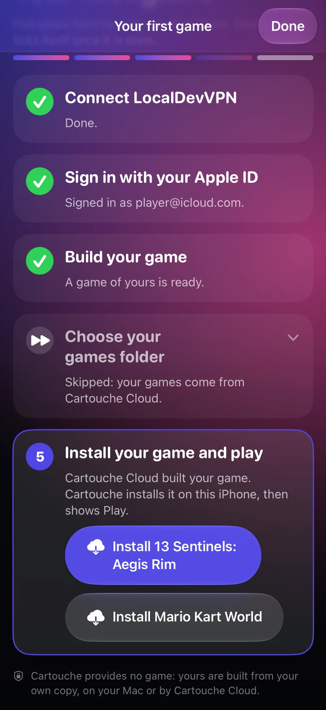

No Mac? From a computer, send your own copy of a game on [Cartouche Cloud's site](https://build.cartouche.cloud/). It builds it on a Mac in the cloud, for you alone, with nxnative, or with nxnative-nobc for an iPhone 11 to 15, then deletes your copy. Cartouche, linked to your account, follows the build and installs the game on your iPhone.

Cartouche Cloud provides no game: it builds only the copy you send it.

## Build a game

1. On a computer, open [Cartouche Cloud's site](https://build.cartouche.cloud/), make your account, and buy credits there.
2. Send your own copy of the game: your console's package (`.nsp`, `.xci`, `.nsz` or `.xcz`, with its updates and DLC, and your console's keys, `prod.keys`), a `.nup`, or a `.zip` of a dump. Then say which iPhone it is for: an iPhone 15 Pro or later, or an iPhone 11 to 15, for which it is built from [nxnative-nobc](/start/requirements/#iphone-11-to-15).
3. Link Cartouche to your account, once ([Link your iPhone](/cloud/iphone/#link-your-iphone)).
4. Cartouche follows the build, step by step, and an email tells you when it is done. Then **Install** puts the game on your iPhone, like your other games.

## Updates and DLC

Choose the base game, its updates and its DLC together when you send it: the newest update is applied, and the DLC are built in. An update or DLC is sent with its base game: to add one to a game already built, send the game again with it, which is a new build.

## Your keys stay with you

Your browser opens the game on your computer and sends the game alone: your keys never leave the computer.

## Credits

A build that succeeds is paid for in credits, bought in advance on Cartouche Cloud's site, which gives the price. A build that fails costs nothing. Credits are held while a game builds, and given back if the build fails.

## What it keeps

- **Your copy:** deleted as soon as the game is built, and two days after you sent it at the latest.
- **The game built:** kept two days, for your account alone, time to install it.
- **Your keys:** never sent.

The details are on Cartouche Cloud's [privacy page](https://build.cartouche.cloud/privacy).

## Nothing to install

No Mac, no Xcode, no Terminal: a browser on a computer, and Cartouche on the iPhone. Cartouche Cloud is for the iPhone and iPad; with a Mac, [Cartouche for Mac](/mac/install/) builds your games at home.
