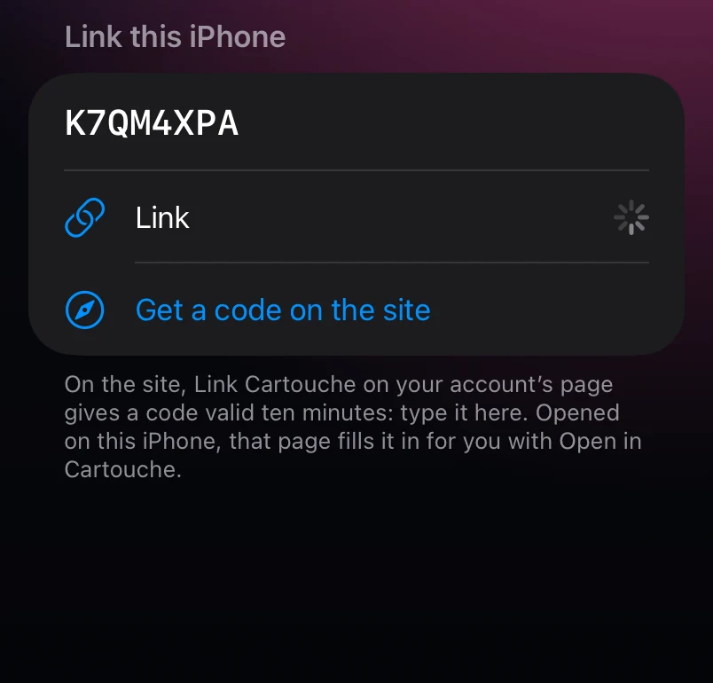
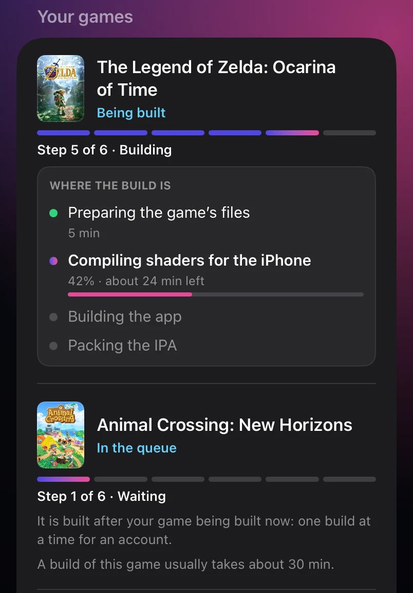
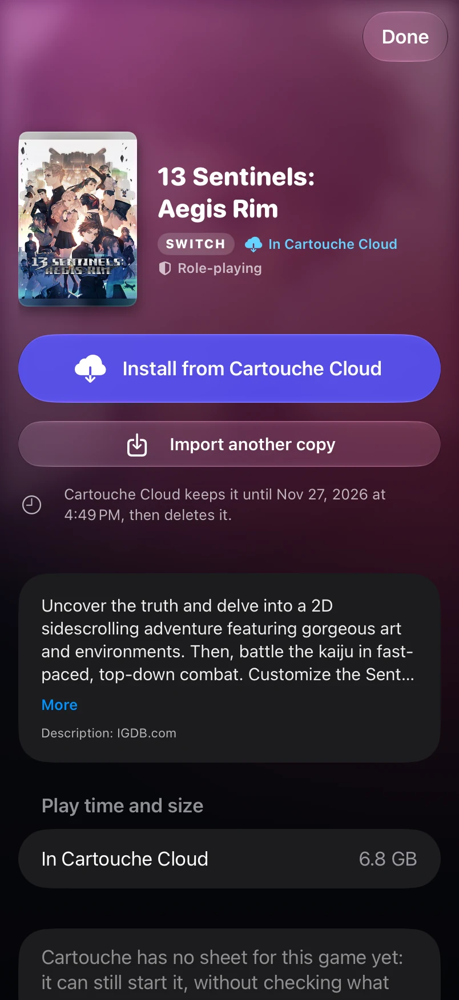

**System › Cartouche Cloud** says what the service is, and links your iPhone to your account. The guide's **No Mac: Cartouche Cloud** opens the same page.

## Link your iPhone

1. On Cartouche Cloud's site, on your account's page, choose **Link Cartouche**: it gives a code valid ten minutes.
2. In Cartouche, type it under **Link this iPhone**. Opened on the iPhone, that page fills it in for you with **Open in Cartouche**, or its QR code does.

Linked, your iPhone reads your account's games and fetches those built, nothing more: sending a game, your credits and your account stay on the site.

## Follow a build

Cartouche shows each game of your account with its cover, where it is, each step of its build and the time left, and your credits.

## Install it

A game built shows in your library and on its sheet, *In Cartouche Cloud*: **Install** puts it on your iPhone, like a game of your games folder. It stays two days on Cartouche Cloud: install it in that time.

## Unlink

**Unlink this iPhone** stops Cartouche following your account here; your account and its games stay on the site. Unlinked on the site, the iPhone says so: link it again with a new code.
