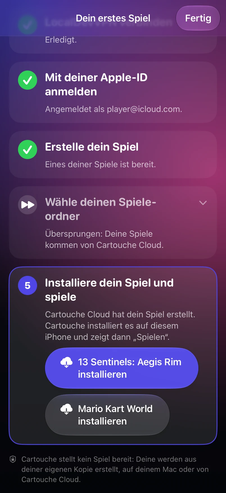

Kein Mac? Sende von einem Computer aus deine eigene Kopie eines Spiels auf der [Website von Cartouche Cloud](https://build.cartouche.cloud/). Sie erstellt es mit nxnative auf einem Mac in der Cloud, nur für dich, und löscht dann deine Kopie. Cartouche, mit deinem Account verknüpft, verfolgt den Build und installiert das Spiel auf deinem iPhone.

Cartouche Cloud stellt kein Spiel bereit: Es erstellt nur die Kopie, die du sendest.

## Ein Spiel erstellen

1. Öffne auf einem Computer die [Website von Cartouche Cloud](https://build.cartouche.cloud/), erstelle deinen Account und kaufe dort Guthaben.
2. Sende deine eigene Kopie des Spiels: das Paket deiner Konsole (`.nsp`, `.xci`, `.nsz` oder `.xcz`, mit seinen Updates und DLCs und den Schlüsseln deiner Konsole, `prod.keys`), eine `.nup` oder ein `.zip` eines Dumps.
3. Verknüpfe Cartouche einmal mit deinem Account ([Dein iPhone verknüpfen](/de/cloud/iphone/#dein-iphone-verknüpfen)).
4. Cartouche verfolgt den Build Schritt für Schritt, und eine E-Mail sagt dir, wann er fertig ist. Dann bringt **Installieren** das Spiel auf dein iPhone, wie deine anderen Spiele.

## Updates und DLCs

Wähle Basisspiel, Updates und DLCs zusammen, wenn du es sendest: Das neueste Update wird angewendet, und die DLCs werden mit erstellt. Ein Update oder DLC wird mit seinem Basisspiel gesendet: Um eins zu einem schon erstellten Spiel hinzuzufügen, sende das Spiel noch einmal damit, was ein neuer Build ist.

## Deine Schlüssel bleiben bei dir

Dein Browser öffnet das Spiel auf deinem Computer und sendet nur das Spiel: Deine Schlüssel verlassen den Computer nie.

## Guthaben

Ein erfolgreicher Build wird mit Guthaben bezahlt, das du vorab auf der Website von Cartouche Cloud kaufst, die den Preis nennt. Ein fehlgeschlagener Build kostet nichts. Das Guthaben wird reserviert, während ein Spiel erstellt wird, und zurückgegeben, wenn der Build fehlschlägt.

## Was es aufbewahrt

- **Deine Kopie:** gelöscht, sobald das Spiel erstellt ist, und spätestens zwei Tage nach dem Senden.
- **Das erstellte Spiel:** zwei Tage aufbewahrt, nur für deinen Account, Zeit genug, um es zu installieren.
- **Deine Schlüssel:** nie gesendet.

Die Details stehen auf der [Datenschutzseite](https://build.cartouche.cloud/privacy) von Cartouche Cloud.

## Nichts zu installieren

Kein Mac, kein Xcode, kein Terminal: ein Browser auf einem Computer und Cartouche auf dem iPhone. Cartouche Cloud ist für iPhone und iPad; mit einem Mac erstellt [Cartouche für Mac](/de/mac/install/) deine Spiele zu Hause.
