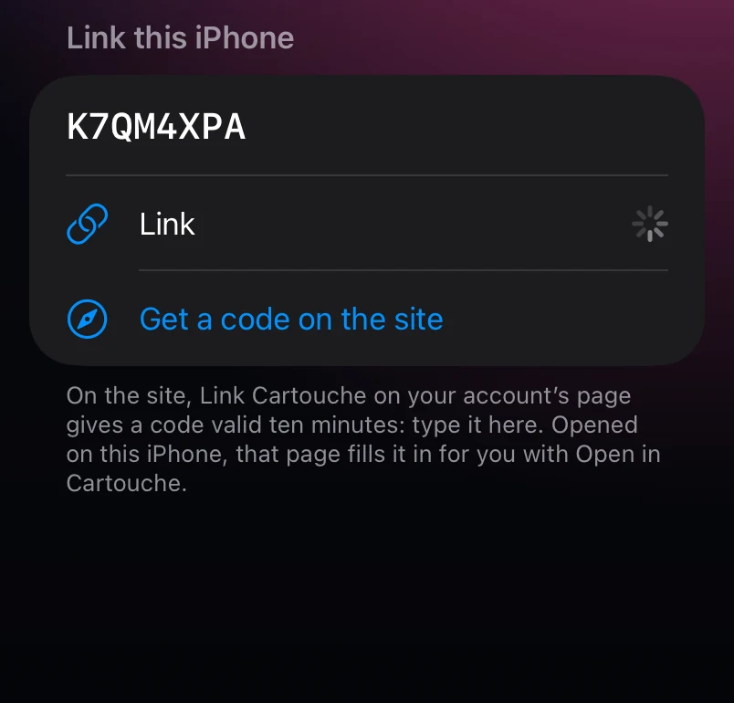
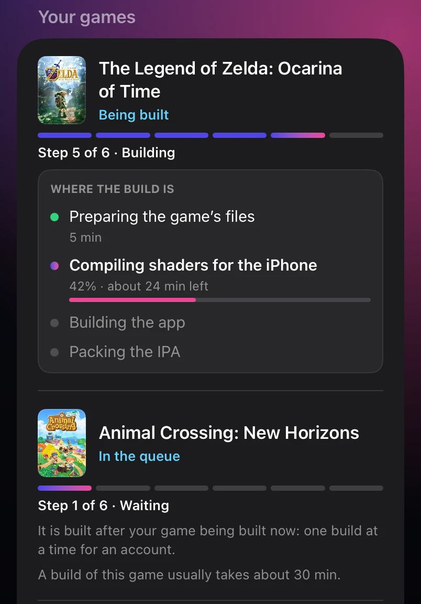
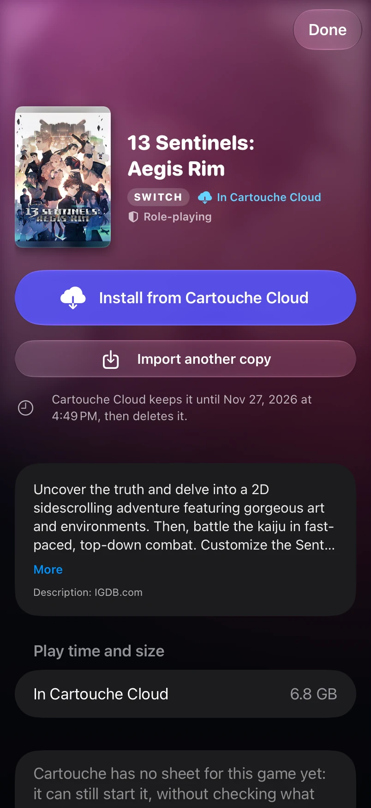

**System › Cartouche Cloud** sagt, was der Dienst ist, und verknüpft dein iPhone mit deinem Account. **Kein Mac: Cartouche Cloud** in der Anleitung öffnet dieselbe Seite.

## Dein iPhone verknüpfen

1. Wähle auf der Website von Cartouche Cloud, auf der Seite deines Accounts, **Link Cartouche**: Sie gibt einen Code, der zehn Minuten gilt.
2. Gib ihn in Cartouche unter **Dieses iPhone verknüpfen** ein. Auf dem iPhone geöffnet, füllt diese Seite ihn mit **Open in Cartouche** für dich aus, oder ihr QR-Code tut es.

Verknüpft liest dein iPhone die Spiele deines Accounts und holt die erstellten, nicht mehr: Ein Spiel senden, dein Guthaben und dein Account bleiben auf der Website.

## Einen Build verfolgen

Cartouche zeigt jedes Spiel deines Accounts mit seinem Cover, wo es steht, jeden Schritt seines Builds und die verbleibende Zeit, und dein Guthaben.

## Es installieren

Ein erstelltes Spiel erscheint in deiner Bibliothek und auf seiner Infoseite, *In Cartouche Cloud*: **Installieren** bringt es auf dein iPhone, wie ein Spiel deines Spieleordners. Es bleibt zwei Tage bei Cartouche Cloud: Installiere es in dieser Zeit.

## Verknüpfung aufheben

**Verknüpfung dieses iPhones aufheben** beendet hier das Verfolgen deines Accounts durch Cartouche; dein Account und seine Spiele bleiben auf der Website. Wird die Verknüpfung auf der Website aufgehoben, sagt es das iPhone: Verknüpfe es mit einem neuen Code erneut.
