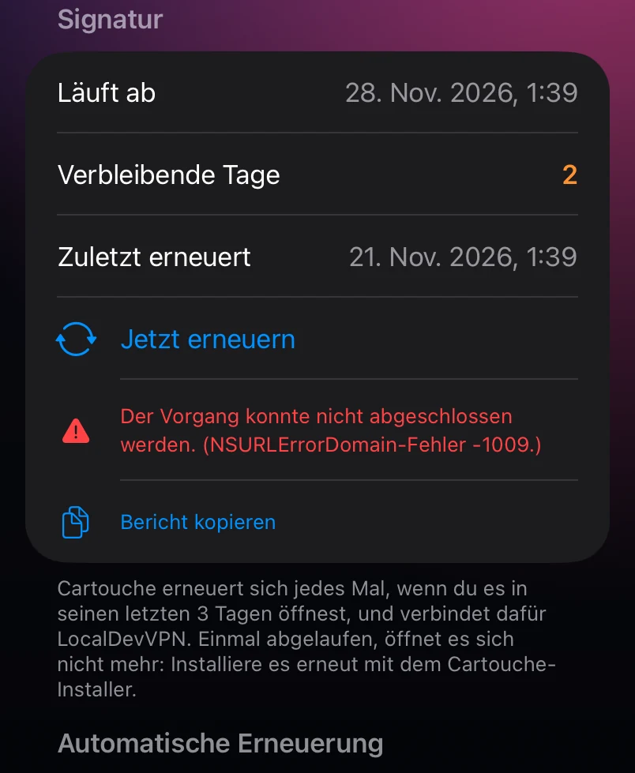
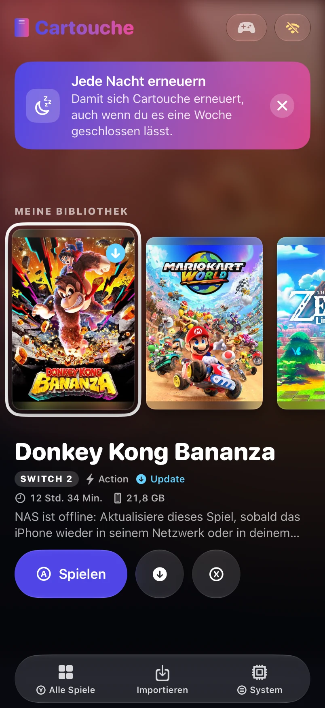

Unter jedem Fehler sagt Cartouche, warum und was zu tun ist, und **Bericht kopieren** gibt der Person, die dir hilft, was sie braucht. Hier die häufigsten Fälle.

## Signatur und Erneuerung

**Cartouche öffnet sich nicht mehr.** Seine Signatur ist abgelaufen: Ein kostenloser Apple Account signiert Apps für sieben Tage, und Cartouche wurde in seinen letzten 3 Tagen weder geöffnet noch nachts erneuert. Installiere es mit dem [Cartouche-Installer](/de/installer/) erneut, über diese Kopie, mit demselben Apple Account: Deine Spiele und Spielstände bleiben. Erstelle dann die [nächtliche Automation](/de/iphone/system/#jede-nacht-erneuern).

**Der Home-Bildschirm sagt „Das Zertifikat funktioniert nicht mehr“.** iOS akzeptiert es nicht mehr, vielleicht nach einer Installation von einem anderen Computer. Melde dich erneut mit deinem Apple Account an: Cartouche holt sich ein neues.

**Apple sagt, die Sitzung sei abgelaufen.** Cartouche kann sich nicht mehr erneuern oder aktualisieren, bis du dich erneut anmeldest: Wähle **Erneut anmelden** auf der Seite „System“, mit demselben Apple Account. Deine Spiele und Spielstände bleiben.

**Apple hat das Zertifikat widerrufen.** Höchstwahrscheinlich hat eine andere App oder ein anderer Computer mit demselben Apple Account ein neues geholt. Cartouche kann sich damit nicht mehr erneuern: Installiere Cartouche mit dem Cartouche-Installer erneut über diese Kopie, mit demselben Apple Account.

**Ein Teil der App fehlt.** Cartouche sagt es, wenn es sich anmeldet, erneuert oder aktualisiert. Installiere es mit dem Cartouche-Installer erneut über diese Kopie, der ihn wieder einsetzt.

**Cartouche sagt, seine IPA für SideStore wurde ohne ihre App-Gruppe installiert.** Manche Signier-Apps lassen die App-Gruppe weg, die die Anmeldung von Cartouche braucht. Installiere Cartouche stattdessen mit dem [Cartouche-Installer](/de/installer/) auf einem Computer, oder signiere mit deiner Signier-App die IPA für dein eigenes Zertifikat, `Cartouche-<version>-Own-Certificate.ipa`, aus den Versionen von Cartouche auf GitHub.

**Die Kopplungsdatei fehlt.** Im Cartouche-Installer **Kopplungsdatei erneut in Cartouche ablegen**.

**Die Erneuerung ist nicht durchgegangen.** Prüfe, dass LocalDevVPN installiert ist und sich verbinden kann, dann **Jetzt erneuern** auf der Seite „System“, die sagt, warum es fehlschlug.

**Die nächtliche Automation läuft nicht.** **Jede Nacht erneuern** auf der Seite „System“ sagt, was es gesehen hat. Prüfe in Kurzbefehle, dass die Automation noch da ist, eingeschaltet, auf **Sofort ausführen**, zu einer Zeit, zu der das iPhone lädt und online ist, und dass **Enable LocalDevVPN** vor **Refresh All Apps** kommt, der von Cartouche und nicht der von LiveContainer.

## Spiele

**Ein Spiel installiert sich nicht: nicht genug Platz.** Cartouche sagt, wie viel das Spiel belegt und wie viel frei ist. Gib Platz frei und installiere es dann erneut.

**Die IPA ist beschädigt.** Sie endet zu früh, oder eine Datei hat sich geändert, seit sie erstellt wurde, etwa wenn eine Kopie vor dem Ende abbricht. Kopiere sie erneut von dort, wo sie erstellt wurde.

**Das Spiel wurde ohne seine Spieldateien erstellt.** Lege seine `romfs.img`, wie nxnative sie geschrieben hat, neben seine IPA in deinen Spieleordner und installiere das Spiel dann von dort.

**Das Spiel schließt sich beim Start, auf einem iPhone 15 oder älter.** nxnative braucht einen Grafikchip, der BC-Texturen liest. Cartouche für Mac erstellt deine Spiele für ein solches iPhone mit nxnative-nobc, sobald sie gekoppelt sind: siehe [Für jedes deiner iPhones erstellen](/de/mac/builder/#für-jedes-deiner-iphones-erstellen). Bei Cartouche Cloud sende das Spiel erneut für ein iPhone 11 bis 15 ([Ein Spiel erstellen](/de/cloud/#ein-spiel-erstellen)).

**iOS hat das Spiel geschlossen.** Nahe an seiner Speichergrenze hinter der Konsole startet das Spiel dann anstelle von Cartouche, mit dem ganzen Arbeitsspeicher von Cartouche. Die Infoseite des Spiels sagt, ob es zu deinem iPhone passt. Sonst bleibt dein Fortschritt bis zum letzten Speichern erhalten.

**Das Spiel ist nicht signiert.** Signiere es erneut, indem du es noch einmal startest; schlägt es weiter fehl, installiere es erneut aus seiner IPA.

## Speicher

**Ein Ort ist offline.** Er antwortet nicht von dort, wo das iPhone ist. Prüfe zu Hause seine Adresse und dass das iPhone in deinem WLAN oder deinem VPN ist. Unterwegs schalte Tailscale ein. Deine Spiele laufen wie immer, und deine Spielstände warten.

**Tailscale ist aus.** LocalDevVPN hat es ausgeschaltet, da iOS nur ein VPN gleichzeitig hält: Öffne Tailscale, um es wieder einzuschalten, oder füge seine Aktion **Connect** zur nächtlichen Automation hinzu.

**Google Drive fragt nach einer erneuten Anmeldung.** Solange dein Google-Cloud-Projekt im Test ist, beendet Google die Anmeldung nach 7 Tagen: **Erneut bei Google anmelden** auf der Seite „Speicher“.

**Cartouche findet deinen Mac nicht.** Öffne auf dem Mac Cartouche, mit eingeschaltetem **Mit Cartouche auf dem iPhone teilen**. Erlaube Cartouche auf dem iPhone unter **Einstellungen › Datenschutz & Sicherheit › Lokales Netzwerk**. Sei im selben WLAN oder schließ das iPhone an den Mac an.

## Cartouche für Mac

**macOS kann die App nicht prüfen.** Nur beim ersten Mal: **Systemeinstellungen › Datenschutz & Sicherheit**, dann **Dennoch öffnen** neben Cartouche.

**Ein Build schlägt fehl.** Der Fehler unter dem Spiel in **Builds** sagt, was zu tun ist: Platz auf einer vollen Festplatte freigeben, beschädigte Spieldateien erneut von deiner Konsole kopieren oder Xcode über **Werkzeuge dieses Mac** aktualisieren. Ein Spiel, dessen Build fehlgeschlagen ist, wird erneut versucht, wenn sich nxnative oder seine Dateien ändern; **Erneut erstellen** versucht es jetzt.

## Immer noch nicht weiter?

Siehe [Hilfe bekommen](/de/help/support/).
