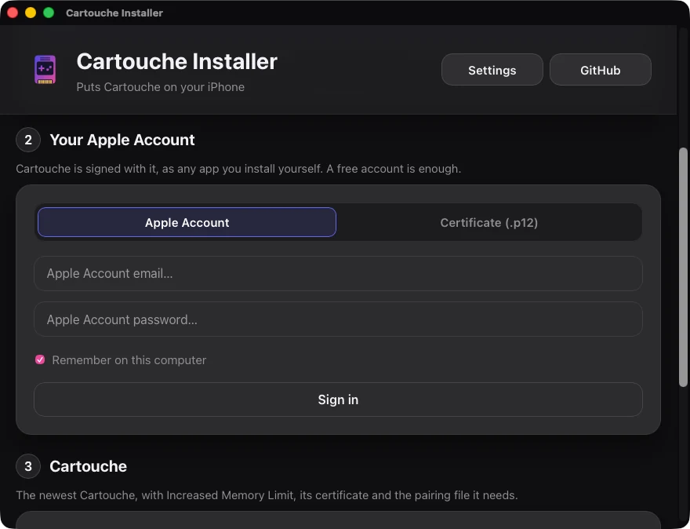

Der Cartouche-Installer bringt Cartouche von einem Mac oder Windows-PC aus auf ein iPhone oder iPad, das eine Mal, bei dem ein Computer gebraucht wird. Sein Fenster hat drei Schritte.

| Computer | Download | Erstes Öffnen |
| --- | --- | --- |
| Mac, Apple silicon oder Intel, macOS 11 oder neuer | [Für Mac](https://cartouche.cloud/download/#installer-mac) | macOS kann ihn nicht prüfen: Klicke unter **Systemeinstellungen › Datenschutz & Sicherheit** einmal neben Cartouche Installer auf **Dennoch öffnen**. |
| Windows 10 oder 11 | [Für Windows](https://cartouche.cloud/download/#installer-windows) | SmartScreen kann die Installation stoppen: **Weitere Informationen › Trotzdem ausführen**. Er wird für dein Konto installiert, ohne Administratorrechte. Installiere auch **Apple-Geräte** aus dem Microsoft Store. |

## Die drei Schritte

1. **Dein iPhone:** Schließ es mit einem Kabel an den Computer an und entsperre es. Tippe beim ersten Mal auf dem iPhone auf **Vertrauen** und gib seinen Code ein.
2. **Dein Apple Account:** Melde dich an, ein kostenloser Account genügt, mit dem Zwei-Faktor-Code, den Apple sendet. **Auf diesem Computer merken** bewahrt das Passwort im Schlüsselbund des Computers auf.
3. **Cartouche:** **Cartouche installieren** lädt das neueste Cartouche aus seinen Releases, prüft es, signiert es mit dem erhöhten Speicherlimit und installiert es, mit seinem Zertifikat und der Kopplungsdatei, die es braucht.

Ist er fertig, sagt der Installer, was beim ersten Mal auf dem iPhone zu tun ist: deinem Apple Account unter **Einstellungen › Allgemein › VPN und Geräteverwaltung** vertrauen und den **Entwicklermodus** einschalten, wenn iOS danach fragt. Öffne dann Cartouche: siehe [Cartouche installieren](/de/start/install/#4-die-einrichtung-von-cartouche).

## Erneut installieren oder aktualisieren

Eine erneute Installation über Cartouche behält seine Spiele und ihre Spielstände und bringt es auf die neueste Version. Tu das, wenn:

- die Signatur von Cartouche abgelaufen ist, nach einer Woche, ohne es zu öffnen;
- Apple das Zertifikat widerrufen hat, mit dem Cartouche signiert ist, wie es die Seite „System“ dann sagt;
- ein Teil der App fehlt, wie Cartouche es sagt, wenn es sich anmeldet, erneuert oder aktualisiert.

Nutze denselben Apple Account wie vorher.

## Die Kopplungsdatei

Die Kopplungsdatei erlaubt Cartouche, Apps auf dem iPhone ohne Computer zu installieren und zu erneuern. Der Installer legt sie bei der Installation in Cartouche ab. Nachdem das iPhone gelöscht oder seine Kopplung entfernt wurde, legt **Kopplungsdatei erneut in Cartouche ablegen** sie wieder ab, ohne Cartouche neu zu installieren.

## Einstellungen

**Einstellungen** enthält die Sprache des Installers (Deutsch, Englisch, Französisch oder Spanisch), die Zertifikate und App-IDs deines Accounts, die Protokolle und die für das ausgewählte iPhone gespeicherte Kopplung.

:::caution[Zu viele Zertifikate]
Ein kostenloser Apple Account hat eine begrenzte Zahl von Entwicklungszertifikaten. Hat er sie alle, bietet der Installer an, sie zu widerrufen und ein neues zu erstellen: Damit signierte Apps öffnen sich nicht mehr, bis sie neu installiert werden.
:::

:::note[Drei Apps]
Ein kostenloser Apple Account kann 3 eigene Apps gleichzeitig installiert haben, abgelaufene eingeschlossen. Deine Spiele laufen in Cartouche und zählen nicht.
:::

Der Installer installiert nichts außer Cartouche und lädt nie etwas anderes als die Releases von Cartouche.
