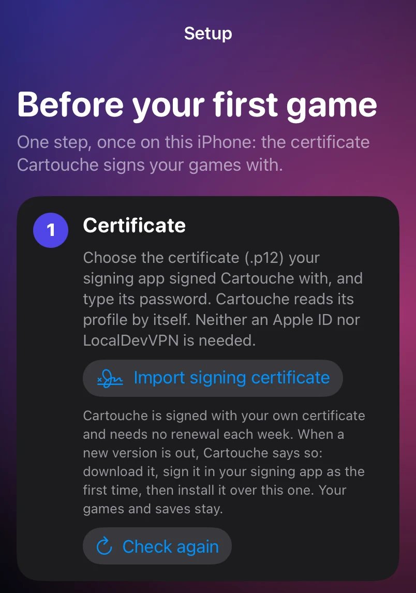

Das Signieren mit deinem Apple Account bleibt der Standard. Wenn du schon ein Signaturzertifikat (.p12) und sein Bereitstellungsprofil hast, kann der Cartouche-Installer Cartouche stattdessen damit signieren: kein Apple Account, kein LocalDevVPN und keine wöchentliche Erneuerung.

Cartouche empfiehlt keine Zertifikatsverkäufer, Signatur-Apps oder Signaturdienste.

## Mit deinem Zertifikat installieren

1. Wähle im Cartouche-Installer dein iPhone aus.
2. Wähle oben im Schritt des Apple Accounts **Zertifikat (.p12)**.
3. Wähle dein Zertifikat (.p12), gib sein Passwort ein (leer lassen, wenn es keines hat) und wähle sein Profil (`.mobileprovision`).
4. Installiere Cartouche. Das Signieren geschieht auf dem Computer; der Installer meldet sich bei keinem Apple Account an.
5. Öffne Cartouche: Es übernimmt dein Zertifikat von selbst. Wenn iOS dich bittet, dem Entwickler zu vertrauen oder den Entwicklermodus einzuschalten, tu es in den Einstellungen.

## Was das Profil erlauben muss

- **Das erhöhte Speicherlimit.** Ohne es haben Cartouche und deine Spiele für die meisten Spiele viel zu wenig Arbeitsspeicher. Der Installer warnt dich, wenn es dem Profil fehlt: Das Signieren kann es nicht hinzufügen.
- **Die Schlüsselbundgruppen der Spiele.** Ein Platzhalterprofil mit der Schlüsselbundberechtigung `*` deines Teams deckt sie ab.
- **Die App-ID von Cartouche** oder eine Platzhalter-ID, die sie abdeckt.

## Was sich ändert

- Spiele starten anstelle von Cartouche: Die Konsole hinter einem Spiel zu halten braucht die App-Erweiterungen, die ein einzelnes Profil nicht signieren kann.
- Cartouche sagt, wann eine neue Version da ist. Installiere sie wie beim ersten Mal mit deinem Zertifikat aus dem Installer: Deine Spiele, ihre Spielstände und dein Zertifikat bleiben.
- Ein Zertifikat, das abläuft oder widerrufen wird, wird genauso ersetzt: Installiere Cartouche mit dem neuen erneut.

Um zu deinem Apple Account zurückzukehren, installiere Cartouche erneut mit der Option **Apple Account** des Installers.
