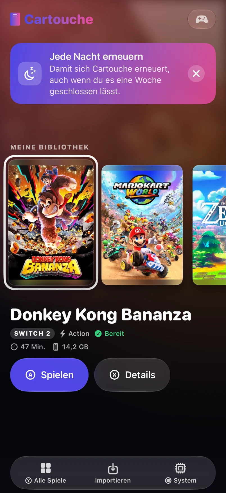
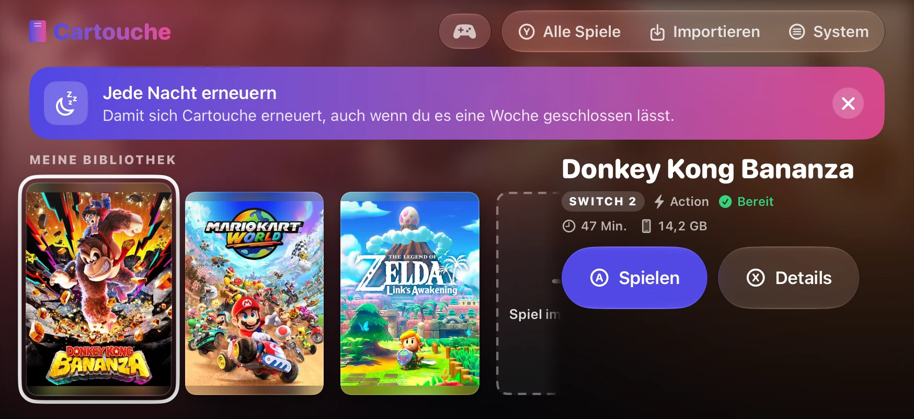
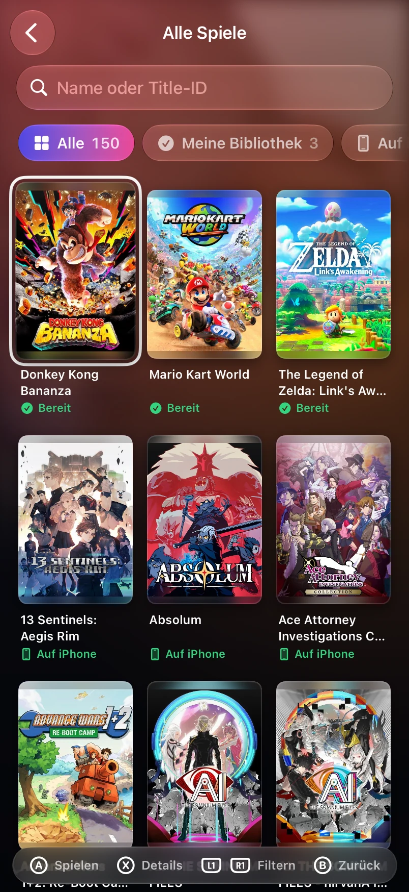

Cartouche öffnet sich mit seiner Konsole: deine Spiele, groß, in einem einzigen Regal, mit ihren offiziellen Covern. Das Spiel im Fokus zeigt alles, was du zum Spielen brauchst, und der Rest von Cartouche ist einen Schritt entfernt.

## Der Home-Bildschirm

- **Meine Bibliothek:** deine Spiele, installiert oder in deinem Spieleordner, dann **Importieren** und **Alle Spiele**.
- **Das Spiel im Fokus:** sein Name, seine Plattform, sein Genre und sein Status auf diesem iPhone, deine Spielzeit und der Platz, den es belegt. **Spielen** startet es, **Details** öffnet seine [Infoseite](/de/iphone/game-sheet/). Liegt in deinem Spieleordner ein neuerer Build, installiert **Aktualisieren** ihn, die Spielstände bleiben.
- **Das Dock:** **Alle Spiele**, **Importieren** und **System**. Es sitzt unten, wenn das iPhone hochkant ist, und in der oberen Leiste, wenn es quer ist.
- **Die obere Leiste:** ein Controller, wenn einer verbunden ist, und in den letzten drei Tagen der Signatur von Cartouche die verbleibenden Tage.

Eine Zeile unter dem Status des Spiels sagt, was noch zu tun ist, etwa eine Einrichtung abschließen, und verschwindet, sobald das Spiel bereit ist.

## Alle Spiele

**Alle Spiele** listet jedes Spiel mit einem Profil in nxnative, deine zuerst, jedes mit seinem Status unter dem Cover. Suche nach Name oder Titel-ID und filtere nach **Alle**, **Meine Bibliothek**, **Auf iPhone**, **Auf Mac**, **In Arbeit** oder Plattform.

Ein Spiel, das du nicht hast, zeigt nur **Meine Kopie importieren**: Cartouche bietet nie einen Download an. Ein Spiel in deinem Spieleordner, das noch nicht installiert ist, zeigt **Von … installieren** mit diesem Ort.

| Status | Was er bedeutet |
| --- | --- |
| **Bereit** | Dein Spiel, installiert, nichts steht im Weg. |
| **Im Speicher** | Seine IPA liegt in deinem Spieleordner: Installiere es, um zu spielen. |
| **Aktualisieren** | Eine neuere IPA liegt in deinem Spieleordner: Das Update behält deine Spielstände. |
| **Läuft auf diesem iPhone** | Die Ergebnisse anderer Spieler auf deinem Modell sagen, dass es spielbar ist. |
| **Auf diesem iPhone noch nicht getestet** | Noch kein Ergebnis auf deinem Modell. |
| **Auf diesem iPhone nicht empfohlen** | Es braucht mehr Arbeitsspeicher, als Cartouche hier hat, oder Spieler haben festgestellt, dass es nicht läuft. |
| **Auf diesem iPhone nicht unterstützt** | Ihm fehlt die iOS-Version oder der Grafikchip. |

## Touch und Controller

Touch und ein Controller steuern jeden Bildschirm, und jede Taste zeigt die Controller-Taste dafür.

| | Touch | Controller |
| --- | --- | --- |
| Den Fokus bewegen | Auf ein Cover tippen | Steuerkreuz oder Stick |
| Spielen, oder die Hauptaktion | **Spielen** | <kbd>A</kbd> |
| Die Infoseite eines Spiels | Auf das Spiel im Fokus tippen, oder **Details** | <kbd>X</kbd> |
| Alle Spiele | **Alle Spiele** | <kbd>Y</kbd> |
| Den Filter ändern | Auf einen Filter tippen | <kbd>L</kbd> <kbd>R</kbd> |
| System | **System** | <kbd>Menu</kbd> |
| Zurück, oder eine Seite schließen | **Fertig** | <kbd>B</kbd> |

Langes Drücken auf eines deiner Spiele bietet **Spielen**, **Details**, **Deinstallieren** und, wenn dein Spieleordner einen neueren Build hat, das Update von dort an.

## Meine Kopie importieren

**Importieren** öffnet „Dateien“: Wähle die IPA eines Spiels, das du aus deiner eigenen Kopie erstellt hast, auf deinem iPhone, in iCloud Drive, auf einem USB-C-Laufwerk oder einer Netzwerkfreigabe. Cartouche liest sie dort, wo sie liegt, installiert sie mit einem Fortschrittsbalken und öffnet dann ihre Infoseite. Eine IPA, die nxnative ohne die Spieldateien erstellt hat, wird mit der `romfs.img` daneben installiert.

Eine IPA, die kein Spiel von nxnative ist, landet unter **System › Andere installierte Apps**: Die Konsole zeigt nur Spiele.

:::note
Cartouche listet, was es ausführen kann, nie, wo man ein Spiel bekommt. Die einzigen Spiele, die es lädt, sind die, die [Cartouche Cloud](/de/cloud/) für dich erstellt hat, aus der Kopie, die du gesendet hast.
:::
