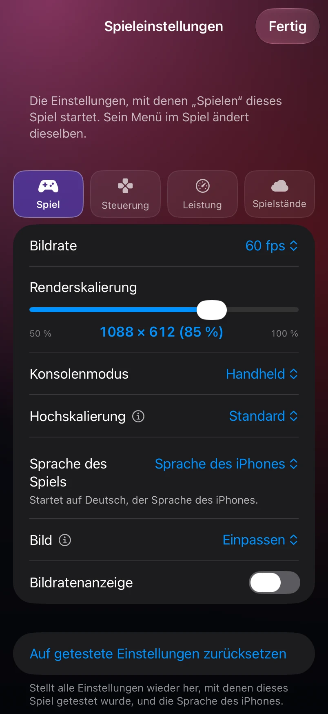
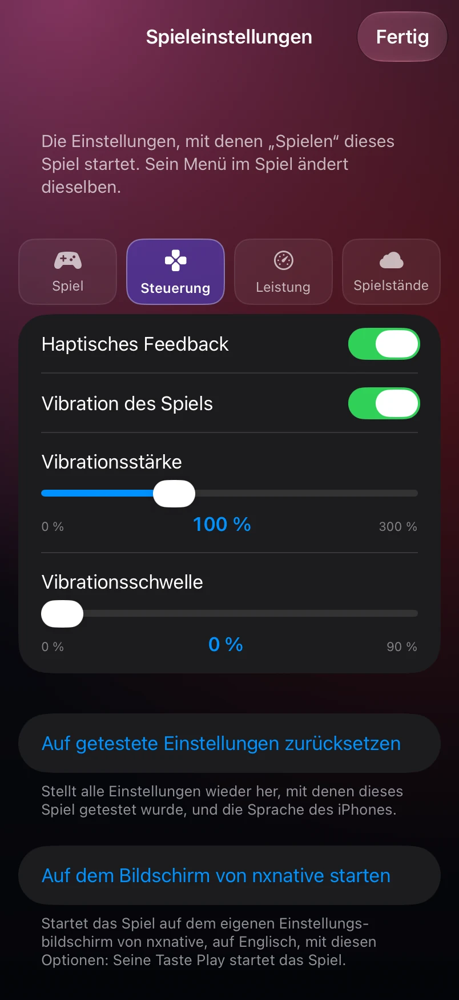

**Spieleinstellungen** auf der Infoseite eines Spiels enthält die Einstellungen, mit denen **Spielen** das Spiel startet: die, die der eigene Bildschirm von nxnative vor einem Spiel zeigt, auf einer Seite von Cartouche, in deiner Sprache. Das Menü im Spiel ändert dieselben. Ist Cartouche auf Deutsch, Französisch oder Spanisch, sind die Wörter dieses Menüs und der Bildschirm, der auf weitere Controller wartet, ebenfalls in dieser Sprache; die Einstellungen in diesem Menü behalten die englischen Namen von nxnative.

## Abschnitte

Die Einstellungen kommen in Abschnitten, **Spiel**, **Leistung**, **Steuerung** und **Spielstände**, einer nach dem anderen: Tippe auf einen Abschnitt oder drücke <kbd>L</kbd> und <kbd>R</kbd> auf einem Controller. Was ein Spiel anbietet, hängt vom Spiel ab; die häufigsten sind:

- **Bildrate** und **Renderskalierung**, mit der Größe in Pixeln, die die Skalierung ergibt.
- **Konsolenmodus:** **Handheld** oder **Im Dock**.
- **Bild:** den Bildschirm **Einpassen** oder **Füllen**.
- **Ausrichtung:** **Automatisch**, wie du das iPhone hältst, oder fest im **Querformat** oder **Hochformat**.
- **Hochskalierung**, **Dynamische Auflösung**, **Bildratenanzeige** und **Leistungsanzeige**.
- **Vibration des Spiels** und **Haptisches Feedback**.
- **Sprache des Spiels** ([weiter unten](#sprache-des-spiels)).

Das **ⓘ** neben einer Einstellung sagt, was sie tut. Eine Einstellung, die die Dateien eines Spiels festlegen, erscheint ausgegraut.

**Auf getestete Einstellungen zurücksetzen** holt jede Einstellung zurück, mit der das Spiel getestet wurde, und die Sprache des iPhones.

## Sprache des Spiels

Ein Spiel spricht die Sprache deines iPhones, wenn es sie hat. Vor jedem Start wählt Cartouche die erste der Sprachen deines iPhones, in der Reihenfolge von **Einstellungen › Allgemein › Sprache & Region**, die das Spiel anbietet. **Sprache des iPhones**, die erste Auswahl der Einstellung, sagt, welche das ist.

Eine Sprache, die du wählst, bleibt die des Spiels, bis du wieder **Sprache des iPhones** oder **Auf getestete Einstellungen zurücksetzen** wählst.

## Cloud-Spielstände

Die eigenen Cloud-Spielstände von nxnative, über einen Ordner in iCloud Drive, sind im Abschnitt **Spielstände**. Cartouche hält deine Spielstände selbst mit dem Spielstandordner deines [Speichers](/de/iphone/saves/) synchron: Du brauchst nur eines von beiden.

## Der eigene Bildschirm von nxnative

**Auf dem Bildschirm von nxnative starten** startet das Spiel einmal auf dem Einstellungsbildschirm von nxnative, auf Englisch, mit diesen Auswahlen: Seine Taste **Play** startet dann das Spiel.
