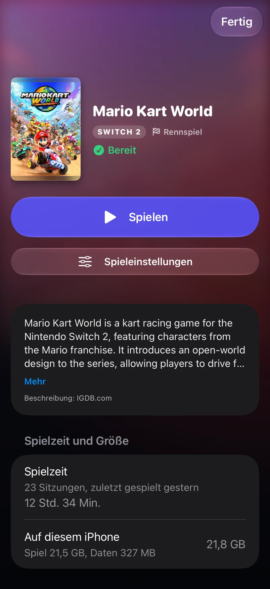
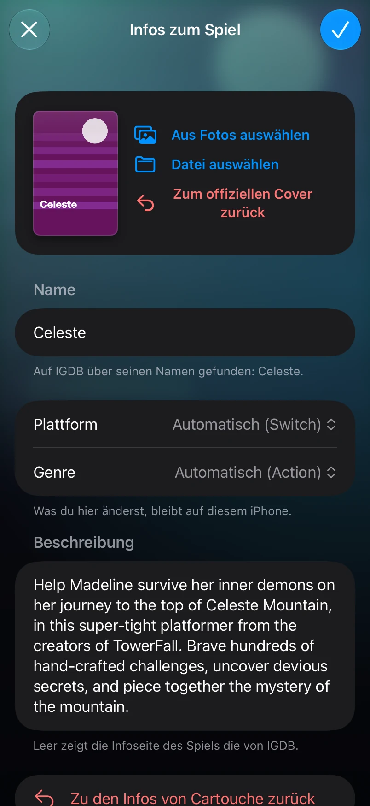
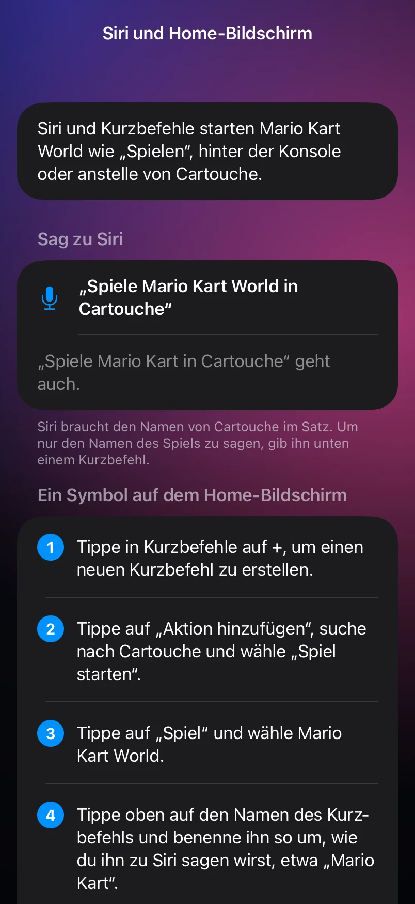
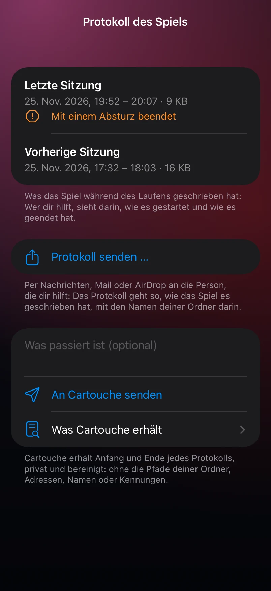

Jedes Spiel hat eine Infoseite: **Details** auf dem Home-Bildschirm oder <kbd>X</kbd> auf einem Controller. Sie sagt, ob das Spiel auf deinem iPhone oder iPad läuft, und sammelt alles, was du damit tun kannst.

## Oben

- **Spielen** und **Spieleinstellungen** für dein eigenes Spiel; **Fortsetzen**, **Spieleinstellungen** und **Beenden**, während es [hinter der Konsole pausiert](/de/iphone/playing/).
- **Installieren** aus deinem Spieleordner für ein Spiel, das dort liegt und noch nicht installiert ist, oder **Meine Kopie importieren** für ein Spiel, das du nicht hast.
- **Aktualisieren** aus deinem Spieleordner, wenn er einen neueren Build hat, mit dem installierten und dem neueren Build.

## Was sie dir sagt

- **Die Beschreibung**, deine oder die von IGDB. Das iPhone übersetzt sie in die Sprache von Cartouche, mit **Original anzeigen** daneben.
- **Spielzeit und Größe:** wie lange du gespielt hast, wie oft und wann zuletzt; der Platz, den das Spiel und seine Daten auf diesem iPhone belegen, und die Größe seiner IPA in deinem Spieleordner.
- **Was das Spiel braucht** gegenüber dem, was dieses iPhone hat: Arbeitsspeicher, iOS-Version und Grafikchip. Ist alles da, wird es zu einer Zeile, *Dieses iPhone hat, was es braucht*.
- **Ergebnisse der Tester**, die deines Modells zuerst: wie das Spiel dort läuft, nach den Messungen anderer Spieler. Ihre Notizen werden auch übersetzt.
- **Technische Details:** die empfohlenen Einstellungen, was nxnative über das Spiel sagt, und der installierte Build.

Auf einem iPhone, dessen Grafikchip keine BC-Texturen liest (iPhone 15 und älter), sagt die Infoseite, dass das Spiel vor seinem ersten Bild stoppt, außer sein Build wandelt sie um, wie es Spiele tun, die mit nxnative-nobc erstellt wurden: Dann sagt sie *Texturen vom Build dieses Spiels für diese GPU umgewandelt*.

## Was du tun kannst

- **[Spieleinstellungen](/de/iphone/game-settings/):** Bildrate, Renderskalierung, Handheld oder Dock, Sprache des Spiels und mehr.
- **[Spielstände](/de/iphone/saves/):** wo sie aufbewahrt werden, eine ältere Kopie zurückspielen oder einen Spielstand von deiner Konsole holen.
- **[Mods](#mods):** Dateien, die Texturen, Texte, Musik oder Level des Spiels ändern, eingeschaltet in der Reihenfolge, die du wählst.
- **Infos des Spiels bearbeiten:** Gib deinem Spiel einen eigenen Namen, eine Plattform, ein Genre, eine Beschreibung und ein Cover, aus Fotos oder „Dateien“. Sie bleiben auf diesem iPhone. **Zu den Infos von Cartouche zurück** macht sie rückgängig. Ein Spiel außerhalb der Liste von nxnative, etwa mit einem Fork erstellt, findet sein Cover und sein Genre auf IGDB über seinen Namen.
- **Siri und Home-Bildschirm:** was du Siri sagst, *„Spiele Stardew Valley in Cartouche“*, und wie du dem Spiel mit der Kurzbefehle-Aktion **Spiel starten** ein eigenes Symbol auf dem Home-Bildschirm gibst.
- **Protokoll teilen:** das Protokoll des Spiels, für die Person, die dir hilft, per Nachrichten, Mail oder AirDrop, oder **An Cartouche senden**, das vorher deine Pfade, Adressen und Namen entfernt. Du siehst, was gesendet wird, bevor es gesendet wird.
- **Builds auf** deinem Mac: Mit einem gekoppelten Mac, wie weit der Build des Spiels dort ist, und eine Taste, um ihn zu starten oder zu stoppen. Siehe [Dein iPhone und dein Mac](/de/mac/iphone/).
- **Nach … kopieren** in deinen Spieleordner und **Deinstallieren**, das fragt, ob seine Spielstände bleiben.

## Mods

Ein Mod ändert Texturen, Texte, Musik oder Level eines Spiels: Das Spiel liest seine Dateien statt der eigenen. **Mods** auf der Infoseite sagt, wie viele aktiv sind. **Mod hinzufügen** holt einen aus Dateien, als Ordner oder als ZIP, so wie Mods weitergegeben werden: Cartouche behält seinen `romfs`-Ordner, wo immer er darin liegt. Enthält deine Auswahl mehrere Mods, kommen alle, ausgeschaltet.

- Schalte jeden Mod ein oder aus. Ändern zwei dieselbe Datei, gewinnt der weiter oben: **Nach oben** und **Nach unten** legen die Reihenfolge fest. Bis zu 16 können gleichzeitig aktiv sein.
- Änderungen gelten ab dem nächsten Start des Spiels. Beende das Spiel vorher, wenn es hinter der Konsole pausiert.
- Ein Mod, der mit einer anderen Version des Spiels hinzugefügt wurde, sagt es: Ein Mod für eine Version funktioniert vielleicht nicht mit einer anderen.
- Ein Mod, der auch den Code des Spiels ändert, mit einem `exefs`-Ordner, kann auf einem iPhone oder iPad nicht funktionieren: iOS führt nur Code aus, der mit dem Spiel signiert ist. Cartouche sagt es und lässt ihn weg.
- Mods bleiben auf diesem iPhone: Sie gehen nicht in deinen Spielstand-Ordner. **Löschen** entfernt einen Mod und seine Dateien.

Cartouche lädt keinen Mod herunter: Du bringst deine eigenen mit.

## Spiele außerhalb der Liste von nxnative

Ein Spiel, für das Cartouche keine Infoseite hat, erscheint trotzdem, als *Noch keine Infoseite*, und startet: Cartouche kann nur nicht prüfen, was es braucht. Sein Cover kommt von IGDB über seine Titel-ID oder seinen Namen.
