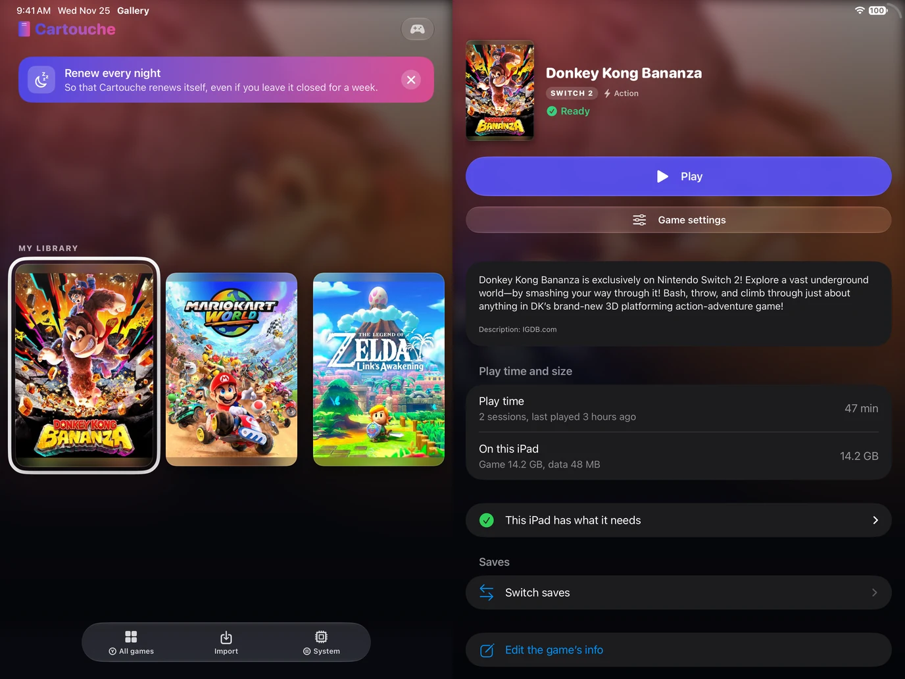
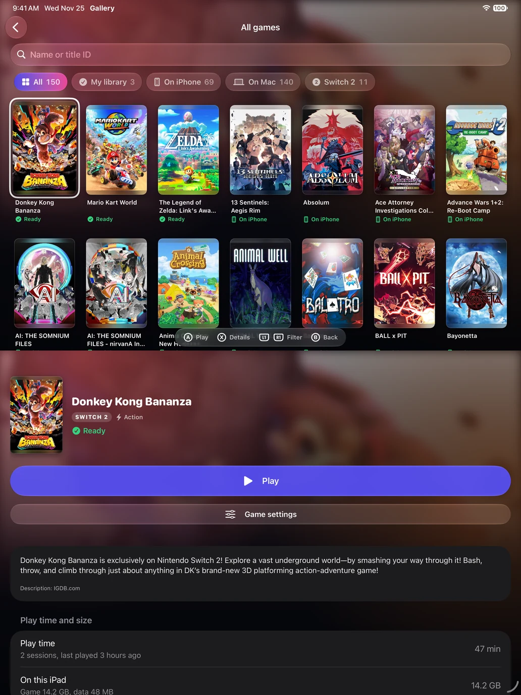

Cartouche ist dieselbe App auf iPhone und iPad, wird gleich installiert und sagt „iPad“, wo immer es von deinem Gerät spricht. Es läuft auf einem iPad mit M1-Chip oder neuer, mit iPadOS 26 oder neuer.

- **Im Querformat** stehen die Konsole und die Infoseite des Spiels nebeneinander.
- **Spiele werden quer gespielt:** Dreh dein iPad zum Spielen quer. Ein Spiel für das Querformat bleibt im Querformat.
- **Alles andere** funktioniert wie auf dem iPhone: [Speicher](/de/iphone/storage/), [Spielstände](/de/iphone/saves/), dein [Mac](/de/mac/iphone/), [Cartouche Cloud](/de/cloud/) und die [Seite „System“](/de/iphone/system/).

Deine Spielstände folgen dir vom iPhone zum iPad und zurück, über deinen Spielstandordner: Der neueste gewinnt.
