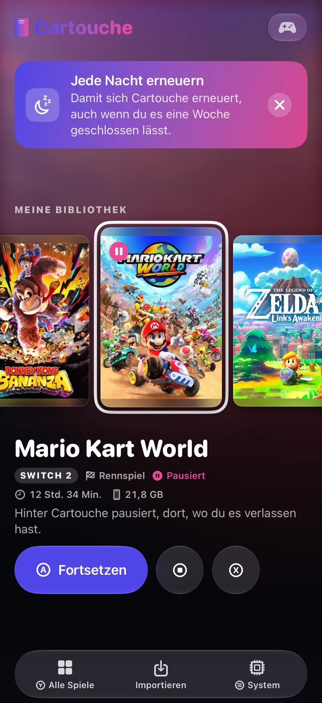
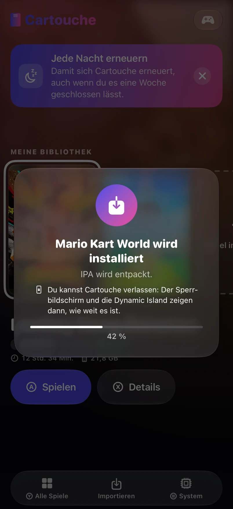

## Das Spiel wartet hinter der Konsole

**Spielen** startet das Spiel im Vollbild, mit eingeschaltetem Spielmodus: das Meiste aus Prozessor und Grafikchip des iPhones, und deine Controller mit der geringsten Latenz.

Die **Home**-Taste, unten auf dem Bildschirm des Spiels oder am Controller, holt die Konsole zurück, ohne das Spiel zu beenden. Das Spiel bleibt pausiert, wo du es gelassen hast:

- **Fortsetzen**, oder wieder die Home-Taste des Controllers, kehrt dorthin zurück;
- **Beenden** beendet es, sobald du es bestätigt hast: Der Fortschritt seit dem letzten Speichern des Spiels geht verloren;
- **Spielen** bei einem anderen Spiel fragt vorher, da nur ein Spiel gleichzeitig läuft.

Die Home-Taste auf dem Bildschirm verschwindet nach ein paar Sekunden: Tippe knapp unter die Stelle, an der sie war, um sie zurückzuholen.

## Wenn der Controller getrennt wird

Wird der letzte Controller während eines Spiels getrennt, weil sein Akku leer ist oder seine Bluetooth-Verbindung abbricht, pausiert das Spiel 3 Sekunden später und die Konsole kommt zurück, die sagt, dass der Controller getrennt wurde. Verbinde ihn wieder, und das Spiel kommt von selbst zurück. **Fortsetzen** kehrt ohne Controller zum Spiel zurück, mit der Touch-Steuerung.

- Ein Spiel, das du nur auf dem Bildschirm spielst, ohne Controller, pausiert nie für einen.
- Ein Controller, der innerhalb der 3 Sekunden zurückkommt, pausiert nichts.
- **System › Während ein Spiel läuft › Pausieren, wenn der Controller getrennt wird** schaltet es aus.
- Ein Spiel, das an Cartouches Stelle startet, pausiert noch nicht für seinen Controller.

## Ein Spiel, das mehr Arbeitsspeicher braucht

Ein Spiel, das mehr Arbeitsspeicher braucht, als es hinter der Konsole hat, startet stattdessen anstelle von Cartouche, mit dem ganzen Arbeitsspeicher von Cartouche: Die Konsole schließt sich, solange es läuft, und öffnet sich wieder, wenn das Spiel endet. Die Infoseite des Spiels sagt es, mit **Erneut hinter Cartouche versuchen**.

Wenn iOS ein Spiel nahe an seiner Speichergrenze hinter der Konsole schließt, sagt Cartouche es, und das Spiel startet von da an anstelle von Cartouche. **System › Während ein Spiel läuft › Cartouche hinter dem Spiel geöffnet lassen** schaltet die Konsole hinter dem Spiel für alle Spiele aus.

## Auf einem Fernseher

Verbinde das iPhone per Kabel mit einem Fernseher oder spiegle seinen Bildschirm per AirPlay auf ein Apple TV oder einen Fernseher mit AirPlay. Der Fernseher zeigt nur das Spiel, wie eine Konsole in ihrem Dock, und die Steuerung bleibt auf dem iPhone. Mit dem Fernseher bleibt das Spiel quer.

Es gibt keine Version für Apple TV: Das iPhone führt das Spiel aus und sendet es an den Fernseher.

## Deine Musik oder dein Podcast

Ein Spiel hält beim Start die Musik oder den Podcast einer anderen App an. Damit sie unter dem Ton des Spiels weiterlaufen, schalte **System › Während ein Spiel läuft › Ton anderer Apps beibehalten** ein: Das gilt ab dem nächsten Start des Spiels. Das Spiel ist im Stummmodus weiterhin zu hören, wie bisher; ein Anruf oder Siri unterbricht beides, wie den Ton jeder App.

## Hochkant oder quer

Halte das iPhone aufrecht, und ein mit einem neueren nxnative erstelltes Spiel dreht sich mit, sein Bild über der Steuerung. Ein früher erstelltes Spiel bleibt quer. Ein iPad drehst du zum Spielen quer.

## Siri und der Home-Bildschirm

Sag Siri *„Spiele Stardew Valley in Cartouche“* oder nutze **Spiel starten**, die Aktion von Cartouche in Kurzbefehle: Das Spiel startet, wie **Spielen** es startet. Ein Kurzbefehl davon auf dem Home-Bildschirm gibt dem Spiel ein eigenes Symbol. Die Infoseite jedes Spiels zeigt unter **Siri und Home-Bildschirm**, wie.

## Ein Spiel installieren und aktualisieren

Ein Spiel in deinem Spieleordner wird von seiner Infoseite oder vom Home-Bildschirm aus installiert, mit **Von … installieren** mit diesem Ort. Der Bildschirm zeigt, wie es kommt, per Kabel, über Tailscale oder per WLAN, und wie schnell, mit einem Tipp, wenn es schneller ginge.

- Du kannst Cartouche währenddessen verlassen: Der Sperrbildschirm und die Dynamic Island zeigen in einer Live-Aktivität, wie weit es ist.
- Eine abgebrochene Verbindung macht dort weiter, wo sie aufgehört hat, sobald das Netz zurück ist.
- Ein neuerer Build eines Spiels in deinem Spieleordner erscheint als **Aktualisieren**: Das Update behält deine Spielstände.
- Ein Spiel, das ohne seine Spieldateien erstellt wurde, wird mit der `romfs.img` neben seiner IPA im Spieleordner installiert.

Wenn etwas eine Installation oder einen Start stoppt, sagt Cartouche, warum und was zu tun ist, und **Bericht kopieren** unter dem Fehler gibt der Person, die dir hilft, was sie braucht. Siehe [Fehlerbehebung](/de/help/troubleshooting/).
