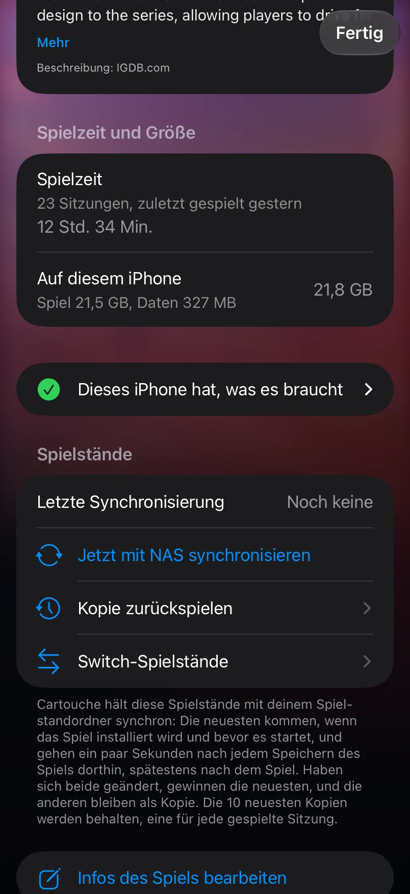
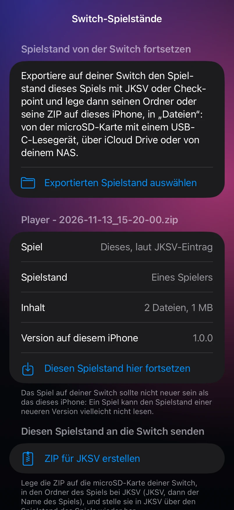

Mit einem unter **System › Speicher** gewählten Spielstandordner hält Cartouche die Spielstände jedes Spiels mit ihm synchron, einen Ordner pro Spiel. Deine Spielstände folgen dir von einem iPhone oder iPad zum nächsten und zu deinem Mac, über deinen Mac oder dein NAS.

## Wie sie synchron bleiben

- **Sie gehen** ein paar Sekunden nach jedem Speichern des Spiels, während du spielst, und spätestens nach dem Spiel.
- **Sie kommen**, wenn du das Spiel installierst und bevor du spielst, etwa nachdem du Cartouche neu installiert hast oder ein anderes iPhone oder dein Mac es gespielt hat.
- **Der neueste gewinnt.** Wenn sich beide Seiten geändert haben, gewinnen die zuletzt geschriebenen Spielstände, und die anderen bleiben als eigene Kopie im Ordner.
- **Zehn Kopien** jedes Spiels werden aufbewahrt, die neueste zuerst.
- **Jede Kopie nennt die Version des Spiels**, die sie geschrieben hat: Eine ältere Version des Spiels nimmt sie nie, und die Infoseite sagt, dass die Kopie kommt, sobald das Spiel aktualisiert ist.
- **Alle Profile gehen mit.** Die Spielstände der anderen Spieler des Spiels, seine Profile 2 bis 8, gehen und kommen mit seinen eigenen.
- **Die schon vorbereiteten Shader kommen wieder.** Die Liste dessen, was das Spiel beim Spielen vorbereitet hat, geht neben seine Kopien, mit dem, was deine anderen iPhones, iPads und Macs vorbereitet haben: Ein wieder installiertes Spiel, oder eines auf einem anderen Gerät, bereitet sie vor dem Start vor und ruckelt in seinen ersten Partien weniger. Sie macht allein keine Kopie.

Ein Spielstandordner, der nicht antwortet, etwa ein NAS, während du unterwegs bist, lässt deine Spielstände warten: Cartouche kopiert sie, sobald er wieder antwortet.

## Auf der Infoseite eines Spiels

**Spielstände** auf der Infoseite sagt, wann sie zuletzt synchron waren und was die letzte Synchronisierung getan hat.

- **Jetzt mit** deinem Ordner **synchronisieren**, wenn das Spiel nicht läuft.
- **Kopie zurückspielen:** Wähle eine der Kopien des Spiels, die neueste zuerst. Cartouche sendet vorher die aktuellen Spielstände in deinen Ordner, damit du zu ihnen zurückkehren kannst.

## Ein Spielstand von deiner Konsole

Dein Spiel geht hier weiter, dort, wo du es auf deiner Konsole gelassen hast:

1. Exportiere auf deiner Konsole den Spielstand des Spiels mit JKSV oder Checkpoint.
2. Lege seinen Ordner oder sein ZIP auf dieses iPhone, in „Dateien“.
3. Öffne auf der Infoseite des Spiels **Spielstände**, dann **Switch-Spielstände** und **Exportierten Spielstand auswählen**.
4. **Diesen Spielstand hier fortsetzen.** Cartouche prüft, dass der Spielstand zu diesem Spiel gehört, behält den, den er ersetzt, und sendet ihn mit einem Spielstandordner als neuesten dorthin.

**Spielstand von vor dem Import zurückspielen** macht es rückgängig.

In die andere Richtung macht **ZIP für JKSV erstellen** aus dem Spielstand des Spiels ein ZIP: Lege es auf die microSD-Karte deiner Konsole, in den Ordner des Spiels bei JKSV, und stelle es in JKSV wieder her. In beide Richtungen geht nur der Spielstand des ersten Profils: Die anderen Profile bleiben, wie sie sind.

:::caution
Das Spiel auf deiner Konsole sollte nicht neuer sein als das auf deinem iPhone: Ein Spiel liest den Spielstand einer neueren Version unter Umständen nicht.
:::

## Auf dem Mac

Cartouche für Mac hält die Spielstände der auf dem Mac gespielten Spiele mit demselben Ordner synchron, nach denselben Regeln. Siehe [Die Konsole auf dem Mac](/de/mac/console/#deine-spielstände-auf-dem-mac).
