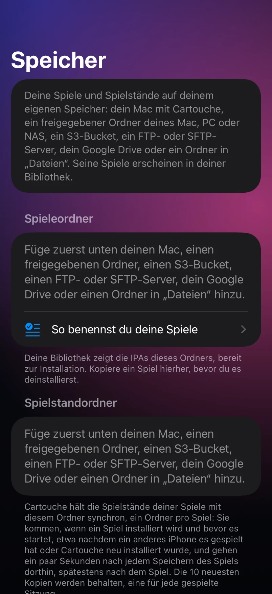
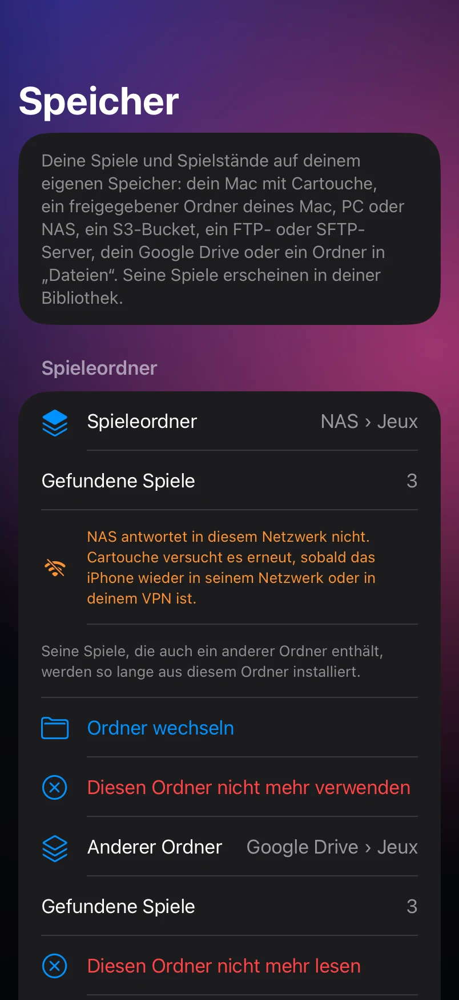
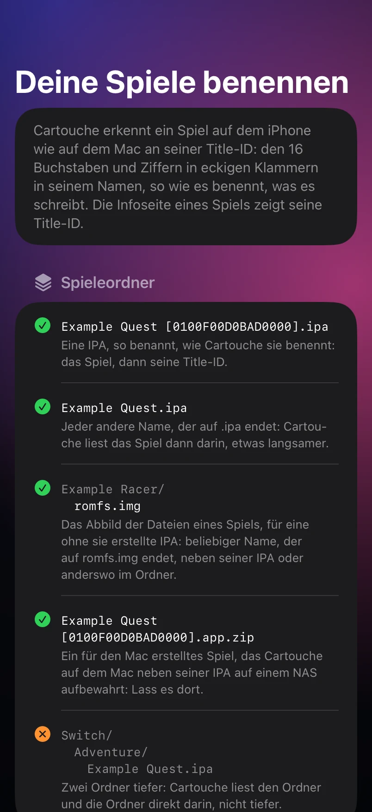
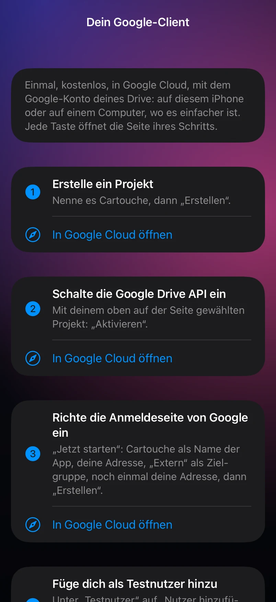

Deine Spiele und Spielstände bleiben zu Hause, auf deinem eigenen Speicher, mit deinem eigenen Konto. **System › Speicher** richtet ihn ein: Die Spiele dort erscheinen in deiner Bibliothek, bereit zur Installation, und Cartouche hält deine Spielstände dort synchron, von einem iPhone oder iPad zum nächsten.

Es gibt keine Adresse für einen Download einzufügen, keinen Link zu folgen und keinen öffentlichen Bucket: nur deine eigenen Orte, mit deinem eigenen Konto. Passwörter bleiben im Schlüsselbund des iPhones.

## Orte

| Ort | Wie Cartouche ihn erreicht |
| --- | --- |
| **Dein Mac** | Über [Cartouche für Mac](/de/mac/iphone/), in deinem WLAN oder per Kabel: einmal mit sechs Ziffern gekoppelt, die auf beiden Bildschirmen erscheinen, dann geht alles verschlüsselt. |
| **Freigegebener Ordner (SMB)** | SMB 2 oder 3, auf deinem Mac, PC oder NAS, mit deinem Konto dort oder als Gast. Die Server in deinem Netzwerk erscheinen von selbst. |
| **S3-Bucket** | Ein privater Bucket von dir, auf Amazon S3 oder einem eigenen Server wie MinIO, mit einem Zugriffsschlüssel deines Kontos. Jede Anfrage wird mit deinen Schlüsseln signiert. |
| **FTP- oder SFTP-Server** | Der deines NAS oder deines Mac, mit deinem Konto. Über SFTP merkt sich Cartouche den Schlüssel des Servers und lehnt jeden anderen ab. FTP sendet das Passwort unverschlüsselt: Nutze es nur in deinem eigenen Netzwerk. |
| **Google Drive** | Deine „Meine Ablage“, über einen eigenen Google-Client, einmal und kostenlos erstellt ([weiter unten](#google-drive)). Cartouche enthält keinen Google-Schlüssel. |
| **Ordner in „Dateien“** | Jeder Ordner, den die App „Dateien“ erreicht. |

Beim ersten Mal fragt iOS, ob Cartouche Geräte in deinem lokalen Netzwerk finden darf: Erlaube es, sonst sieht Cartouche deinen Mac oder dein NAS nicht.

## Spieleordner

Wähle den Ordner mit den IPAs deiner Spiele. Deine Bibliothek zeigt dann jede davon, bereit zur Installation, und ein neuerer Build eines installierten Spiels erscheint als Update, die Spielstände bleiben.

- **Weiteren Spieleordner hinzufügen**, auf jedem deiner Orte: Ein Spiel, das in mehreren Ordnern liegt, erscheint nur einmal und wird aus einem Ordner installiert, der antwortet, zu Hause oder unterwegs.
- **Nach … kopieren** auf der Infoseite eines Spiels kopiert das installierte Spiel in deinen Spieleordner, den ersten: Tu das, bevor du ein Spiel deinstallierst, von dem du keine IPA hast.
- Ein Ordner, den dein Konto nur lesen kann, ist in Ordnung: Cartouche installiert seine Spiele und schreibt nichts hinein.
- Ein Spiel, das nxnative ohne seine Spieldateien erstellt hat, kommt als IPA und `romfs.img`: Bewahre beide nebeneinander auf, und Cartouche installiert sie zusammen.

## Spielstandordner

Wähle den Ordner, in dem Cartouche eine Kopie deiner Spielstände aufbewahrt, einen Ordner pro Spiel. Siehe [Deine Spielstände](/de/iphone/saves/).

## So benennst du deine Spiele

Cartouche erkennt ein Spiel an seiner Titel-ID, den 16 Buchstaben und Ziffern in eckigen Klammern in seinem Namen, etwa `Celeste [01002B30028F6000].ipa`, und findet die meisten IPAs auch ohne sie. **So benennst du deine Spiele** unter dem Spieleordner zeigt mit Beispielen, welche Namen Cartouche findet, welche es auslässt und warum.

## Unterwegs

Mit **Tailscale**, das du separat aus dem App Store auf dem iPhone und auf deinem Mac oder NAS installierst, mit demselben Konto angemeldet, erreicht Cartouche sie, wo immer du bist: deinen Mac von selbst, ein NAS über seinen Namen oder seine Adresse in Tailscale. **Unterwegs** auf der Seite „Speicher“ sagt, ob Tailscale verbunden ist.

iOS hält nur ein VPN gleichzeitig, also schaltet LocalDevVPN Tailscale aus, wenn Cartouche sich erneuert. Mit eingeschaltetem Tailscale wartet Cartouche mit der Erneuerung bis zu den letzten 2 Tagen seiner Signatur und sagt dir dann, dass du Tailscale wieder einschalten sollst. Siehe [Jede Nacht erneuern](/de/iphone/system/#jede-nacht-erneuern).

## Wenn ein Ort nicht antwortet

Ein Server, der von dort, wo das iPhone ist, nicht antwortet, etwa ein NAS zu Hause, während du unterwegs bist, ist *offline*. Deine installierten Spiele laufen wie immer, dein Spieleordner behält seine letzte Liste, und deine Spielstände warten: Cartouche kopiert sie, sobald der Server wieder antwortet. Es versucht es jedes Mal neu, wenn das iPhone das Netzwerk wechselt, jede Minute, solange Cartouche offen ist, und wenn du es verlangst.

## Google Drive

Cartouche hat keinen eigenen Google-Schlüssel: Es erreicht dein Drive über einen OAuth-Client von dir, vom Typ iOS, einmal und kostenlos in Google Cloud erstellt.

1. Wähle auf der Seite „Speicher“ **Google Drive hinzufügen**.
2. **Erstelle deinen Client, Schritt für Schritt** öffnet nacheinander jede Seite von Google Cloud, mit der Bundle-ID von Cartouche zum Kopieren: ein Projekt erstellen, die Google Drive API einschalten, die Anmeldeseite von Google einrichten, dich als Testnutzer hinzufügen, den Client erstellen.
3. Füge die Client-ID ein, tippe auf **Mit Google anmelden** und erlaube den Zugriff auf dein Drive. Google sagt, dass es die App nicht überprüft hat: Sie ist deine, wähle **Weiter**.
4. Wähle deinen Spieleordner in „Meine Ablage“.

Solange dein Google-Cloud-Projekt im Test ist, beendet Google die Anmeldung nach 7 Tagen: **Erneut bei Google anmelden** holt das Drive zurück, und deine Spielstände warten so lange.

## Derselbe Speicher auf deinem Mac

Sobald dein iPhone mit [Cartouche für Mac](/de/mac/iphone/) gekoppelt ist, behalten beide dieselben Verbindungen, Passwörter eingeschlossen: Eine, die du auf einem hinzufügst, änderst oder entfernst, kommt beim anderen an. Auf dem Mac zeigt sie **System › Speicher** der Konsole.

## Die Backups deines iPhones

Die Spiele, die Cartouche installiert, bleiben aus den Backups deines iPhones heraus, in iCloud oder auf einem Computer, damit sie dein iCloud nicht füllen: Jedes belegt Gigabytes und wird aus deinem Speicher neu installiert. Ihre Spielstände kommen weiterhin ins Backup.
