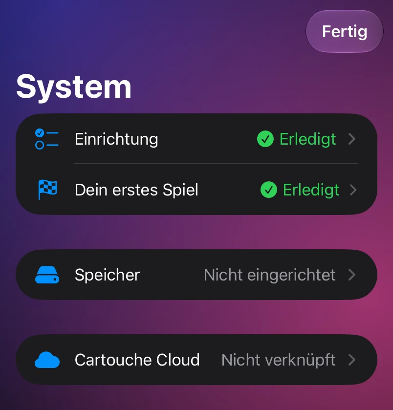
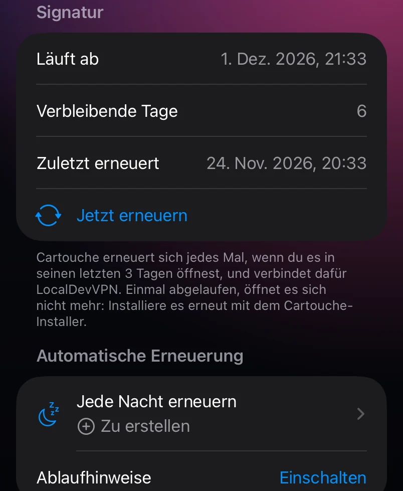
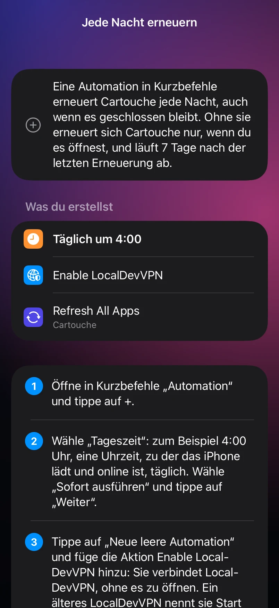
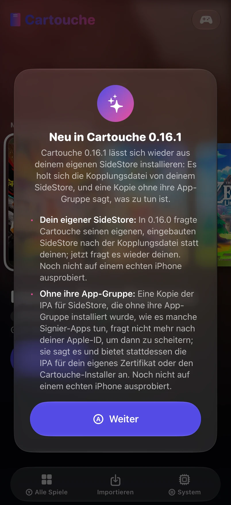
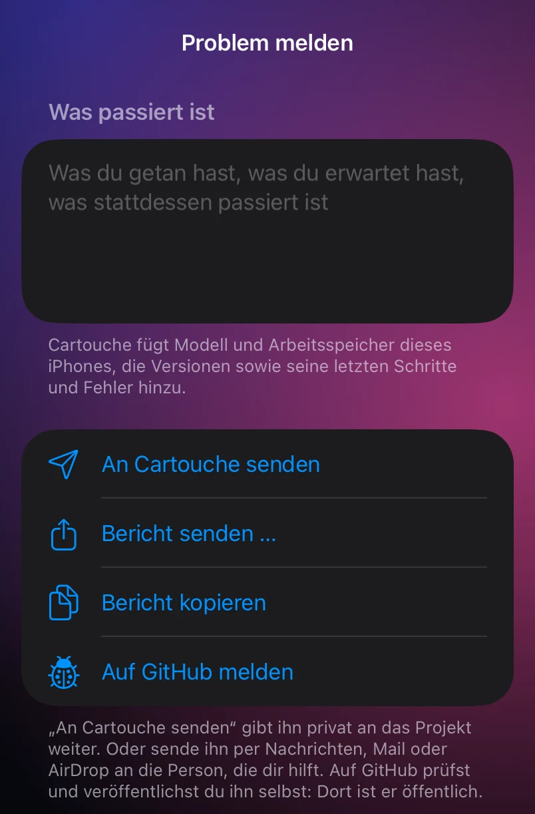

**System**, im Dock der Konsole oder mit der Taste <kbd>Menu</kbd> des Controllers, öffnet sich über der Konsole. **Fertig**, oder wieder <kbd>Menu</kbd>, schließt es.

## Einrichtung und Signatur

**Einrichtung** zeigt die Einrichtungsschritte von Cartouche, abgehakt, sobald sie erledigt sind. **Signatur** sagt, wann die Signatur von Cartouche abläuft, und die verbleibenden Tage.

Ein kostenloser Apple Account signiert Apps für sieben Tage. Der integrierte SideStore erneuert Cartouche selbst, über LocalDevVPN, das Cartouche verbindet:

- jedes Mal, wenn du Cartouche in den letzten 3 Tagen seiner Signatur öffnest;
- wenn du auf **Jetzt erneuern** tippst, ohne Cartouche zu verlassen;
- jede Nacht, mit der Kurzbefehle-Automation [weiter unten](#jede-nacht-erneuern).

Mit eingeschalteten **Ablaufhinweisen** warnt dich Cartouche 24 Stunden und 6 Stunden, bevor es abläuft. Ist es abgelaufen, öffnet sich Cartouche nicht mehr: Installiere es mit dem [Cartouche-Installer](/de/installer/) erneut, über diese Kopie, was deine Spiele und Spielstände behält.

Apple-Sitzung abgelaufen? Cartouche meldet sich selbst erneut an oder bittet dich darum, mit **Erneut anmelden**.

## Jede Nacht erneuern

Eine Automation in Kurzbefehle erneuert Cartouche jede Nacht, auch wenn es geschlossen bleibt. iOS lässt keine App sie für dich erstellen, also erstellst du sie einmal:

1. Öffne in Kurzbefehle **Automation** und tippe auf **+**.
2. Wähle **Tageszeit**: zum Beispiel 4:00 Uhr, eine Zeit, zu der das iPhone lädt und online ist, täglich. Wähle **Sofort ausführen** und tippe auf **Weiter**.
3. Tippe auf **Neue leere Automation** und füge die Aktion **Enable LocalDevVPN** hinzu: Sie verbindet LocalDevVPN, ohne es zu öffnen.
4. Füge dann **Refresh All Apps** hinzu, aus den Aktionen von Cartouche und nicht von LiveContainer, und tippe auf **Fertig**.
5. Tippe zurück in Cartouche auf **Ich habe die Automation erstellt**.

Cartouche verfolgt jeden Lauf: **Jede Nacht erneuern** auf der Seite „System“ sagt, ob sie noch zu erstellen, erstellt, aktiv oder fehlgeschlagen ist und warum, und was zu beheben ist.

:::tip[Mit Tailscale]
LocalDevVPN schaltet Tailscale aus, da iOS nur ein VPN gleichzeitig hält. Füge die Aktion **Connect** von Tailscale als letzte zur Automation hinzu, und es schaltet sich von selbst wieder ein.
:::

## Updates

Cartouche bietet seine neuen Versionen über der Konsole an und installiert sie selbst über LocalDevVPN, ohne Computer. Danach schließt es sich: Öffne es wieder. Deine Spiele, ihre Spielstände und die Einstellungen von Cartouche bleiben.

Nach einem Update öffnet sich Cartouche mit **Neuigkeiten**, in deiner Sprache. **System › Updates** hat auch **Nach Update suchen** und die **Neuigkeiten** der letzten Versionen.

## Arbeitsspeicher

Cartouche bekommt das **erhöhte Speicherlimit**, auch mit einem kostenlosen Apple Account. **Arbeitsspeicher** zeigt die Grenze, die iOS Cartouche hier gibt, die, die es dem letzten Spiel hinter der Konsole gab, und ob das erhöhte Speicherlimit aktiv ist. **Während ein Spiel läuft** enthält **Cartouche hinter dem Spiel geöffnet lassen** ([Spielen](/de/iphone/playing/#ein-spiel-das-mehr-arbeitsspeicher-braucht)), **Pausieren, wenn der Controller getrennt wird** ([Spielen](/de/iphone/playing/#wenn-der-controller-getrennt-wird)) und **Ton anderer Apps beibehalten**, das deine Musik oder deinen Podcast unter dem Ton des Spiels weiterlaufen lässt ([Spielen](/de/iphone/playing/#deine-musik-oder-dein-podcast)).

## Speicher, Builds und Cartouche Cloud

- **[Speicher](/de/iphone/storage/):** dein Spieleordner, dein Spielstandordner und deine Orte.
- **Builds auf** deinem Mac: Mit einem gekoppelten Mac alle seine Builds, vom iPhone aus gesteuert ([Dein iPhone und dein Mac](/de/mac/iphone/)).
- **[Cartouche Cloud](/de/cloud/iphone/):** Verknüpfe dieses iPhone mit deinem Account und verfolge die für dich erstellten Spiele.

## Spielmessungen

Nach jedem Spiel sendet Cartouche, was nxnative während des Spiels gemessen hat, etwa Bildrate und Arbeitsspeicher, damit Spiele auf iPhone, iPad und Mac besser laufen. Nie deinen Apple Account, den Namen deines iPhones, deine Dateien, die Adressen deines Speichers oder das Protokoll des Spiels. **System › Spielmessungen** zeigt, was gesendet wird, schaltet es aus und löscht, was dieses iPhone gesendet hat. Siehe [Datenschutz](/de/about/privacy/).

## Problem melden

**Problem melden** zeigt einen vollständigen Bericht über das, was schiefging, mit dem Modell dieses iPhones, den Versionen und den letzten Schritten und Fehlern von Cartouche, ohne Passwörter, Servernamen oder -adressen, Benutzernamen oder Apple Account. Nichts verlässt das iPhone, bevor du wählst, wie: **An Cartouche senden**, privat, oder per Nachrichten, Mail oder AirDrop an die Person, die dir hilft. Siehe [Hilfe bekommen](/de/help/support/).

## Andere installierte Apps

Eine IPA, die du installiert hast und die kein Spiel von nxnative ist, erscheint hier, nicht auf der Konsole. Sie öffnet sich anstelle von Cartouche und kann hier deinstalliert werden.

## Cartouche zurücksetzen

**Cartouche zurücksetzen** löscht alles, was du in Cartouche abgelegt hast, deine Spiele und ihre Spielstände hier, deine Einstellungen und deinen Speicher, und startet es dann wieder wie beim ersten Öffnen, ohne Computer. Spielstände, die nicht in deinem Spielstandordner sind, werden vorher genannt, mit **Jetzt in den Spielstandordner senden**. Was dein Speicher enthält, das Zertifikat und die Kopplungsdatei bleiben.

## Sprache

Cartouche spricht Deutsch, Englisch, Französisch oder Spanisch: Es folgt der Sprache deines iPhones.
