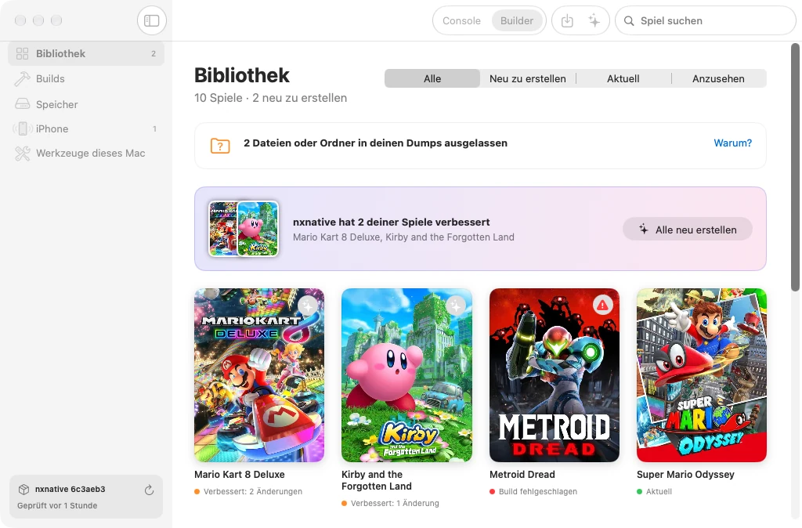
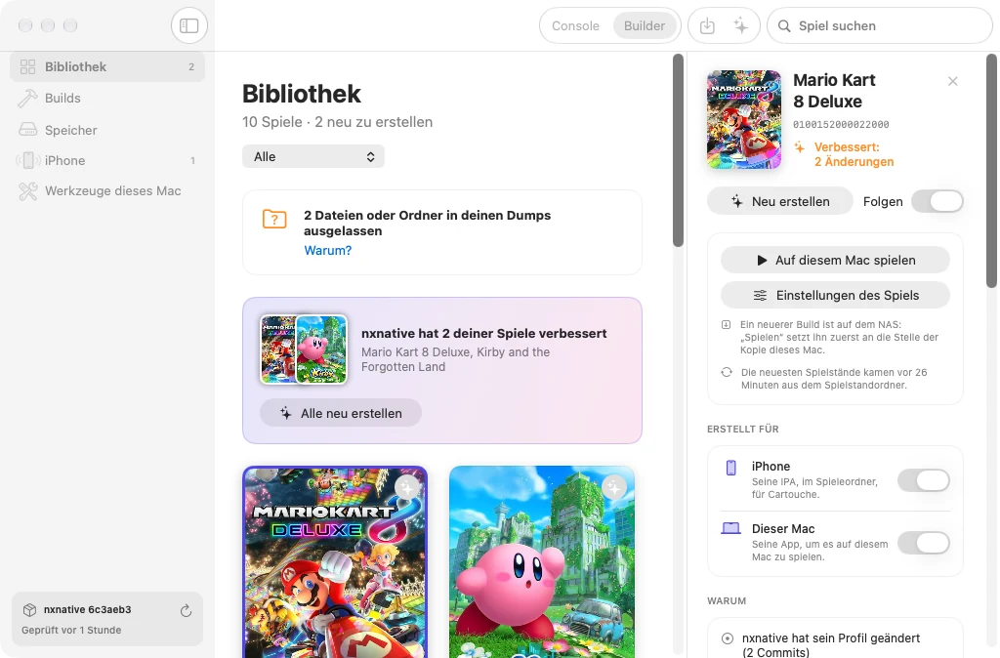
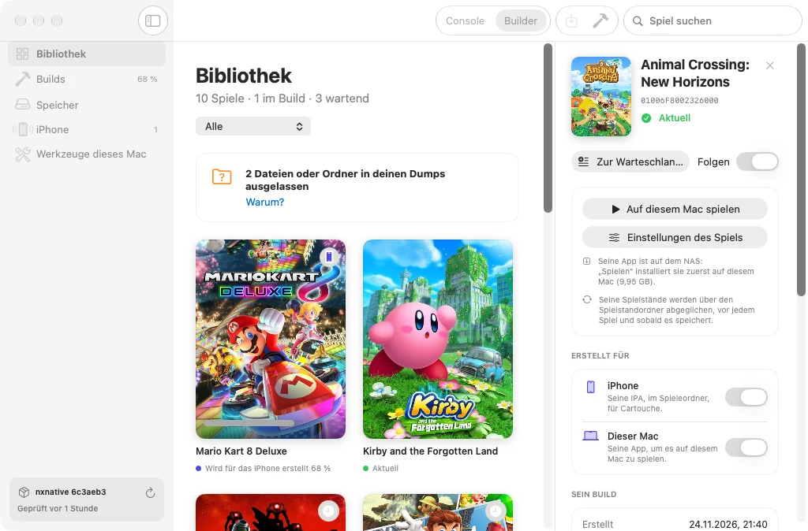

**Builder**, oben im Fenster oder <kbd>⌘</kbd><kbd>2</kbd>, zeigt den Builder. Er erstellt jedes deiner Spiele mit nxnative zu einer IPA für iPhone und iPad und zu einer App für diesen Mac, legt sie in deinen Spieleordner und erstellt sie neu, wenn nxnative sie verbessert.

## Die Bibliothek

**Bibliothek** zeigt deine Spiele mit ihren Covern: die deines Dump-Ordners und die, deren IPA allein in deinem Spieleordner liegt. Jedes sagt, ob es aktuell ist, ob ein Neubau fällig ist und warum, ob es nachts erstellt wurde oder fehlgeschlagen ist und was fehlschlug. Filtere sie nach **Alle**, **Neu zu erstellen**, **Aktuell** oder **Anzusehen**.

Die Infoseite eines Spiels zeigt, was nxnative seit seinem Build dafür geändert hat, seine IPA und seine App für diesen Mac, **Erstellen**, **Neu erstellen** oder **Erneut erstellen**, ob ihm gefolgt wird und wofür es erstellt wird.

## Erstellen

Öffne ein Spiel und wähle **Erstellen**. Der erste Build eines großen Spiels dauert Stunden; die nächsten nutzen seinen Build-Ordner wieder und dauern Minuten. **Builds** zeigt den laufenden Durchlauf, Spiel für Spiel und Schritt für Schritt, seine Warteschlange und die früheren Durchläufe mit ihren Berichten.

- Ein Spiel, das während eines Durchlaufs mit **Zur Warteschlange hinzufügen** angefordert wird, wartet am Ende des Durchlaufs, bis es dran ist.
- **Dieses Spiel stoppen** stoppt nur das Spiel, das erstellt wird; **Alle stoppen** stoppt den Durchlauf und leert seine Warteschlange.
- Eine Mitteilung sagt, wann ein Durchlauf endet.

## Updates und DLCs

Lege das Update und die DLCs eines Spiels mit ihm in deinen Dump-Ordner: Der Builder erstellt sie mit dem Spiel, das neueste Update und jedes DLC.

- **Pakete** (`.nsp`, `.xci`, `.nsz`, `.xcz`) können neben dem Spiel liegen, in einem eigenen Ordner wie `Zelda/Update/` oder irgendwo sonst im Dump-Ordner: Der Builder erkennt ihr Spiel an seiner Titel-ID. Sie brauchen `prod.keys`, gewählt im Einrichtungsassistenten oder in den Einstellungen.
- **Ein Dump** hat sie in `updates/<version>/` und `dlc/`; die `.nup` eines Switch-2-Spiels enthält die, die in ihr verpackt sind.
- **Eine `.nup` ohne ihre DLCs** nimmt sie als Bilder: Lege das Bild jedes DLC, `1.img`, `2.img` … nach seiner Nummer, in einen Ordner namens `aoc` neben der `.nup`, im Ordner des Spiels. nxnative macht ein solches Bild von jedem DLC, mit dem es ein Spiel erstellt, im Ordner `aoc` des Build-Ordners des Spiels. Eine `.nup` mit eigenen DLCs behält diese.
- **Ein neues Update oder DLC** im Dump-Ordner lässt das Spiel neu erstellen. Cartouche auf dem iPhone bietet dann das Update auf der Infoseite des Spiels an, die Spielstände bleiben.

## Wenn nxnative deine Spiele verbessert

nxnative bekommt Dutzende Änderungen am Tag. Der Builder liest, was sich seit dem Build jedes Spiels geändert hat, und erstellt ein Spiel nur neu, wenn es etwas gewinnt:

| Ein Spiel wird neu erstellt, wenn | |
| --- | --- |
| es nie erstellt wurde oder seine IPA den Spieleordner verlassen hat | |
| sein Ordner neue Dateien enthält | ein neues Update, ein DLC oder ein Dump |
| eine Änderung von nxnative dafür gemacht ist | sein Profil oder eine Korrektur, die es nennt |
| sich der gemeinsame Code von nxnative geändert hat | standardmäßig jede Woche; oder sofort oder nie, in den Einstellungen |
| sich Xcode geändert hat | |

**nxnative hat** einige deiner Spiele **verbessert**? **Alle neu erstellen** erstellt sie. Cartouche auf dem iPhone bietet dann jedes Update auf der Infoseite des Spiels an, die Spielstände bleiben.

Ein Spiel, dessen Build fehlgeschlagen ist, wartet, bis sich nxnative oder seine Dateien ändern, statt jede Nacht wieder zu scheitern; **Erneut erstellen** erstellt es sofort.

## Jede Nacht

**Fälliges jede Nacht erstellen** in den Einstellungen erstellt, was nxnative verbessert hat, zu der Zeit, die du wählst, auch bei geschlossener App. Der Mac bleibt wach, während er erstellt, und eine Mitteilung sagt, wie es lief. Eine nicht eingebundene Freigabe deines NAS wird von selbst wieder eingebunden.

## Für das iPhone und den Mac erstellt

Jedes Spiel wird für iPhone und iPad erstellt und auch für diesen Mac, außer du schaltest eines von beiden unter **Erstellen für** aus, für alle Spiele unter **Einstellungen › Builds** oder für ein Spiel auf seiner Infoseite. Siehe [Auf dem Mac spielen](/de/mac/console/#auf-dem-mac-spielen).

## Für jedes deiner iPhones erstellen

Das iPhone 15, das iPhone 15 Plus und ältere Modelle haben einen Grafikchip, der keine BC-komprimierten Texturen liest, die nxnative braucht. **Einstellungen › Builds › Erstellen für** sagt, für wen die Spiele sind: standardmäßig deine gekoppelten iPhones oder ein Modell, das du wählst. Wenn eines davon keine BC-Texturen liest, erstellt der Builder jedes Spiel mit [nxnative-nobc](https://github.com/mianmuhammadse/nxnative-nobc), einem separaten Fork von nxnative von mianmuhammadse, der diese Texturen umwandelt; sonst mit nxnative. Die Einstellung sagt, womit und warum.

## Wenig Platz auf dem Mac

Jedes Spiel behält einen Build-Ordner, der seinen nächsten Build schnell macht. Der Builder sorgt dafür, dass deine Festplatte nicht vollläuft: Er entfernt die extrahierten Dateien, sobald ein Build endet, entfernt die am längsten nicht genutzten Build-Ordner, wenn der Platz knapp wird, und sagt vor einem Build, wie viel Platz fehlt. **Speicher** zeigt, was der Builder behält, mit **Freigeben**.

## Wenn ein Build nicht durchgeht

Der Fehler unter einem Spiel in **Builds** sagt, was zu tun ist, wenn du etwas tun kannst: eine volle Festplatte, beschädigte Spieldateien, die du erneut von deiner Konsole kopierst, oder ein Xcode, das aktualisiert werden muss. Wenn die neueste Änderung von nxnative den Build eines Spiels kaputt macht, erstellt der Builder es von selbst mit einer früheren Änderung, die funktioniert hat.

## Was er nie tut

Er lädt, teilt oder überträgt nie ein Spiel, einen Schlüssel oder eine IPA irgendwohin außer in deinen eigenen Speicher: Er erstellt die Spiele, die du besitzt, aus deinen eigenen Dateien, auf deinem Mac, in deinen eigenen Spieleordner.
