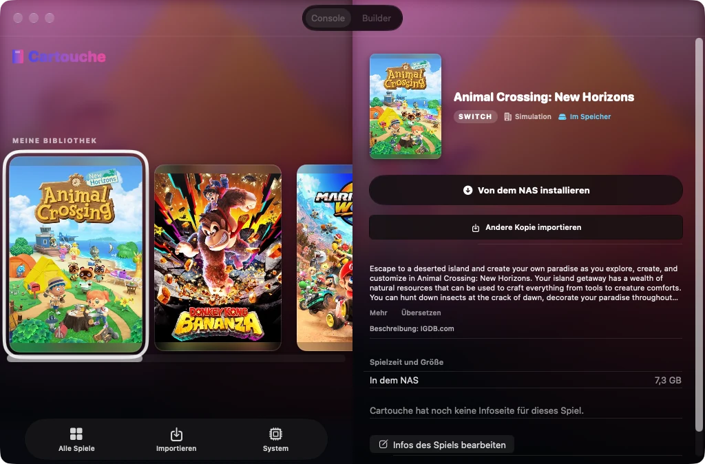
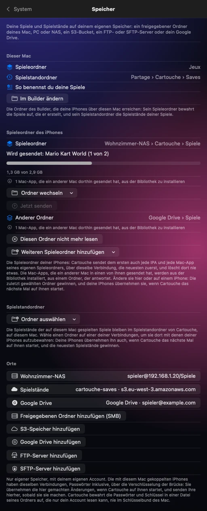

**Console**, oben im Fenster oder <kbd>⌘</kbd><kbd>1</kbd>, zeigt die Konsole von Cartouche, wie auf dem iPhone: deine für diesen Mac erstellten Spiele mit ihren Covern, das Spiel im Fokus mit **Spielen** und seine Infoseite daneben.

## Auf dem Mac spielen

**Spielen** startet das Spiel sofort, im Vollbild, mit dem Fenster von Cartouche dahinter, mit deinen neuesten Spielständen. <kbd>⌃</kbd><kbd>⌘</kbd><kbd>F</kbd> setzt es in ein Fenster. Wenn das Spiel endet, kommt Cartouche wieder nach vorn.

- **Einstellungen des Spiels** öffnet die Einstellungen des Spiels auf seiner Infoseite, wie auf dem iPhone, mit den eigenen des Mac: Anzeigemodus, Vollbild oder Fenster, und Controller.
- Das Spiel spricht die Sprache deines Mac, wenn es sie hat, bis du eine wählst.
- Ein Spiel, das dein NAS aufbewahrt und das noch nicht auf diesem Mac ist, erscheint auch: **Vom NAS installieren** installiert es, dann startet **Spielen** es. Das Menü neben **Meine Bibliothek** wählt **Alle**, **Installiert** (auf diesem Mac) oder **Nicht installiert**, wie auf dem iPhone.
- **Von diesem Mac entfernen** legt seine App in den Papierkorb; das Spiel bleibt in deinem Spieleordner.
- Wird der letzte Controller während eines Spiels getrennt, pausiert das Spiel 3 Sekunden später und Cartouche kommt wieder nach vorn und sagt es. Ein wieder verbundener Controller setzt das Spiel fort, wie **Fortsetzen** oder das Spiel, das du über das Dock nach vorn holst. **System › Während ein Spiel läuft** schaltet es aus.

Die Infoseite sagt auch, wie lange du das Spiel auf diesem Mac gespielt hast und ob es hier läuft.

## Deine Spielstände auf dem Mac

Der Mac hält die Spielstände der dort gespielten Spiele mit deinem Spielstandordner synchron, wie das iPhone: Die neueste Kopie kommt, bevor ein Spiel startet, und die Spielstände des Mac gehen ein paar Sekunden nach dem Speichern des Spiels. Wenn sich beide Seiten geändert haben, gewinnen die zuletzt geschriebenen Spielstände, und die anderen werden als Kopie behalten. Alle Profile des Spiels gehen mit, jedes mit dem Platz, den das Spiel ihm gemacht hat, und die Shader, die es vorbereitet hat, kommen wieder, wie auf dem iPhone. Die Infoseite zeigt sie, mit **Jetzt mit … synchronisieren** und **Kopie zurückspielen**, und holt einen Spielstand von deiner Konsole wie auf dem iPhone. **Kopie zurückspielen** zeigt unter **Auf diesem Mac** auch die Kopien, die jedes Spiel bei seinem Start von seinen Spielständen macht, um zum Start einer Sitzung zurückzukehren ([Deine Spielstände](/de/iphone/saves/)).

Die Kopie eines Spiels auf diesem Mac, das dein NAS aufbewahrt, bleibt aus Time Machine heraus: Sie kommt wieder vom NAS. Die Spielstände des Spiels kommen weiterhin hinein.

Ohne einen von dir gewählten Spielstandordner bewahrt Cartouche Builder die Spielstände in seinem eigenen Ordner auf, nur auf diesem Mac: Nach deinem ersten Spiel schlägt dir die Startseite der Konsole vor, einen zu wählen, in iCloud Drive oder auf deinem NAS, und sein × entfernt den Vorschlag für immer.

## Mods

Die Infoseite eines Spiels hat **Mods** auch auf dem Mac, wie auf dem iPhone ([Die Infoseite eines Spiels](/de/iphone/game-sheet/#mods)): Füge einen Mod aus einem Ordner oder einem ZIP auf diesem Mac hinzu, schalte ihn ein oder aus und lege die Reihenfolge fest. Ein Mod, der auch den Code des Spiels ändert, mit einem `exefs`-Ordner, funktioniert auf dem Mac noch nicht: Cartouche sagt es und lässt ihn weg. Die Mods des Mac bleiben auf diesem Mac.

## System

**System** im Dock der Konsole öffnet die Seite „System“ des iPhones mit den eigenen Abschnitten dieses Mac:

- **Dein erstes Spiel:** die Anleitung, in den drei Schritten dieses Mac: der Einrichtungsassistent, ein für diesen Mac erstelltes Spiel und dieses Spiel gespielt.
- **Speicher:** deine Verbindungen, dieselben wie die deiner gekoppelten iPhones, und die Spiele- und Spielstandordner des Mac ([weiter unten](#derselbe-speicher-wie-auf-deinem-iphone)).
- **Den Builder öffnen**, mit seinen Einstellungen.
- **Während ein Spiel läuft:** **Pausieren, wenn der Controller getrennt wird** ([oben](#auf-dem-mac-spielen)).
- **Dieser Mac:** sein Modell, sein Chip und sein macOS, und ob sein Grafikchip hat, was nxnative braucht.
- **Updates:** die von Cartouche für Mac, mit **Nach Update suchen** und **Updates selbst installieren**.
- **Spielmessungen** und **Problem melden**, wie auf dem iPhone.

## Derselbe Speicher wie auf deinem iPhone

Deine gekoppelten iPhones und der Mac behalten dieselben Verbindungen zu deinem Speicher, Passwörter eingeschlossen: Ein freigegebener Ordner, ein S3-Bucket, ein FTP- oder SFTP-Server oder dein Google Drive, auf einem hinzugefügt, kommt beim anderen an. Den Spieleordner und den Spielstandordner, die du auf einem davon wählst, behalten beide.

Wenn der auf dem iPhone gewählte Spieleordner auf einer deiner Verbindungen liegt, sendet der Builder ihm jedes Spiel, das er erstellt, eines nach dem anderen, damit dein iPhone sie findet, auch wenn der Mac schläft.
