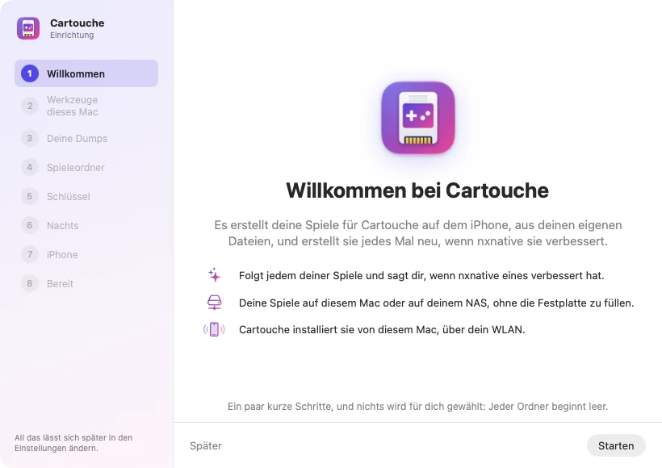
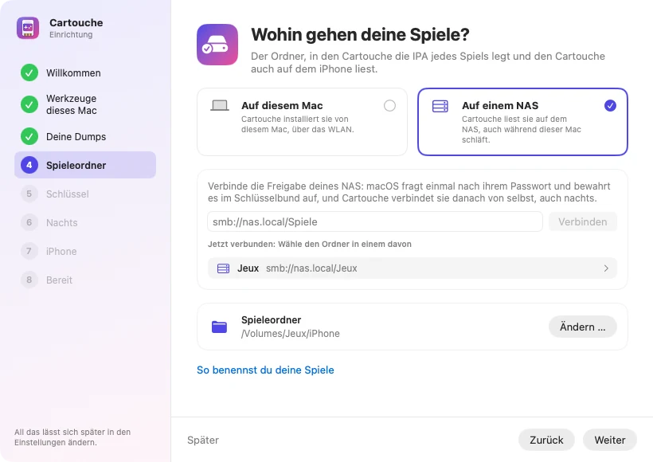
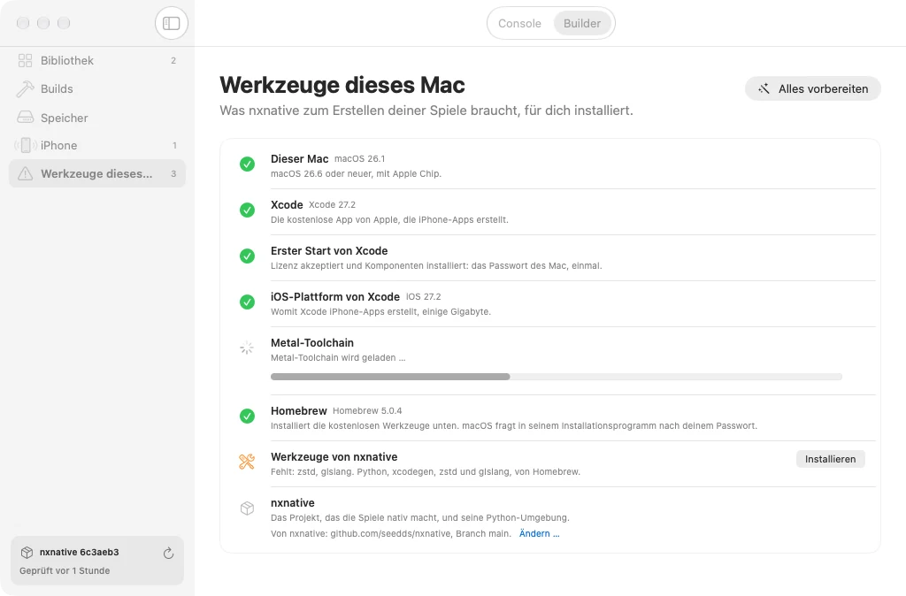

Auf dem Mac ist Cartouche eine einzige App: seine **Konsole**, wie auf dem iPhone, und der **Builder**, der deine Spiele mit nxnative aus deinen eigenen Kopien erstellt, für iPhone, iPad und Mac. Es braucht einen Mac mit Apple silicon und macOS 26.6 oder neuer.

## Laden und erstes Öffnen

1. [Lade Cartouche für Mac](https://cartouche.cloud/download/#builder): Das Image wird sofort geladen.
2. Öffne es und zieh **Cartouche** auf **Programme**.
3. Öffne Cartouche aus „Programme“. Beim ersten Mal sagt macOS, dass es die App nicht prüfen kann, da sie nicht von Apple signiert ist: Klicke unter **Systemeinstellungen › Datenschutz & Sicherheit** einmal neben Cartouche auf **Dennoch öffnen**. Seine Updates öffnen sich, ohne erneut zu fragen.

## Der Einrichtungsassistent

Beim ersten Start richtet ein Einrichtungsassistent den Mac mit dir ein, Schritt für Schritt. Nichts wird für dich gewählt: Jeder Ordner ist anfangs leer. Jede Wahl wird gespeichert, sobald du sie triffst, und alle lassen sich später in den Einstellungen ändern, wo **Erweitert › Einrichtungsassistenten öffnen** ihn wieder öffnet.

1. **Willkommen:** was die App tut.
2. **Werkzeuge dieses Mac:** **Alles vorbereiten** installiert, womit nxnative erstellt. Xcode kommt aus dem App Store, den die App für dich öffnet; Homebrew fragt nach dem Passwort deines Mac; der Rest wird im Hintergrund installiert, während du mit den nächsten Schritten weitermachst.
3. **Deine Dumps:** der Ordner deiner Spiele, wie du sie von deiner Konsole gedumpt hast, auf dem Mac oder auf deinem NAS. Der Builder liest ihn nur.
4. **Spieleordner:** wohin die IPAs deiner Spiele kommen, auf diesem Mac oder auf deinem NAS. Es ist der Ordner, den Cartouche auch auf dem iPhone liest.
5. **Schlüssel:** die Schlüssel deiner Konsole, `prod.keys`, für Spiele, die als Pakete vorliegen.
6. **Nachts:** ob jede Nacht Fälliges erstellt werden soll, und wann.
7. **iPhone:** ob der Mac seine Spiele und Spielstände mit Cartouche auf dem iPhone teilt, und wie du ihn koppelst.
8. **Bereit:** was jeder Schritt gewählt hat, mit einer Taste zurück dorthin.

:::tip[Deine Spiele auf einem NAS]
Für einen Ordner auf deinem NAS gibst du im Assistenten die Adresse seiner Freigabe ein, und der Finder verbindet sie; dann wählst du den Ordner darin. macOS bewahrt das Passwort im Schlüsselbund auf, und Cartouche verbindet die Freigabe selbst wieder, auch nachts.
:::

## Werkzeuge dieses Mac

**Werkzeuge dieses Mac** im Builder zeigt jedes Werkzeug, das nxnative braucht, installiert oder fehlend, mit einer Installation für das Fehlende, und **Xcode aktualisieren**, wenn nxnative ein neueres braucht.

## Deine Dumps

Der Builder liest deine Spiele als Pakete deiner Konsole (`.nsp`, `.xci`, `.nsz`, `.xcz`, mit ihren Updates und DLCs, die `prod.keys` brauchen, oder `.nup`), als Dumps oder als `.zip` eines Dumps. Sie können lose im Ordner liegen, ein Ordner pro Spiel, oder in Ordnern von Ordnern. Ein Spiel wird an seiner Titel-ID erkannt; die Bibliothek sagt, was sie ausgelassen hat und warum.

**Deine Spiele benennen**, unter **Ordner** in den Einstellungen, zeigt mit Beispielen, was der Builder und Cartouche aus jedem Namen machen.

## Updates

Cartouche für Mac sucht beim Öffnen und alle sechs Stunden nach neuen Versionen. Eine neue Version wird geladen, geprüft und eingesetzt, wenn die App beendet wird, oder sofort mit **Neu starten**. **Updates selbst installieren** in den Einstellungen lässt sich ausschalten: Die App bietet dann jedes Update an.

## Weiter

[Erstelle deine Spiele](/de/mac/builder/).
