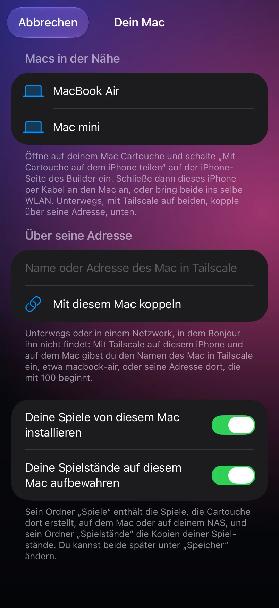
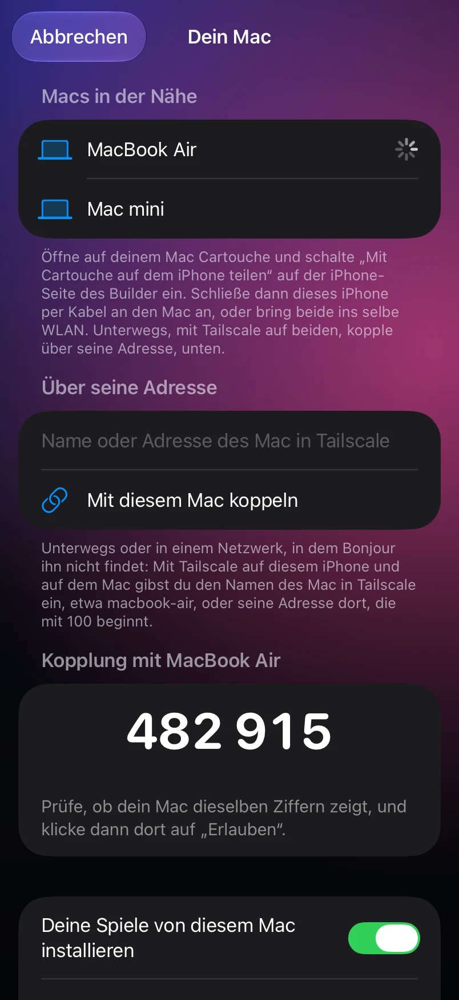
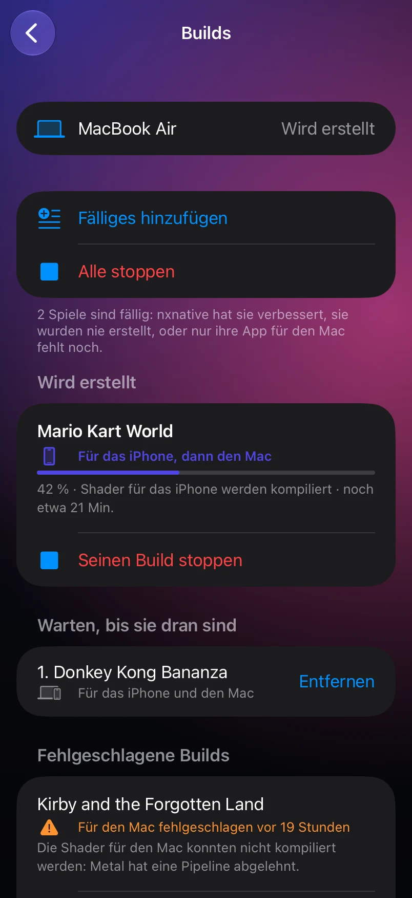
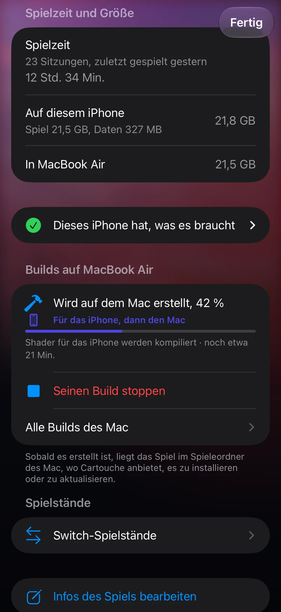

Einmal gekoppelt, wird dein Mac zu einem Speicherort von Cartouche auf dem iPhone: Cartouche installiert deine Spiele von dort und bewahrt deine Spielstände dort auf, unterwegs verschlüsselt. Und das iPhone steuert die Builds des Mac.

## Koppeln

1. Schalte auf dem Mac auf der Seite **iPhone** des Builders **Mit Cartouche auf dem iPhone teilen** ein.
2. Wähle auf dem iPhone unter **System › Speicher** **Deinen Mac hinzufügen** und dann deinen Mac unter **Macs in der Nähe**. Erlaube Cartouche beim ersten Mal, Geräte in deinem lokalen Netzwerk zu finden.
3. Beide Bildschirme zeigen sechs Ziffern: Wenn sie gleich sind, klicke auf dem Mac auf **Erlauben**.

Der Mac teilt zwei Ordner, und nichts anderes von ihm ist erreichbar: **Spiele**, dein Spieleordner, wo immer er ist, auf dem Mac oder auf deinem NAS; und **Spielstände**, der Ordner, den du für die Kopien deiner Spielstände wählst. Der Schlüssel, den beide teilen, geht nie über das Netzwerk, und jede Nachricht ist verschlüsselt.

## Im WLAN, per Kabel oder unterwegs

- **Per Kabel:** Schließ das iPhone an den Mac an, und es erreicht den Mac über das Kabel, ohne WLAN. **Deinen Mac hinzufügen** listet diesen Mac zuerst, **Per Kabel**. Das iPhone muss dem Mac vertrauen, wie es der Finder einmal fragt.
- **Ein Spiel deines NAS, über den Mac:** Solange das iPhone an einem Mac hängt, der dein NAS, deinen FTP- oder SFTP-Server per Ethernet erreicht, kommt ein Spiel deiner Spieleordner dort über den Mac und das Kabel, ohne etwas einzustellen. Der Bildschirm der Installation zeigt dann **Per Kabel, über den Mac**. Im WLAN lässt der Mac das iPhone das NAS selbst lesen.
- **In deinem WLAN:** Das iPhone findet den Mac von selbst oder unter der Adresse, unter der es ihn zuletzt erreicht hat, auch über dein VPN. Der Mac bleibt wach, solange ein iPhone verbunden ist.
- **Unterwegs:** Mit Tailscale auf dem Mac und auf dem iPhone, mit demselben Konto angemeldet, erreicht das iPhone den Mac über Tailscale. Ein Mac, der nie in deinem WLAN war, wird über seinen Namen oder seine Adresse in Tailscale gekoppelt, unter **Deinen Mac hinzufügen › Über seine Adresse**.

Der Mac antwortet, solange Cartouche auf ihm geöffnet ist.

## Cartouche, von deinem Mac erneuert

Cartouche öffnet sich auf deinem iPhone jeweils sieben Tage lang und muss dann erneuert werden. Cartouche für Mac erneuert es für dich, per Kabel oder in deinem WLAN, mit oder ohne die Freigabe oben, und ohne LocalDevVPN:

1. Klicke auf der Seite **iPhone** des Builders unter **Erneuerung von Cartouche** auf **Anmelden …**, melde dich mit dem Apple Account an, mit dem du Cartouche installiert hast, und gib den Code ein, den Apple sendet.
2. Schließe das iPhone an den Mac an und vertraue dem Mac, wenn es fragt. Um es auch in deinem WLAN zu erreichen, aktiviere seine WLAN-Synchronisierung im Finder.

Von da an sieht der Mac alle halbe Stunde nach den iPhones, die er erreicht, solange er geöffnet ist, sein Fenster oder seine Menüleiste, und erneuert Cartouche in seinen letzten zwei Tagen oder sobald es abgelaufen ist. **Erneuern** tut es sofort. Eine Erneuerung installiert nichts neu: Cartouche behält seine Spiele, seine Spielstände und seinen erweiterten Speicher und zeigt sein neues Datum beim nächsten Start.

Dein Passwort geht nur an Apple, einmal: Der Mac behält nur die Sitzung, die Apple dafür gibt, und fragt dich daher nie nach dem Passwort, wenn er sich öffnet, baut oder spielt. Sobald Apple diese Sitzung beendet (eine Anmeldung anderswo, ein neues Passwort oder die Tage, die Apple ihr gibt) und eine Erneuerung fällig ist, sagt eine Mitteilung, höchstens eine am Tag, dass du dich auf der Seite **iPhone** erneut anmelden sollst. Ein mit einem anderen Apple Account installiertes Cartouche lässt der Mac in Ruhe; und ein Cartouche, dessen Zertifikat nicht mehr in deinem Account ist, öffnet sich erst wieder mit einer Installation durch den Cartouche Installer.

## Die Builds des Mac vom iPhone aus steuern

- Die Infoseite jedes Spiels zeigt **Builds auf** deinem Mac: wird erstellt, mit Fortschritt und verbleibender Zeit, wartet, bis es dran ist, aktuell, von nxnative verbessert oder fehlgeschlagen und warum. Ihre Taste bittet den Mac, es zu erstellen, jetzt oder nach dem laufenden Durchlauf, oder stoppt seinen Build.
- **System › Builds auf** deinem Mac zeigt alle seine Builds, wie sein eigenes Fenster sie hat: **Fälliges erstellen**, **Alle stoppen**, die Warteschlange mit **Entfernen**, die fehlgeschlagenen Builds, **Folgen** für jedes Spiel und **Fälliges jede Nacht erstellen** mit seiner Uhrzeit.

Die Ordner des Mac, seine Werkzeuge und seine Einstellungen bleiben auf dem Mac.

## Dieselben Verbindungen

Einmal gekoppelt, behalten iPhone und Mac dieselben Verbindungen zu deinem Speicher, Passwörter eingeschlossen: Eine, die du auf einem hinzufügst, änderst oder entfernst, kommt beim anderen an. Siehe [Derselbe Speicher wie auf deinem iPhone](/de/mac/console/#derselbe-speicher-wie-auf-deinem-iphone).

## Beide aktuell halten

Cartouche auf dem iPhone und Cartouche für Mac sprechen miteinander: Wenn eines viel älter ist, sagt das iPhone, dass du beide aktualisieren sollst. Cartouche für Mac aktualisiert sich selbst; ein altes Cartouche für Mac, das seine Updates nicht mehr findet, bekommt den Link vom iPhone, unter **System › Builds auf** deinem Mac.
