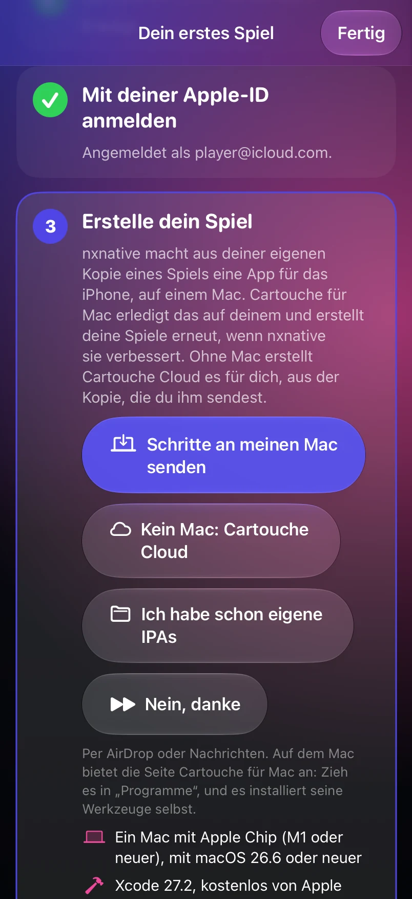
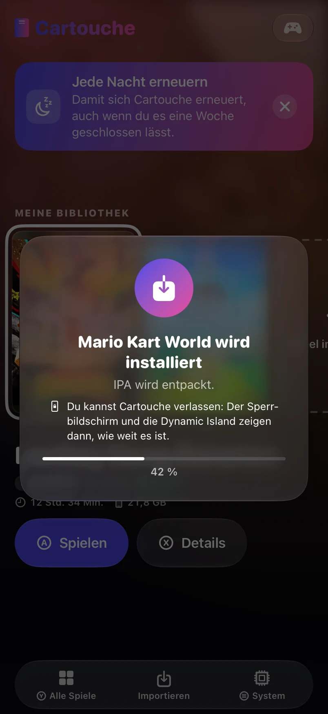

Wenn du Cartouche zum ersten Mal öffnest, öffnet sich seine Anleitung, **Dein erstes Spiel**, beim nächsten Schritt. Jeder Schritt hakt sich selbst ab, sobald er erledigt ist, in beliebiger Reihenfolge, und die Anleitung führt dich bis zum Spielen.

## 1. LocalDevVPN verbinden und anmelden

Die Schritte der Einrichtung, aus [Cartouche installieren](/de/start/install/#4-die-einrichtung-von-cartouche). Die Anleitung zeigt sie zuerst, solange sie nicht erledigt sind.

## 2. Dein Spiel erstellen

Dein Spiel ist deine eigene Kopie, von deiner Konsole gedumpt. nxnative macht daraus eine App für das iPhone, auf einem Mac. Wähle den Weg, der zu dir passt:

- **Mit deinem Mac:** **Schritte an meinen Mac senden** schickt dem Mac per AirDrop oder Nachrichten die Seite mit [Cartouche für Mac](/de/mac/install/). Installiere es dort; es erstellt dein Spiel und legt es in deinen Spieleordner.
- **Kein Mac: Cartouche Cloud** öffnet [Cartouche Cloud](/de/cloud/): Sende deine Kopie von einem Computer aus, und das für dich erstellte Spiel kommt zu Cartouche.
- **Ich habe schon eigene IPAs** öffnet „Dateien“: Die IPA, die du wählst, wird installiert.
- **Nein, danke:** Deine Spiele sind schon erstellt, zum Beispiel auf deinem NAS. Die Anleitung geht weiter zu deinem Spieleordner.

## 3. Deinen Spieleordner wählen

**Spieleordner auswählen** öffnet die Seite [Speicher](/de/iphone/storage/): Füge deinen Mac, einen freigegebenen Ordner deines NAS, einen S3-Bucket, einen FTP- oder SFTP-Server, dein Google Drive oder einen Ordner in „Dateien“ hinzu und wähle dann den Ordner mit deinen Spielen. Cartouche listet deine Spiele von dort auf und bietet ihre Updates an.

Mit Cartouche Cloud brauchst du keinen Spieleordner: Die Anleitung überspringt diesen Schritt. Gar kein Spieleordner? **Stattdessen eine IPA importieren** installiert eine IPA aus „Dateien“.

## 4. Dein Spiel installieren und spielen

Dein Spiel erscheint im letzten Schritt der Anleitung und in deiner Bibliothek. **Installieren** installiert es, aus deinem Spieleordner oder von Cartouche Cloud, dann öffnet sich seine Infoseite mit **Spielen**.

Deine nächsten Spiele gehen genauso: auf dem Mac oder von Cartouche Cloud erstellt, dann installiert.

## Die Anleitung wieder öffnen

- Das **×** auf der Karte der Anleitung nimmt sie vom Home-Bildschirm.
- **System › Dein erstes Spiel** öffnet sie wieder, wann du willst.
- Solange du kein Spiel hast, öffnet auch **Wie bekomme ich ein Spiel** neben **Meine Kopie importieren** sie.

Auf dem Mac hat die Konsole von Cartouche ihre eigene Anleitung, in drei Schritten: der Einrichtungsassistent, ein für diesen Mac erstelltes Spiel und dieses Spiel gespielt. Siehe [Die Konsole auf dem Mac](/de/mac/console/).
