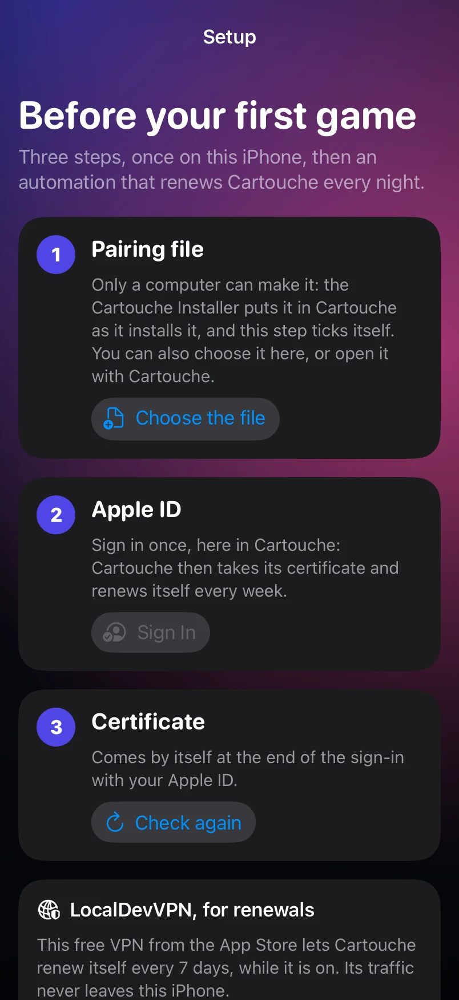

Ein Computer wird einmal gebraucht, um Cartouche auf dein iPhone oder iPad zu bringen. Danach signiert, erneuert und aktualisiert sich Cartouche ohne ihn. Du nutzt schon SideStore? [Installiere es stattdessen von dort](/de/start/sidestore/), ohne Computer.

Auf einem iPad ist jeder Schritt gleich, mit dem iPad anstelle des iPhones.

## 1. LocalDevVPN auf dem iPhone

Installiere **LocalDevVPN**, kostenlos, aus dem App Store. Cartouche meldet sich darüber an und erneuert sich darüber. Sein Datenverkehr verlässt das iPhone nie, und Cartouche verbindet es selbst, wenn es es braucht.

## 2. Der Cartouche-Installer auf deinem Computer

1. Lade den Cartouche-Installer [für Mac](https://cartouche.cloud/download/#installer-mac) oder [für Windows](https://cartouche.cloud/download/#installer-windows). Installiere unter Windows auch **Apple-Geräte** aus dem Microsoft Store, damit Windows mit dem iPhone sprechen kann.
2. Öffne ihn. Er ist weder von Apple noch von Microsoft beglaubigt, also beim ersten Mal:
   - auf einem Mac **Systemeinstellungen › Datenschutz & Sicherheit** öffnen und neben Cartouche Installer einmal auf **Dennoch öffnen** klicken;
   - unter Windows, wenn SmartScreen die Installation stoppt, **Weitere Informationen › Trotzdem ausführen** wählen.
3. Schließe das iPhone mit einem Kabel an den Computer an und entsperre es. Tippe beim ersten Mal auf dem iPhone auf **Vertrauen** und gib seinen Code ein.
4. Melde dich im Installer mit deinem Apple Account an (ein kostenloser genügt) und gib den Code ein, den Apple an deine Geräte sendet.
5. Klicke auf **Cartouche installieren**. Der Installer lädt das neueste Cartouche, prüft es, signiert es mit dem erhöhten Speicherlimit und installiert es, mit seinem Zertifikat und der Kopplungsdatei, die es braucht.

Mehr über den Installer, seine Einstellungen und was zu tun ist, wenn er stoppt: [Cartouche-Installer](/de/installer/).

:::tip[Dein eigenes Signaturzertifikat]
Du hast ein Signaturzertifikat (.p12) und sein Bereitstellungsprofil? Der Installer kann Cartouche stattdessen damit signieren, ohne Apple Account und ohne wöchentliche Erneuerung. Siehe [Dein eigenes Zertifikat](/de/installer/own-certificate/).
:::

## 3. Das erste Mal auf dem iPhone

Bevor Cartouche sich zum ersten Mal öffnet:

1. Vertraue unter **Einstellungen › Allgemein › VPN und Geräteverwaltung** deinem Apple Account.
2. Wenn iOS danach fragt, schalte den **Entwicklermodus** unter **Einstellungen › Datenschutz & Sicherheit** ein und starte das iPhone neu.

## 4. Die Einrichtung von Cartouche

Öffne Cartouche. Seine Einrichtung dauert ein paar Schritte, einmal:

1. **LocalDevVPN, für die Erneuerungen:** **LocalDevVPN verbinden** verbindet es und bringt dich zurück zu Cartouche.
2. **Apple-ID:** Melde dich mit dem Apple Account an, den du dem Installer gegeben hast, und gib den Code ein, den Apple sendet. Cartouche übernimmt sein Zertifikat.
3. **Kopplungsdatei:** schon vom Installer abgelegt; dieser Schritt hakt sich selbst ab.
4. **Jede Nacht erneuern:** Der letzte Schritt zeigt die Kurzbefehle-Automation, die du einmal erstellst, damit Cartouche sich jede Nacht erneuert, auch wenn es geschlossen bleibt. Siehe [Jede Nacht erneuern](/de/iphone/system/#jede-nacht-erneuern).

Ist die Einrichtung abgeschlossen, erneuert Cartouche seine Signatur für sieben Tage selbst und bietet seine eigenen Updates an. Deine Spiele und ihre Spielstände bleiben bei jedem Update.

## Weiter

[Dein erstes Spiel](/de/start/first-game/): Die Anleitung von Cartouche führt dich von hier bis zum Spielen.
