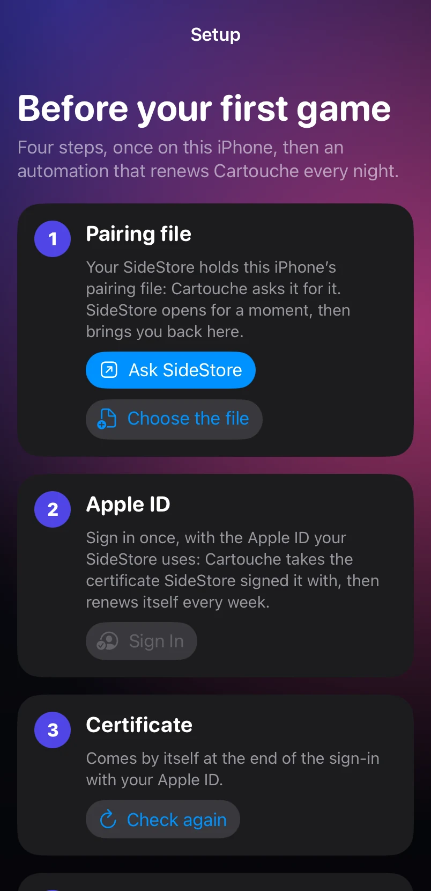

Wenn SideStore schon auf deinem iPhone oder iPad ist, kannst du Cartouche daraus installieren, ohne Computer.

1. Füge in SideStore die Quelle von Cartouche hinzu: `https://source.cartouche.cloud`. Auf dem iPhone fügt die Taste unten sie für dich hinzu.

   <a href="sidestore://source?url=https://source.cartouche.cloud">Zu SideStore hinzufügen</a>

2. Installiere **Cartouche** aus dieser Quelle. Wenn SideStore fragt, wähle **Keep App Extensions (Use Main Profile)**: Cartouche braucht sie, um deine Spiele hinter seiner Konsole auszuführen.
3. Öffne Cartouche. Seine Einrichtung holt sich bei deinem SideStore die Kopplungsdatei und übernimmt sein Zertifikat: Du musst keinen Apple Account erneut eingeben.
4. Danach installiert sich Cartouche einmal neu, um das erhöhte Speicherlimit zu bekommen, den Arbeitsspeicher, den deine Spiele brauchen.

Von da an erneuert und aktualisiert sich Cartouche wie nach einer Installation mit dem Installer. Seine Einrichtung endet mit demselben letzten Schritt, [Jede Nacht erneuern](/de/iphone/system/#jede-nacht-erneuern).

:::note
Eine Kopie von Cartouche, die von einer anderen App auf dem iPhone signiert wurde, startet kein Spiel, außer der aus der Quelle von Cartouche für SideStore. Wenn du dein eigenes Signaturzertifikat hast, siehe [Dein eigenes Zertifikat](/de/installer/own-certificate/).
:::

## Weiter

[Dein erstes Spiel](/de/start/first-game/).
