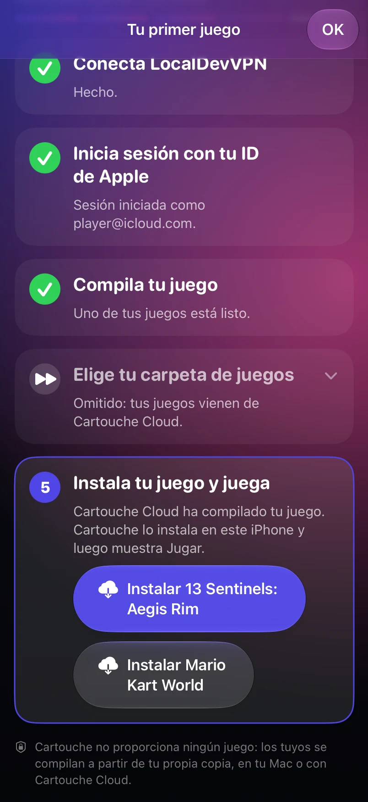

¿No tienes Mac? Desde un ordenador, envía tu propia copia de un juego en el [sitio de Cartouche Cloud](https://build.cartouche.cloud/). La compila con nxnative en un Mac en la nube, solo para ti, y luego borra tu copia. Cartouche, vinculado a tu cuenta, sigue la compilación e instala el juego en tu iPhone.

Cartouche Cloud no proporciona ningún juego: solo compila la copia que le envías.

## Compilar un juego

1. En un ordenador, abre el [sitio de Cartouche Cloud](https://build.cartouche.cloud/), crea tu cuenta y compra créditos allí.
2. Envía tu propia copia del juego: el paquete de tu consola (`.nsp`, `.xci`, `.nsz` o `.xcz`, con sus actualizaciones y DLC, y las claves de tu consola, `prod.keys`), un `.nup`, o un `.zip` de un dump.
3. Vincula Cartouche a tu cuenta, una vez ([Vincular tu iPhone](/es/cloud/iphone/#vincular-tu-iphone)).
4. Cartouche sigue la compilación, paso a paso, y un correo te avisa cuando termina. Luego **Instalar** pone el juego en tu iPhone, como tus otros juegos.

## Actualizaciones y DLC

Elige juntos el juego base, sus actualizaciones y sus DLC al enviarlo: se aplica la actualización más reciente, y los DLC se compilan con él. Una actualización o un DLC se envía con su juego base: para añadir uno a un juego ya compilado, vuelve a enviar el juego con él, lo que es una compilación nueva.

## Tus claves se quedan contigo

Tu navegador abre el juego en tu ordenador y envía solo el juego: tus claves nunca salen del ordenador.

## Créditos

Una compilación que sale bien se paga en créditos, comprados por adelantado en el sitio de Cartouche Cloud, que da el precio. Una compilación que falla no cuesta nada. Los créditos se reservan mientras se compila un juego, y se devuelven si la compilación falla.

## Lo que conserva

- **Tu copia:** se borra en cuanto el juego está compilado, y como muy tarde dos días después de enviarla.
- **El juego compilado:** se conserva dos días, solo para tu cuenta, el tiempo de instalarlo.
- **Tus claves:** nunca se envían.

El detalle está en la [página de privacidad](https://build.cartouche.cloud/privacy) de Cartouche Cloud.

## Nada que instalar

Sin Mac, sin Xcode, sin Terminal: un navegador en un ordenador, y Cartouche en el iPhone. Cartouche Cloud es para el iPhone y el iPad; con un Mac, [Cartouche para Mac](/es/mac/install/) compila tus juegos en casa.
