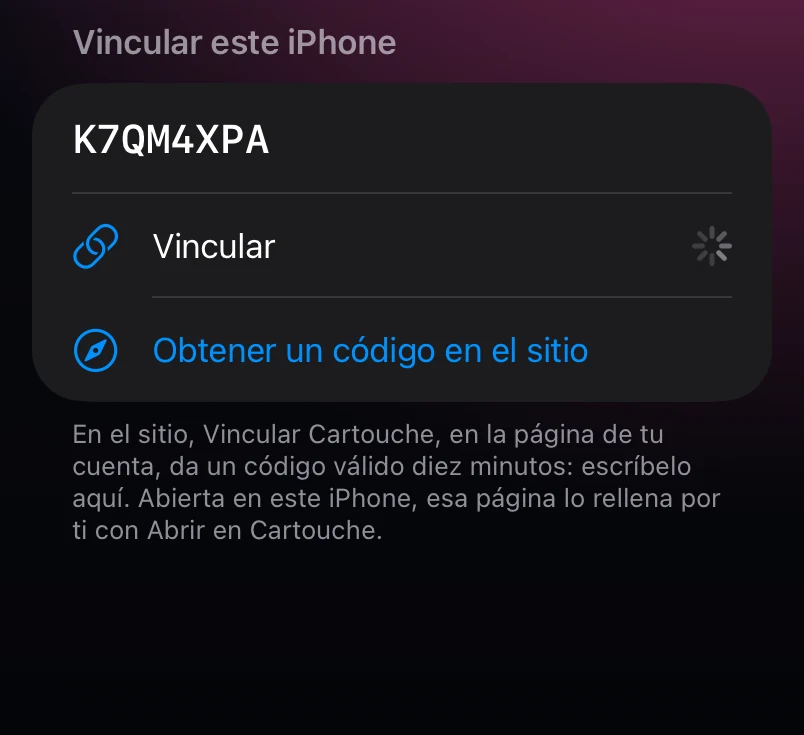
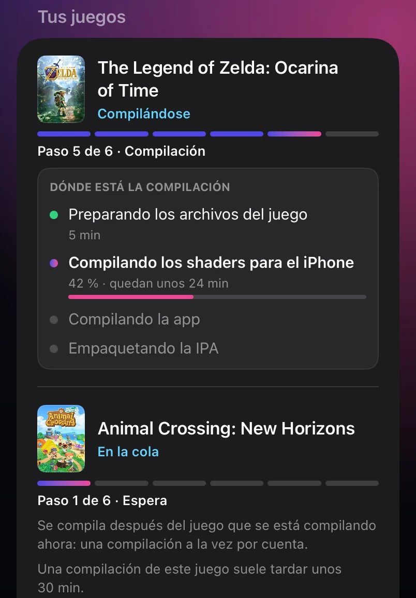
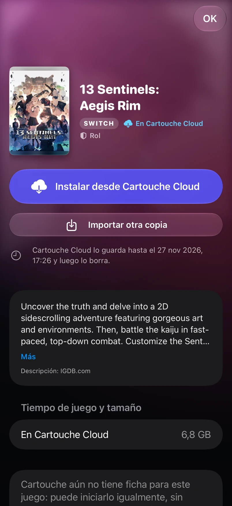

**Sistema › Cartouche Cloud** dice qué es el servicio, y vincula tu iPhone a tu cuenta. **Sin Mac: Cartouche Cloud**, en la guía, abre la misma página.

## Vincular tu iPhone

1. En el sitio de Cartouche Cloud, en la página de tu cuenta, elige **Link Cartouche**: da un código válido durante diez minutos.
2. En Cartouche, escríbelo en **Vincular este iPhone**. Abierta en el iPhone, esa página lo rellena por ti con **Open in Cartouche**, o lo hace su código QR.

Vinculado, tu iPhone lee los juegos de tu cuenta y descarga los compilados, nada más: enviar un juego, tus créditos y tu cuenta se quedan en el sitio.

## Seguir una compilación

Cartouche muestra cada juego de tu cuenta con su portada, dónde está, cada paso de su compilación y el tiempo restante, y tus créditos.

## Instalarlo

Un juego compilado aparece en tu biblioteca y en su ficha, *En Cartouche Cloud*: **Instalar** lo pone en tu iPhone, como un juego de tu carpeta de juegos. Se queda dos días en Cartouche Cloud: instálalo en ese tiempo.

## Desvincular

**Desvincular este iPhone** hace que Cartouche deje de seguir tu cuenta aquí; tu cuenta y sus juegos se quedan en el sitio. Si se desvincula en el sitio, el iPhone lo dice: vuelve a vincularlo con un código nuevo.
