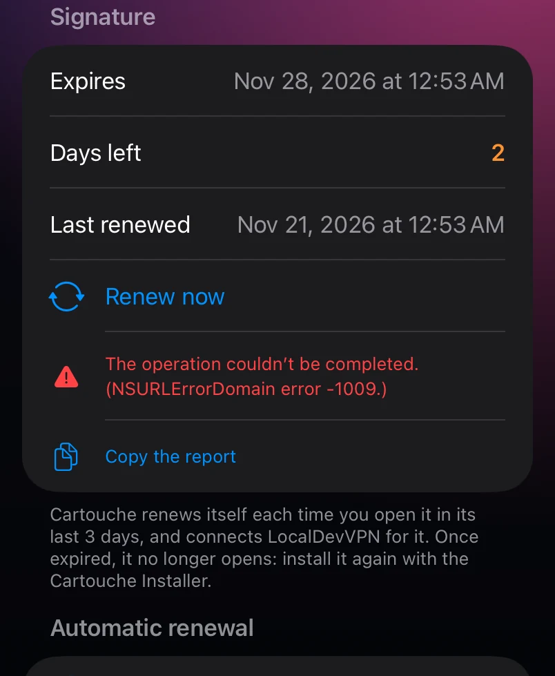
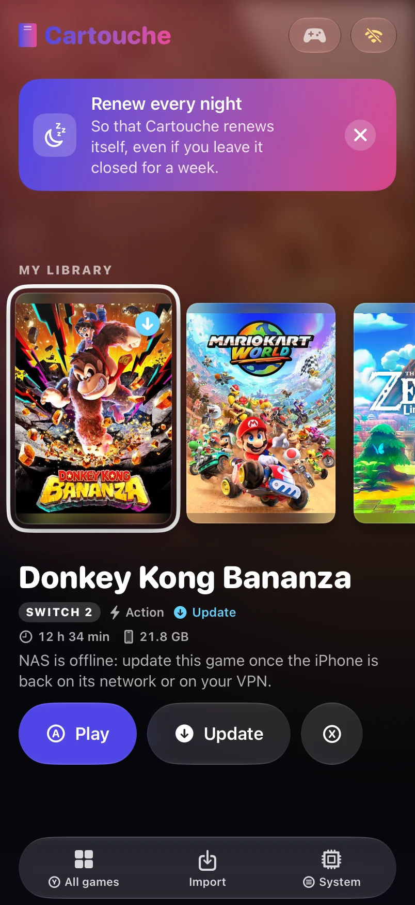

Bajo cada error, Cartouche dice por qué y qué hacer, y **Copiar el informe** da a quien te ayuda lo que necesita. Estos son los casos más comunes.

## Firma y renovación

**Cartouche ya no se abre.** Su firma caducó: una cuenta de Apple gratuita firma apps por siete días, y Cartouche no se abrió en sus 3 últimos días ni se renovó por la noche. Vuelve a instalarlo con el [Instalador de Cartouche](/es/installer/), sobre esta copia, con la misma cuenta de Apple: tus juegos y tus partidas guardadas se quedan. Luego crea la [automatización nocturna](/es/iphone/system/#renovarse-cada-noche).

**La pantalla de inicio dice «El certificado ya no funciona».** iOS ya no lo acepta, quizá tras una instalación desde otro ordenador. Vuelve a iniciar sesión con tu cuenta de Apple: Cartouche toma uno nuevo.

**Apple dice que la sesión caducó.** Cartouche ya no puede renovarse ni actualizarse hasta que vuelvas a iniciar sesión: elige **Volver a iniciar sesión** en la página Sistema, con la misma cuenta de Apple. Tus juegos y tus partidas guardadas se quedan.

**Apple revocó el certificado.** Lo más probable es que otra app u otro ordenador tomara uno nuevo con la misma cuenta de Apple. Cartouche ya no puede renovarse con él: vuelve a instalar Cartouche sobre esta copia con el Instalador de Cartouche, con la misma cuenta de Apple.

**Falta una parte de la app.** Cartouche lo dice cuando inicia sesión, se renueva o se actualiza. Vuelve a instalarlo sobre esta copia con el Instalador de Cartouche, que la restituye.

**Falta el archivo de emparejamiento.** En el Instalador de Cartouche, **Volver a poner el archivo de emparejamiento en Cartouche**.

**La renovación no salió.** Comprueba que LocalDevVPN está instalado y puede conectarse, y luego **Renovar ahora** en la página Sistema, que dice por qué falló.

**La automatización nocturna no se ejecuta.** **Renovar cada noche**, en la página Sistema, dice lo que vio. En Atajos, comprueba que la automatización sigue ahí, activada, en **Ejecutar inmediatamente**, a una hora en la que el iPhone se carga y tiene conexión, y que **Enable LocalDevVPN** va antes de **Refresh All Apps**, la de Cartouche y no la de LiveContainer.

## Juegos

**Un juego no se instala: no hay espacio suficiente.** Cartouche dice cuánto ocupa el juego y cuánto espacio queda libre. Libera espacio y vuelve a instalarlo.

**La IPA está dañada.** Termina antes de tiempo, o un archivo cambió desde que se creó, como cuando una copia se detiene antes del final. Vuelve a copiarla desde donde se compiló.

**El juego se compiló sin los archivos del juego.** Pon su `romfs.img`, tal como lo escribió nxnative, junto a su IPA en tu carpeta de juegos, y luego instala el juego desde allí.

**El juego se cierra al abrirse, en un iPhone 15 o anterior.** nxnative necesita un chip gráfico que lea texturas BC. Cartouche para Mac compila tus juegos con nxnative-nobc para un iPhone así una vez emparejados: mira [Compilar para cada uno de tus iPhone](/es/mac/builder/#compilar-para-cada-uno-de-tus-iphone).

**iOS cerró el juego.** Cerca de su límite de memoria detrás de la consola, el juego se abre entonces en lugar de Cartouche, con toda la memoria de Cartouche. La ficha del juego dice si cabe en tu iPhone. Si no, tu progreso se conserva hasta su último guardado.

**El juego no está firmado.** Vuelve a firmarlo abriéndolo una vez más; si sigue fallando, vuelve a instalarlo desde su IPA.

## Almacenamiento

**Un lugar está sin conexión.** No responde desde donde está el iPhone. En casa, comprueba su dirección y que el iPhone está en tu Wi-Fi o tu VPN. Fuera, activa Tailscale. Tus juegos funcionan como siempre, y tus partidas guardadas esperan.

**Tailscale está desactivado.** LocalDevVPN lo desactivó, ya que iOS mantiene una sola VPN a la vez: abre Tailscale para volver a activarlo, o añade su acción **Connect** a la automatización nocturna.

**Google Drive pide volver a iniciar sesión.** Mientras tu proyecto de Google Cloud está en pruebas, Google cierra la sesión tras 7 días: **Volver a iniciar sesión en Google** en la página Almacenamiento.

**Cartouche no encuentra tu Mac.** En el Mac, abre Cartouche, con **Compartir con Cartouche en el iPhone** activado. En el iPhone, permite Cartouche en **Ajustes › Privacidad y seguridad › Red local**. Usa la misma Wi-Fi, o conecta el iPhone al Mac.

## Cartouche para Mac

**macOS no puede comprobar la app.** Solo la primera vez: **Ajustes del Sistema › Privacidad y seguridad**, y luego **Abrir igualmente** junto a Cartouche.

**Una compilación falla.** El error bajo el juego en **Compilaciones** dice qué hacer: liberar espacio en un disco lleno, volver a copiar desde tu consola archivos del juego dañados, o actualizar Xcode desde **Herramientas de este Mac**. Un juego cuya compilación falló se vuelve a probar cuando cambian nxnative o sus archivos; **Compilar de nuevo** lo prueba ahora.

## ¿Sigues atascado?

Mira [Obtener ayuda](/es/help/support/).
