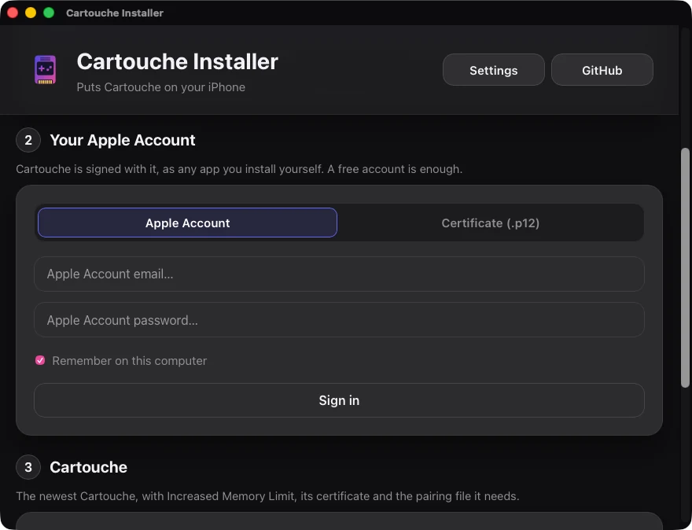

El Instalador de Cartouche pone Cartouche en un iPhone o un iPad desde un Mac o un PC con Windows, la única vez que hace falta un ordenador. Su ventana tiene tres pasos.

| Ordenador | Descarga | Primera apertura |
| --- | --- | --- |
| Mac, Apple silicon o Intel, macOS 11 o posterior | [Para Mac](https://cartouche.cloud/download/#installer-mac) | macOS no puede comprobarlo: en **Ajustes del Sistema › Privacidad y seguridad**, haz clic en **Abrir igualmente** junto a Cartouche Installer, una vez. |
| Windows 10 u 11 | [Para Windows](https://cartouche.cloud/download/#installer-windows) | SmartScreen puede detener la instalación: **Más información › Ejecutar de todas formas**. Se instala para tu cuenta, sin derechos de administrador. Instala también **Dispositivos Apple** desde Microsoft Store. |

## Los tres pasos

1. **Tu iPhone:** conéctalo al ordenador con un cable y desbloquéalo. La primera vez, toca **Confiar** en el iPhone y escribe su código.
2. **Tu cuenta de Apple:** inicia sesión, basta con una cuenta gratuita, con el código de doble factor que envía Apple. **Recordar en este ordenador** guarda la contraseña en el llavero del ordenador.
3. **Cartouche:** **Instalar Cartouche** descarga la versión más reciente de Cartouche desde sus versiones publicadas, la comprueba, la firma con la memoria ampliada y la instala, con su certificado y el archivo de emparejamiento que necesita.

Cuando termina, el Instalador dice qué hacer en el iPhone la primera vez: confiar en tu cuenta de Apple en **Ajustes › General › VPN y gestión de dispositivos**, y activar el **Modo de desarrollador** si iOS lo pide. Luego abre Cartouche: mira [Instalar Cartouche](/es/start/install/#4-la-puesta-a-punto-de-cartouche).

## Volver a instalar, o actualizar

Volver a instalar sobre Cartouche conserva sus juegos y sus partidas guardadas, y lo lleva a la versión más reciente. Hazlo cuando:

- la firma de Cartouche caducó, tras una semana sin abrirlo;
- Apple revocó el certificado con el que está firmado Cartouche, como dice entonces la página Sistema;
- falta una parte de la app, como dice Cartouche cuando inicia sesión, se renueva o se actualiza.

Usa la misma cuenta de Apple que antes.

## El archivo de emparejamiento

El archivo de emparejamiento permite a Cartouche instalar y renovar apps en el iPhone sin ordenador. El Instalador lo pone en Cartouche al instalarlo. Después de borrar el iPhone, o de eliminar su emparejamiento, **Volver a poner el archivo de emparejamiento en Cartouche** lo restituye, sin volver a instalar Cartouche.

## Ajustes

**Ajustes** contiene el idioma del Instalador (español, inglés, francés o alemán), los certificados y los App IDs de tu cuenta, los registros y el emparejamiento guardado para el iPhone seleccionado.

:::caution[Demasiados certificados]
Una cuenta de Apple gratuita tiene un número limitado de certificados de desarrollo. Cuando los tiene todos, el Instalador ofrece revocarlos y crear uno nuevo: las apps firmadas con ellos dejan de abrirse hasta que se vuelven a instalar.
:::

:::note[Tres apps]
Una cuenta de Apple gratuita puede tener 3 apps propias instaladas a la vez, caducadas incluidas. Tus juegos funcionan dentro de Cartouche y no cuentan.
:::

El Instalador no instala nada más que Cartouche, y nunca descarga nada más que las versiones publicadas de Cartouche.
