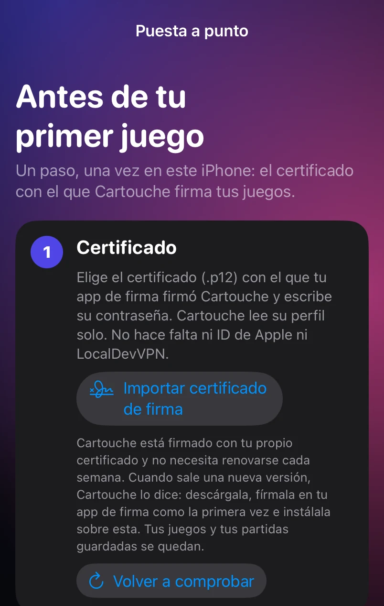

Firmar con tu cuenta de Apple sigue siendo lo predeterminado. Si ya tienes un certificado de firma (.p12) y su perfil de aprovisionamiento, el Instalador de Cartouche puede firmar Cartouche con ellos: sin cuenta de Apple, sin LocalDevVPN y sin renovación semanal.

Cartouche no recomienda vendedores de certificados, apps de firma ni servicios de firma.

## Instalar con tu certificado

1. En el Instalador de Cartouche, selecciona tu iPhone.
2. Arriba en el paso de la cuenta de Apple, elige **Certificado (.p12)**.
3. Elige tu certificado (.p12), escribe su contraseña (déjala vacía si no tiene) y elige su perfil (`.mobileprovision`).
4. Instala Cartouche. La firma se hace en el ordenador; el Instalador no inicia sesión en ninguna cuenta de Apple.
5. Abre Cartouche: toma tu certificado solo. Si iOS te pide confiar en el desarrollador o activar el Modo de desarrollador, hazlo en Ajustes.

## Lo que debe permitir el perfil

- **La memoria ampliada.** Sin ella, Cartouche y tus juegos tienen demasiado poca memoria para la mayoría de los juegos. El Instalador te avisa cuando el perfil no la tiene: la firma no puede añadirla.
- **Los grupos de llavero de los juegos.** Un perfil comodín con el permiso de llavero `*` de tu equipo los cubre.
- **El App ID de Cartouche**, o uno comodín que lo cubra.

## Lo que cambia

- Los juegos se abren en lugar de Cartouche: mantener la consola detrás de un juego necesita las extensiones de la app que un solo perfil no puede firmar.
- Cartouche dice cuándo sale una nueva versión. Instálala desde el Instalador con tu certificado, como la primera vez: tus juegos, sus partidas guardadas y tu certificado se quedan.
- Un certificado que caduca o se revoca se sustituye igual: vuelve a instalar Cartouche con el nuevo.

Para volver a tu cuenta de Apple, vuelve a instalar Cartouche con la opción **Cuenta de Apple** del Instalador.
