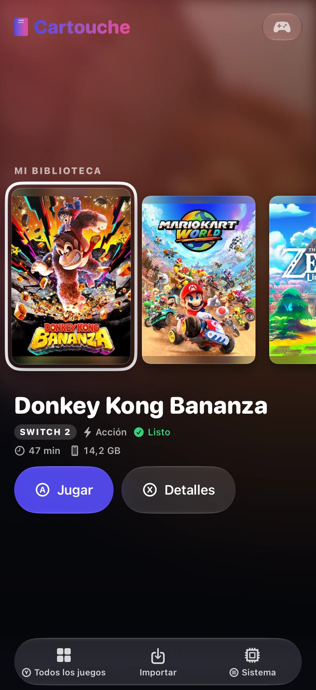
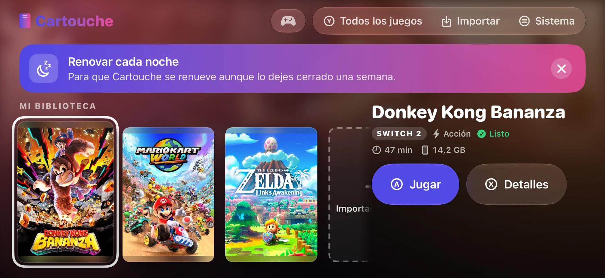
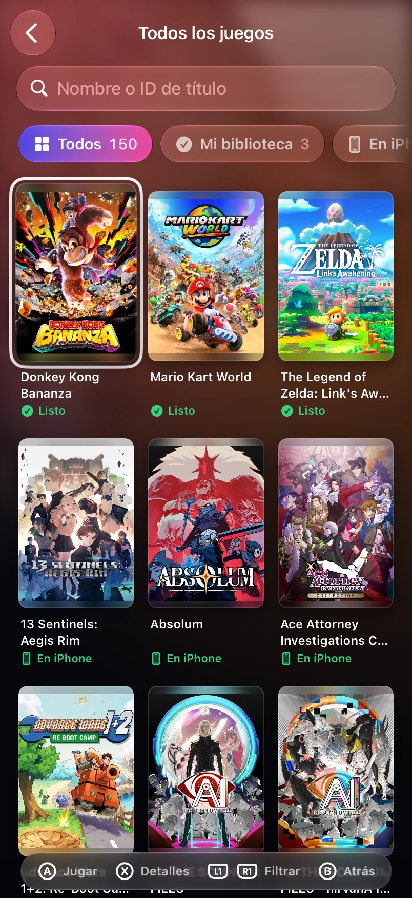

Cartouche se abre en su consola: tus juegos, en grande, en una sola estantería, con sus portadas oficiales. El juego seleccionado muestra todo lo que necesitas para jugarlo, y el resto de Cartouche está a un paso.

## La pantalla de inicio

- **Mi biblioteca:** tus juegos, instalados o en tu carpeta de juegos, y luego **Importar** y **Todos los juegos**. Cuando unos están instalados y otros no, el menú junto a su título los muestra todos, solo los **Instalados**, o solo los que están **Sin instalar**, aún en tu Mac, en tu carpeta de juegos o en Cartouche Cloud. Cartouche guarda tu elección; <kbd>L</kbd> y <kbd>R</kbd> la cambian con un mando.
- **El juego seleccionado:** su nombre, su plataforma, su género y su estado en este iPhone, el tiempo que lo has jugado y el espacio que ocupa. **Jugar** lo abre, **Detalles** abre su [ficha](/es/iphone/game-sheet/). Cuando tu carpeta de juegos tiene una compilación más reciente, **Actualizar** la instala, conservando las partidas guardadas.
- **El dock:** **Todos los juegos**, **Importar** y **Sistema**. Está abajo cuando el iPhone está en vertical, y en la barra superior cuando está en horizontal.
- **La barra superior:** un mando cuando hay uno conectado y, en los tres últimos días de la firma de Cartouche, los días que quedan.

Una línea bajo el estado del juego dice lo que queda por hacer, como una puesta a punto por terminar, y desaparece cuando el juego está listo para jugar.

## Todos los juegos

**Todos los juegos** lista cada juego que tiene un perfil en nxnative, los tuyos primero, cada uno con su estado bajo su portada. Busca por nombre o por ID de título, y filtra por **Todos**, **Mi biblioteca**, **En iPhone**, **En Mac**, **En puesta en marcha** o por plataforma.

Un juego que no tienes solo muestra **Importar mi copia**: Cartouche nunca ofrece una descarga. Un juego de tu carpeta de juegos que aún no está instalado muestra **Instalar desde** ese lugar.

| Estado | Lo que significa |
| --- | --- |
| **Listo** | Tu juego, instalado, sin nada que lo impida. |
| **En el almacenamiento** | Su IPA está en tu carpeta de juegos: instálalo para jugar. |
| **Actualizar** | Una IPA más reciente está en tu carpeta de juegos: actualizar conserva tus partidas guardadas. |
| **Funciona en este iPhone** | Los resultados de otros jugadores en tu modelo dicen que es jugable. |
| **Aún sin probar en este iPhone** | Todavía no hay resultados en tu modelo. |
| **No recomendado en este iPhone** | Necesita más memoria de la que Cartouche tiene aquí, o los jugadores vieron que no funciona. |
| **No compatible con este iPhone** | Le falta la versión de iOS o el chip gráfico. |

## Pantalla táctil y mando

La pantalla táctil y un mando manejan cada pantalla, y cada botón muestra el botón del mando que le corresponde.

| | Táctil | Mando |
| --- | --- | --- |
| Mover la selección | Toca una portada | Cruceta o joystick |
| Jugar, o la acción principal | **Jugar** | <kbd>A</kbd> |
| La ficha de un juego | Toca el juego seleccionado, o **Detalles** | <kbd>X</kbd> |
| Todos los juegos | **Todos los juegos** | <kbd>Y</kbd> |
| Cambiar el filtro | Toca un filtro | <kbd>L</kbd> <kbd>R</kbd> |
| Sistema | **Sistema** | <kbd>Menu</kbd> |
| Atrás, o cerrar una página | **OK** | <kbd>B</kbd> |

Una pulsación larga en uno de tus juegos ofrece **Jugar**, **Detalles**, **Desinstalar**, y **Actualizar desde** tu carpeta de juegos cuando tiene una compilación más reciente.

## Importar mi copia

**Importar** abre Archivos: elige la IPA de un juego que compilaste a partir de tu propia copia, en tu iPhone, iCloud Drive, una unidad USB-C o una carpeta de red. Cartouche la lee donde está, la instala con una barra de progreso y luego abre su ficha. Una IPA que nxnative compiló sin los archivos del juego se instala con el `romfs.img` que tiene al lado.

Una IPA que no es un juego de nxnative va a **Sistema › Otras apps instaladas**: la consola solo muestra juegos.

:::note
Cartouche lista lo que puede ejecutar, nunca dónde conseguir un juego. Los únicos juegos que descarga son los que [Cartouche Cloud](/es/cloud/) compiló para ti, a partir de la copia que le enviaste.
:::
