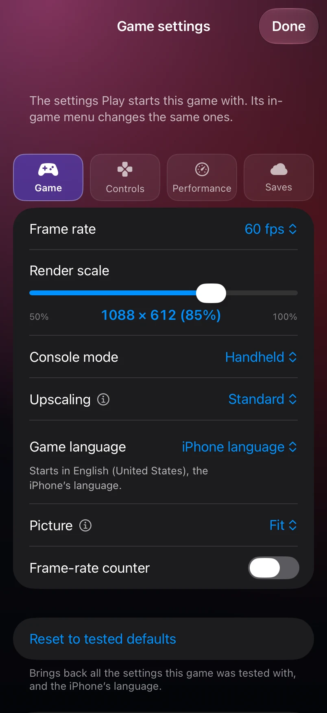
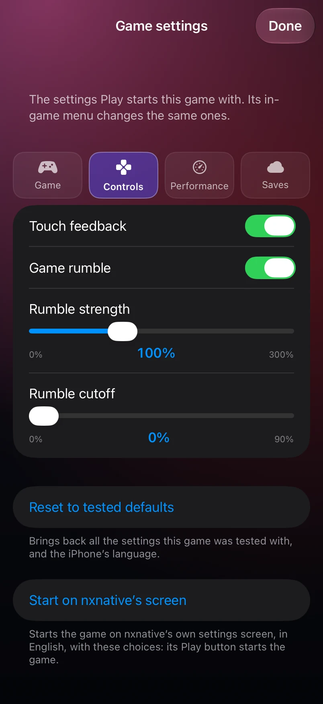

**Ajustes del juego**, en la ficha de un juego, guarda los ajustes con los que **Jugar** abre el juego: los que muestra la propia pantalla de nxnative antes de un juego, en una página de Cartouche, en tu idioma. El menú del juego cambia los mismos.

## Secciones

Los ajustes vienen en secciones, **Juego**, **Rendimiento**, **Controles** y **Partidas guardadas**, una a la vez: toca una sección, o pulsa <kbd>L</kbd> y <kbd>R</kbd> en un mando. Lo que ofrece un juego depende del juego; los más comunes son:

- **Fotogramas por segundo** y **Escala de renderizado**, con el tamaño en píxeles que da la escala.
- **Modo de la consola:** **Portátil** o **En la base**.
- **Imagen:** **Ajustar** o **Rellenar** la pantalla.
- **Reescalado**, **Resolución dinámica**, **Contador de fotogramas** e **Indicadores de rendimiento**.
- **Vibración del juego** y **Respuesta táctil**.
- **Idioma del juego** ([más abajo](#idioma-del-juego)).

La **ⓘ** junto a un ajuste dice lo que hace. Un ajuste que fijan los archivos de un juego aparece en gris.

**Volver a los ajustes probados** recupera todos los ajustes con los que se probó el juego, y el idioma del iPhone.

## Idioma del juego

Un juego habla el idioma de tu iPhone cuando lo tiene. Antes de cada inicio, Cartouche elige el primero de los idiomas de tu iPhone, en el orden de **Ajustes › General › Idioma y región**, que ofrece el juego. **Idioma del iPhone**, la primera opción del ajuste, dice cuál es.

Un idioma que eliges se queda como el del juego hasta que vuelvas a elegir **Idioma del iPhone**, o **Volver a los ajustes probados**.

## Partidas en la nube

Las partidas en la nube propias de nxnative, a través de una carpeta de iCloud Drive, están en la sección **Partidas guardadas**. Cartouche mantiene tus partidas guardadas al día por su cuenta, con la carpeta de partidas guardadas de tu [almacenamiento](/es/iphone/saves/): solo necesitas una de las dos.

## La propia pantalla de nxnative

**Iniciar en la pantalla de nxnative** abre el juego una vez en la pantalla de ajustes de nxnative, en inglés, con estas opciones: su botón **Play** abre entonces el juego.
