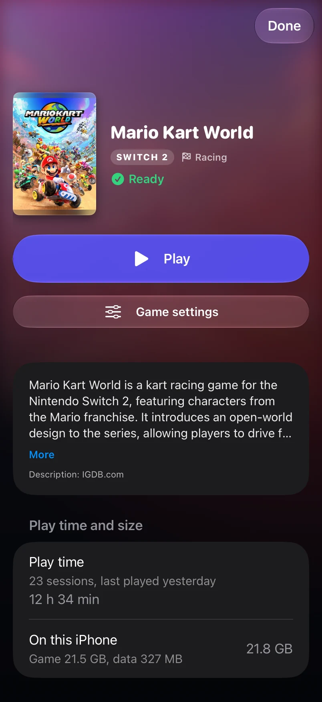
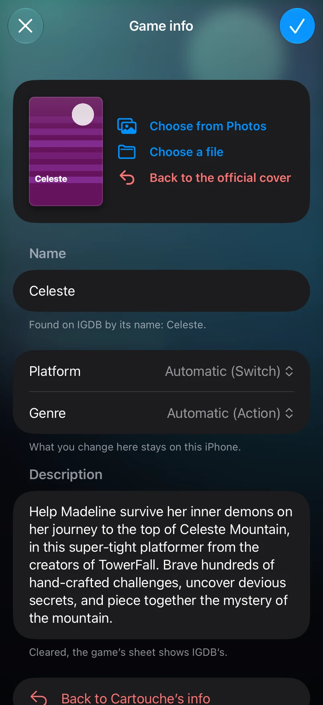
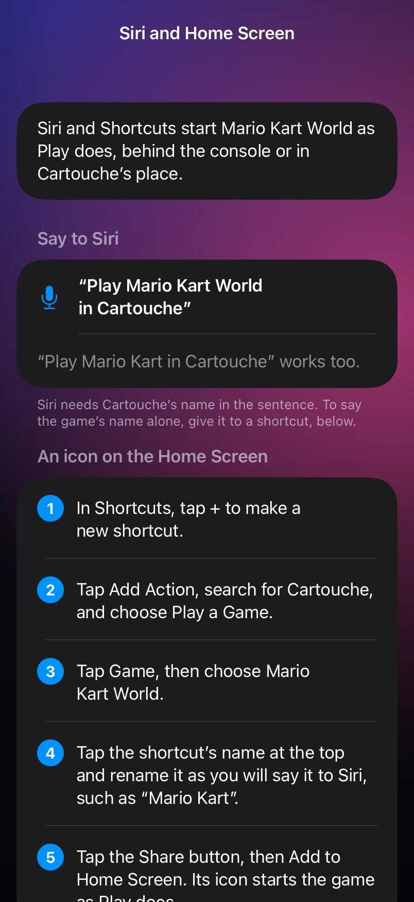
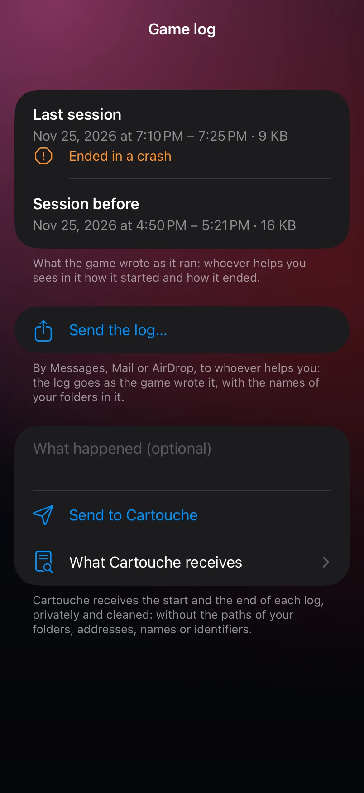

Cada juego tiene una ficha: **Detalles** en la pantalla de inicio, o <kbd>X</kbd> en un mando. Dice si el juego funciona en tu iPhone o iPad, y reúne todo lo que puedes hacer con él.

## Arriba

- **Jugar** y **Ajustes del juego** para tu propio juego; **Reanudar**, **Ajustes del juego** y **Salir** mientras está [en pausa detrás de la consola](/es/iphone/playing/).
- **Instalar desde** tu carpeta de juegos, para un juego que está allí y aún no está instalado, o **Importar mi copia** para un juego que no tienes.
- **Actualizar desde** tu carpeta de juegos cuando tiene una compilación más reciente, con la compilación instalada y la más reciente.

## Lo que te dice

- **La descripción**, la tuya o la de IGDB. El iPhone la traduce al idioma de Cartouche, con **Ver el original** al lado.
- **Tiempo de juego y tamaño:** cuánto has jugado, cuántas veces y cuándo por última vez; el espacio que ocupan el juego y sus datos en este iPhone, y el tamaño de su IPA en tu carpeta de juegos.
- **Lo que necesita el juego** frente a lo que tiene este iPhone: la memoria, la versión de iOS y el chip gráfico. Cuando todo está, se resume en una línea, *Este iPhone tiene lo que necesita*.
- **Resultados de los testers**, los de tu modelo primero: cómo funciona el juego en él, según lo que midieron otros jugadores. Sus notas también se traducen.
- **Detalles técnicos:** los ajustes recomendados, lo que nxnative dice del juego y la compilación instalada.

En un iPhone cuyo chip gráfico no lee texturas BC (iPhone 15 y anteriores), la ficha dice que el juego se detiene antes de su primera imagen, salvo que su compilación las convierta, como hacen los juegos compilados con nxnative-nobc: entonces dice *Texturas convertidas para esta GPU por la compilación de este juego*.

## Lo que puedes hacer

- **[Ajustes del juego](/es/iphone/game-settings/):** fotogramas por segundo, escala de renderizado, portátil o en la base, idioma del juego, y más.
- **[Partidas guardadas](/es/iphone/saves/):** dónde se guardan, restaurar una copia anterior o traer una partida de tu consola.
- **Editar la información del juego:** da a tu juego un nombre, una plataforma, un género, una descripción y una portada propios, desde Fotos o Archivos. Se quedan en este iPhone. **Volver a la información de Cartouche** los deshace. Un juego fuera de la lista de nxnative, compilado con una bifurcación por ejemplo, encuentra su portada y su género en IGDB por su nombre.
- **Siri y pantalla de inicio:** qué decirle a Siri, *«Juega a Stardew Valley en Cartouche»*, y cómo dar al juego su propio icono en la pantalla de inicio con la acción de Atajos **Jugar a un juego**.
- **Compartir el registro:** el registro del juego, para quien te ayuda, por Mensajes, Mail o AirDrop, o **Enviar a Cartouche**, que primero quita tus rutas, direcciones y nombres. Ves lo que se envía antes de que se envíe.
- **Compilaciones en** tu Mac: con un Mac emparejado, cómo va allí la compilación del juego, y un botón para compilarlo o detenerlo. Mira [Tu iPhone y tu Mac](/es/mac/iphone/).
- **Copiar a** tu carpeta de juegos, y **Desinstalar**, que pregunta si sus partidas guardadas se quedan.

## Juegos fuera de la lista de nxnative

Un juego para el que Cartouche no tiene ficha se muestra igualmente, como *Aún sin ficha*, y se abre: Cartouche simplemente no puede comprobar lo que necesita. Su portada viene de IGDB por su ID de título o su nombre.
