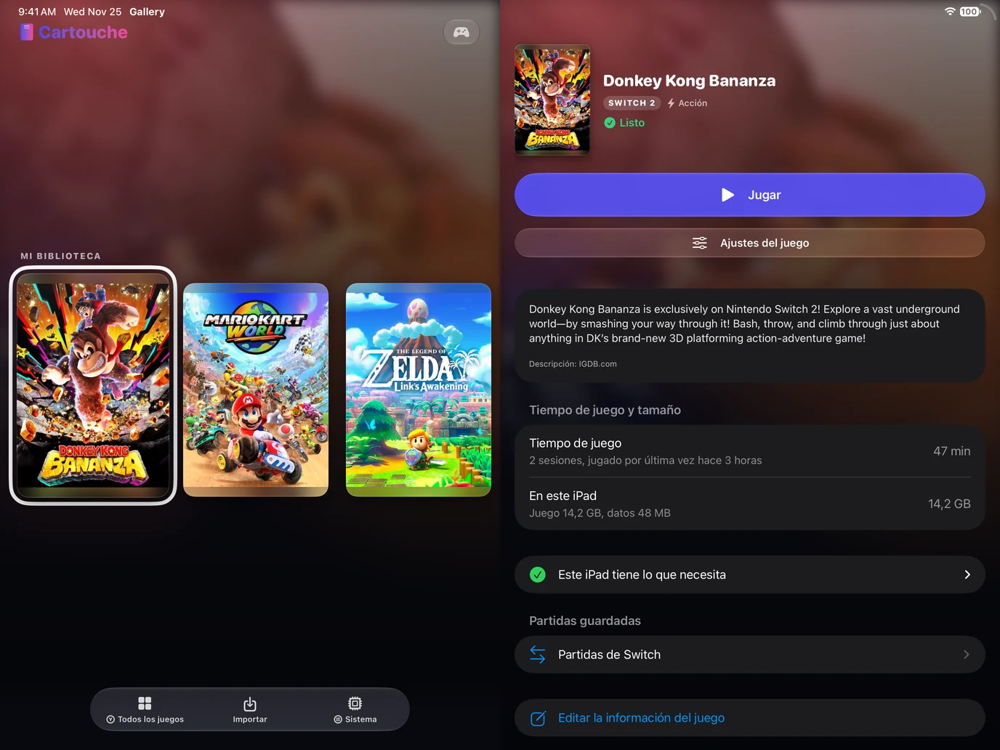
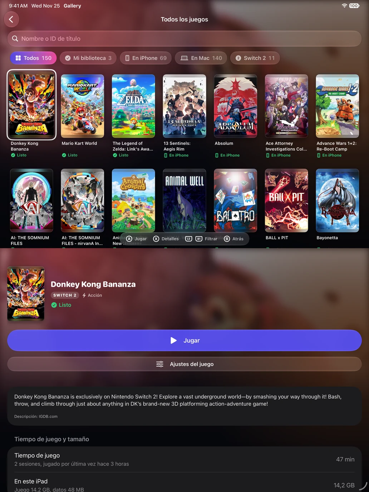

Cartouche es la misma app en iPhone y en iPad, se instala de la misma manera y dice «iPad» donde habla de tu dispositivo. Funciona en un iPad con chip M1 o posterior, con iPadOS 26 o posterior.

- **En horizontal**, la consola y la ficha del juego están una al lado de la otra.
- **Los juegos se juegan en horizontal:** pon tu iPad en horizontal para jugar. Un juego hecho para jugarse en horizontal se queda en horizontal.
- **Todo lo demás** funciona como en el iPhone: [almacenamiento](/es/iphone/storage/), [partidas guardadas](/es/iphone/saves/), tu [Mac](/es/mac/iphone/), [Cartouche Cloud](/es/cloud/) y la [página Sistema](/es/iphone/system/).

Tus partidas guardadas te siguen de tu iPhone a tu iPad y de vuelta, a través de tu carpeta de partidas guardadas: gana la más reciente.
