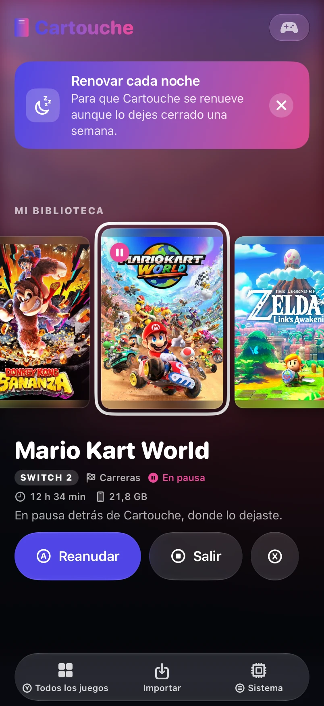
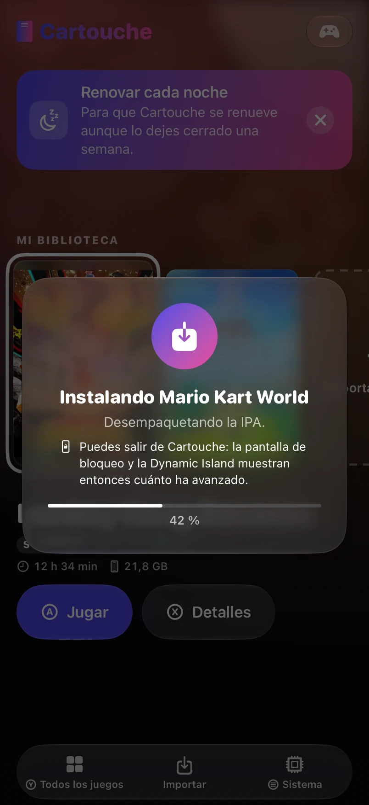

## El juego espera detrás de la consola

**Jugar** abre el juego a pantalla completa, con el modo Juego activado: lo máximo del procesador y del chip gráfico del iPhone, y tus mandos con la menor latencia.

El botón de **inicio**, abajo en la pantalla del juego o en el mando, vuelve a la consola sin cerrar el juego. El juego se queda en pausa donde lo dejaste:

- **Reanudar**, o de nuevo el botón de inicio del mando, vuelve a él;
- **Salir** lo cierra, una vez que lo confirmas: se pierde lo jugado desde la última vez que el juego guardó;
- **Jugar** en otro juego pregunta antes, ya que solo funciona un juego a la vez.

El botón de inicio en pantalla se oculta tras unos segundos: toca justo debajo de donde estaba para que vuelva.

## Si el mando se desconecta

Cuando el último mando se desconecta durante una partida, porque se le acabó la batería o se cortó su Bluetooth, el juego se pone en pausa 3 segundos después y vuelve la consola, que dice que el mando se desconectó. Vuelve a conectarlo y el juego vuelve solo. **Reanudar** vuelve al juego sin mando, con los controles táctiles.

- Un juego al que juegas solo en la pantalla, sin mando, nunca se pone en pausa por él.
- Un mando que vuelve en esos 3 segundos no pone nada en pausa.
- **Sistema › Mientras funciona un juego › Pausar si el mando se desconecta** lo desactiva.
- Un juego que se abre en lugar de Cartouche aún no se pone en pausa por su mando.

## Un juego que necesita más memoria

Un juego que necesita más memoria de la que tiene detrás de la consola se abre en lugar de Cartouche, con toda la memoria de Cartouche: la consola se cierra mientras funciona y vuelve a abrirse cuando el juego termina. La ficha del juego lo dice, con **Volver a probar detrás de Cartouche**.

Si iOS cierra un juego cerca de su límite de memoria detrás de la consola, Cartouche lo dice, y desde entonces el juego se abre en lugar de Cartouche. **Sistema › Mientras funciona un juego › Mantener Cartouche abierto detrás del juego** desactiva la consola detrás del juego para todos los juegos.

## En una tele

Conecta el iPhone a una tele con un cable, o duplica su pantalla con AirPlay en un Apple TV o una tele con AirPlay. La tele muestra solo el juego, como una consola en su base, y los controles se quedan en el iPhone. Con la tele, el juego se queda en horizontal.

No hay versión para Apple TV: el iPhone ejecuta el juego y lo envía a la tele.

## Tu música o tu pódcast

Un juego detiene al iniciarse la música o el pódcast de otra app. Para que sigan sonando bajo el sonido del juego, activa **Sistema › Mientras funciona un juego › Mantener el sonido de otras apps**: se aplica desde el próximo inicio del juego. El juego sigue sonando en modo silencio, como antes; una llamada o Siri interrumpe ambos, como el sonido de cualquier app.

## En vertical o en horizontal

Sostén el iPhone en vertical, y un juego compilado con un nxnative reciente gira con él, con la imagen encima de los controles. Un juego compilado antes se queda en horizontal. En un iPad, ponlo en horizontal para jugar.

## Siri y la pantalla de inicio

Di *«Juega a Stardew Valley en Cartouche»* a Siri, o usa **Jugar a un juego**, la acción de Cartouche en Atajos: el juego se abre como lo abre **Jugar**. Un atajo de ella añadido a la pantalla de inicio da al juego su propio icono. La ficha de cada juego muestra cómo, en **Siri y pantalla de inicio**.

## Instalar y actualizar un juego

Un juego de tu carpeta de juegos se instala desde su ficha o desde la pantalla de inicio, con **Instalar desde** ese lugar. La pantalla dice cómo llega, por cable, a través de Tailscale o por Wi-Fi, y a qué velocidad, con un consejo cuando podría ir más rápido.

- Mientras tanto puedes salir de Cartouche: la pantalla bloqueada y la Dynamic Island muestran cuánto lleva, en una Actividad en vivo.
- Una conexión cortada sigue donde se paró en cuanto vuelve la red.
- Una compilación más reciente de un juego en tu carpeta de juegos aparece como **Actualizar**: actualizar conserva tus partidas guardadas.
- Un juego compilado sin los archivos del juego se instala con el `romfs.img` que hay junto a su IPA en la carpeta de juegos.

Cuando algo detiene una instalación o un inicio, Cartouche dice por qué y qué hacer, y **Copiar el informe** bajo el error da a quien te ayuda lo que necesita. Mira [Solución de problemas](/es/help/troubleshooting/).
