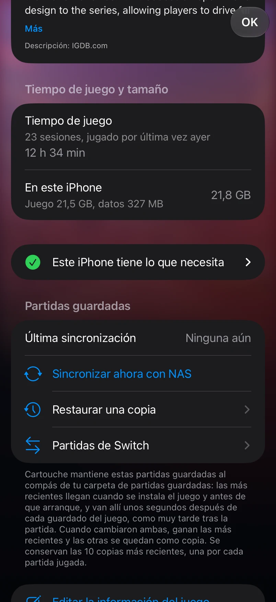
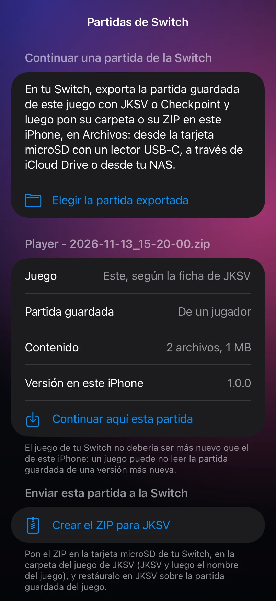

Con una carpeta de partidas guardadas elegida en **Sistema › Almacenamiento**, Cartouche mantiene al día con ella las partidas de cada juego, una carpeta por juego. Tus partidas te siguen de un iPhone o iPad a otro, y a tu Mac, a través de tu Mac o tu NAS.

## Cómo se mantienen al día

- **Se van** unos segundos después de cada guardado del juego, mientras juegas, y como muy tarde después del juego.
- **Vienen** cuando instalas el juego y antes de jugar, como después de volver a instalar Cartouche, o después de que otro iPhone o tu Mac lo jugara.
- **Gana la más reciente.** Cuando ambos lados cambiaron, ganan las partidas escritas en último lugar, y las otras se quedan en la carpeta como copia propia.
- **Diez copias** de cada juego se conservan, la más reciente primero.
- **Cada copia indica la versión del juego** que la escribió: una versión más antigua del juego nunca la toma, y la ficha dice que la copia llegará cuando el juego se actualice.
- **Todos los perfiles van con ellas.** Las partidas de los otros jugadores del juego, sus perfiles 2 a 8, se van y llegan con las suyas, cada una con el espacio que el juego le hizo.
- **Los shaders ya preparados vuelven.** La lista de lo que el juego preparó mientras jugabas se va junto a sus copias, con lo que prepararon tus otros iPhone, iPad y Mac: un juego instalado de nuevo, o en otro dispositivo, los prepara antes de empezar, y da menos tirones en sus primeras partidas. No hace ninguna copia por sí sola.

Una carpeta de partidas guardadas que no responde, un NAS mientras estás fuera, deja tus partidas en espera: Cartouche las copia en cuanto vuelve a responder.

## En la ficha de un juego

**Partidas guardadas**, en la ficha, dice cuándo se sincronizaron por última vez y qué hizo la última sincronización.

- **Sincronizar ahora con** tu carpeta, cuando el juego no está funcionando.
- **Restaurar una copia:** elige una de las copias del juego, la más reciente primero. Cartouche envía antes las partidas actuales a tu carpeta, para que puedas volver a ellas.

## Volver al inicio de una partida

Cada vez que un juego arranca, guarda en tu iPhone una copia de las partidas guardadas con las que empieza, hasta diez, con o sin carpeta de partidas guardadas. Si un mod o una partida salió mal, abre **Restaurar una copia** en la ficha del juego: en **En este iPhone**, las copias marcadas **Al empezar una partida** te llevan de vuelta allí.

Cartouche conserva antes en tu iPhone las partidas que sustituyen, en **Antes de restaurar una copia**, y, con una carpeta de partidas guardadas, las envía allí, y luego la copia restaurada, como la más reciente.

## Una partida de tu consola

Tu partida sigue aquí, desde donde la dejaste en tu consola:

1. En tu consola, exporta la partida guardada del juego con JKSV o Checkpoint.
2. Pon su carpeta o su ZIP en este iPhone, en Archivos.
3. En la ficha del juego, abre **Partidas guardadas**, luego **Partidas de Switch**, y **Elegir la partida exportada**.
4. **Continuar aquí esta partida.** Cartouche comprueba que la partida es de este juego, conserva la que sustituye y, con una carpeta de partidas guardadas, la envía allí como la más reciente.

**Restaurar la partida de antes de la importación** lo deshace.

En el otro sentido, **Crear el ZIP para JKSV** convierte la partida del juego en un ZIP: ponlo en la tarjeta microSD de tu consola, en la carpeta de JKSV del juego, y restáuralo en JKSV. En los dos sentidos, solo pasa la partida del primer perfil: los otros perfiles se quedan como están. Una partida de JKSV conserva el espacio que tenía en tu consola.

:::caution
El juego de tu consola no debería ser más reciente que el de tu iPhone: un juego puede no leer la partida de una versión más reciente.
:::

## En el Mac

Cartouche para Mac mantiene al día las partidas de los juegos jugados en el Mac con la misma carpeta, con las mismas reglas. Mira [La consola en el Mac](/es/mac/console/#tus-partidas-guardadas-en-el-mac).
