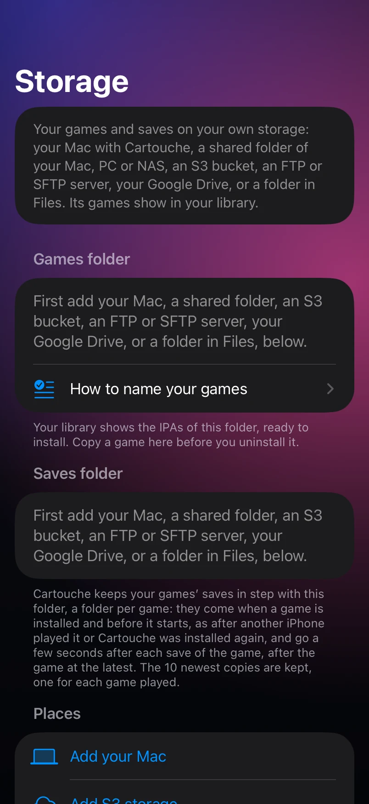
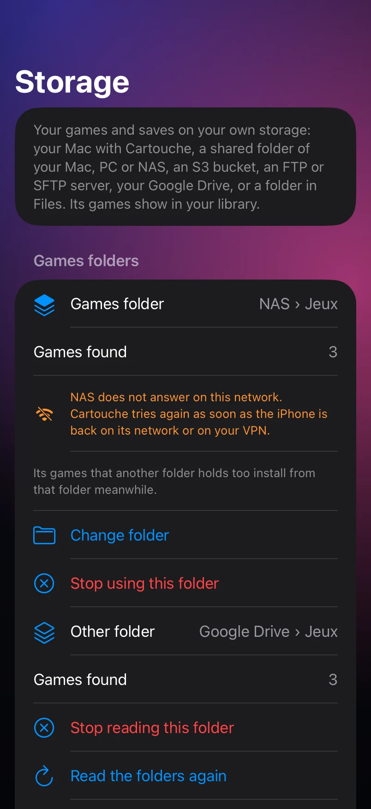
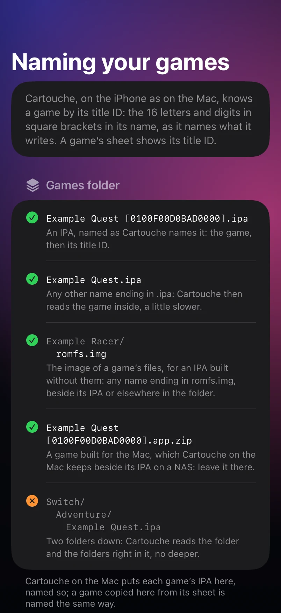
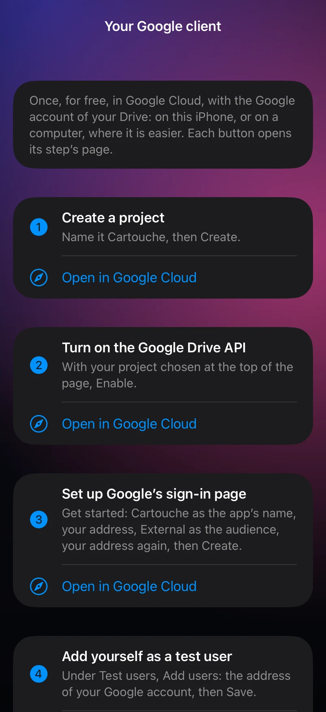

Tus juegos y tus partidas guardadas se quedan en casa, en tu propio almacenamiento, con tu propia cuenta. **Sistema › Almacenamiento** lo configura: los juegos que hay allí aparecen en tu biblioteca, listos para instalar, y Cartouche mantiene allí tus partidas guardadas al día, de un iPhone o iPad a otro.

No hay dirección que pegar para una descarga, ni enlace que seguir, ni bucket público: solo tus propios lugares, con tu propia cuenta. Las contraseñas se quedan en el llavero del iPhone.

## Lugares

| Lugar | Cómo llega Cartouche a él |
| --- | --- |
| **Tu Mac** | A través de [Cartouche para Mac](/es/mac/iphone/), en tu Wi-Fi o por cable: emparejado una vez con seis cifras que aparecen en ambas pantallas, y luego todo va cifrado. |
| **Carpeta compartida (SMB)** | SMB 2 o 3, en tu Mac, PC o NAS, con tu cuenta allí, o como invitado. Los servidores de tu red aparecen solos. |
| **Bucket S3** | Un bucket privado tuyo, en Amazon S3 o en un servidor propio como MinIO, con una clave de acceso de tu cuenta. Cada petición se firma con tus claves. |
| **Servidor FTP o SFTP** | El de tu NAS o tu Mac, con tu cuenta. Por SFTP, Cartouche guarda la clave del servidor y rechaza cualquier otra. FTP envía la contraseña sin cifrar: resérvalo para tu propia red. |
| **Google Drive** | Tu Mi unidad, a través de un cliente de Google propio, creado una vez y gratis ([más abajo](#google-drive)). Cartouche no lleva ninguna clave de Google. |
| **Carpeta en Archivos** | Cualquier carpeta a la que llegue la app Archivos. |

La primera vez, iOS pide permitir que Cartouche busque dispositivos en tu red local: permítelo, o Cartouche no podrá ver tu Mac ni tu NAS.

## Carpeta de juegos

Elige la carpeta que contiene las IPA de tus juegos. Tu biblioteca muestra entonces cada una, lista para instalar, y una compilación más reciente de un juego instalado aparece como actualización, conservando las partidas guardadas.

- **Añadir otra carpeta de juegos**, en cualquiera de tus lugares: un juego que está en varias carpetas aparece una sola vez, y se instala desde una carpeta que responde, en casa o fuera.
- **Copiar a**, en la ficha de un juego, copia el juego instalado a tu carpeta de juegos, la primera: hazlo antes de desinstalar un juego del que no tienes la IPA.
- Una carpeta que tu cuenta solo puede leer vale: Cartouche instala sus juegos y no escribe nada en ella.
- Un juego que nxnative compiló sin los archivos del juego viene como una IPA y un `romfs.img`: guarda los dos uno al lado del otro, y Cartouche los instala juntos.

## Carpeta de partidas guardadas

Elige la carpeta donde Cartouche guarda una copia de tus partidas, una carpeta por juego. Mira [Tus partidas guardadas](/es/iphone/saves/).

## Cómo nombrar tus juegos

Cartouche reconoce un juego por su ID de título, las 16 letras y cifras entre corchetes de su nombre, como `Celeste [01002B30028F6000].ipa`, y encuentra la mayoría de las IPA incluso sin él. **Cómo nombrar tus juegos**, bajo la carpeta de juegos, muestra con ejemplos qué nombres encuentra Cartouche, cuáles deja de lado y por qué.

## Fuera de casa

Con **Tailscale**, que instalas aparte desde el App Store en el iPhone y en tu Mac o NAS, con la misma cuenta, Cartouche llega a ellos estés donde estés: a tu Mac solo, a un NAS por su nombre o su dirección en Tailscale. **Fuera de casa**, en la página Almacenamiento, dice si Tailscale está conectado.

iOS mantiene una sola VPN a la vez, así que LocalDevVPN desactiva Tailscale cuando Cartouche se renueva. Con Tailscale activado, Cartouche espera a los 2 últimos días de su firma para renovarse, y luego te dice que vuelvas a activar Tailscale. Mira [Renovarse cada noche](/es/iphone/system/#renovarse-cada-noche).

## Cuando un lugar no responde

Un servidor que no responde desde donde está el iPhone, un NAS en casa mientras estás fuera, está *sin conexión*. Tus juegos instalados funcionan como siempre, tu carpeta de juegos conserva su última lista y tus partidas guardadas esperan: Cartouche las copia en cuanto el servidor vuelve a responder. Lo vuelve a intentar cada vez que el iPhone cambia de red, cada minuto mientras Cartouche está abierto, y cuando se lo pides.

## Google Drive

Cartouche no tiene clave de Google propia: llega a tu Drive a través de un cliente OAuth tuyo, de tipo iOS, creado una vez y gratis en Google Cloud.

1. En la página Almacenamiento, elige **Añadir Google Drive**.
2. **Crea tu cliente, paso a paso** abre cada página de Google Cloud por turno, con el bundle ID de Cartouche para copiar: crea un proyecto, activa la API de Google Drive, configura la página de inicio de sesión de Google, añádete como usuario de prueba y crea el cliente.
3. Pega el ID de cliente, toca **Iniciar sesión con Google** y permite el acceso a tu Drive. Google dice que no ha verificado la app: es la tuya, elige **Continuar**.
4. Elige tu carpeta de juegos en Mi unidad.

Mientras tu proyecto de Google Cloud está en pruebas, Google cierra la sesión tras 7 días: **Volver a iniciar sesión en Google** recupera el Drive, y tus partidas guardadas esperan mientras tanto.

## El mismo almacenamiento en tu Mac

Una vez emparejado tu iPhone con [Cartouche para Mac](/es/mac/iphone/), los dos mantienen las mismas conexiones, contraseñas incluidas: una que añades, cambias o quitas en uno llega al otro. En el Mac, **Sistema › Almacenamiento** de la consola las muestra.

## Las copias de seguridad de tu iPhone

Los juegos que instala Cartouche quedan fuera de las copias de seguridad de tu iPhone, en iCloud o en un ordenador, para no llenar tu iCloud: cada uno ocupa gigabytes, y se vuelve a instalar desde tu almacenamiento. Sus partidas guardadas siguen entrando en la copia.
