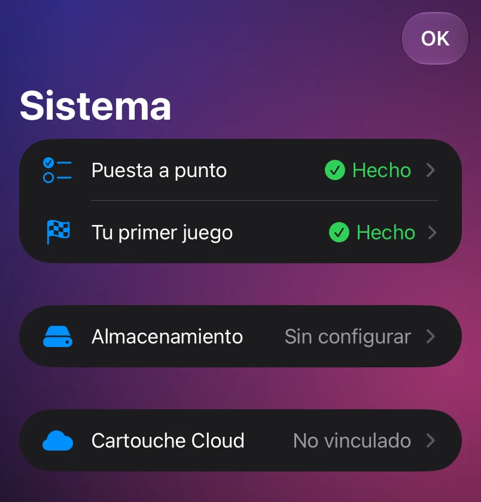
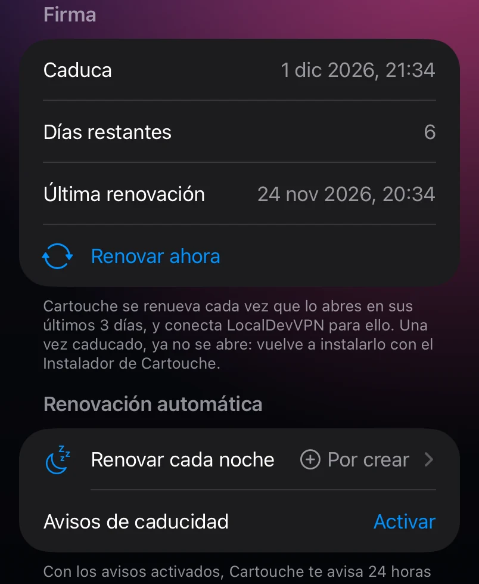
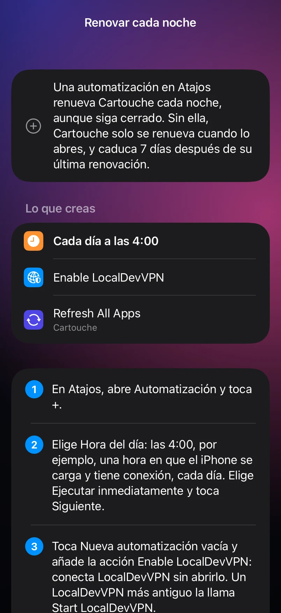
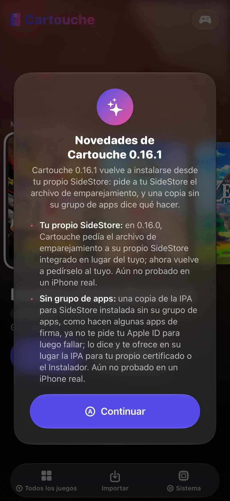
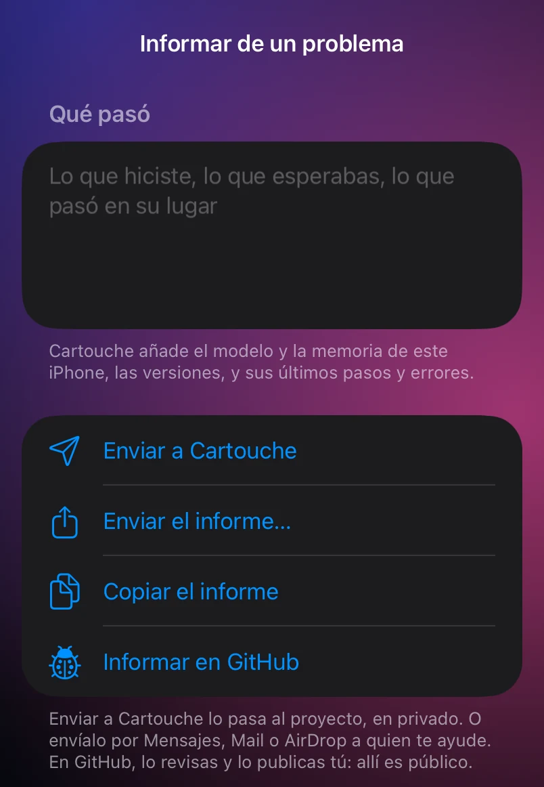

**Sistema**, en el dock de la consola o con el botón <kbd>Menu</kbd> del mando, se abre sobre la consola. **OK**, o de nuevo <kbd>Menu</kbd>, la cierra.

## Puesta a punto y firma

**Puesta a punto** muestra los pasos de la puesta a punto de Cartouche, marcados una vez hechos. **Firma** dice cuándo caduca la firma de Cartouche y los días que quedan.

Una cuenta de Apple gratuita firma apps por siete días. El SideStore integrado renueva Cartouche solo, a través de LocalDevVPN, que Cartouche conecta:

- cada vez que abres Cartouche en los 3 últimos días de su firma;
- cuando tocas **Renovar ahora**, sin salir de Cartouche;
- cada noche, con la automatización de Atajos de [más abajo](#renovarse-cada-noche).

Con **Avisos de caducidad** activado, Cartouche te avisa 24 horas y 6 horas antes de caducar. Una vez caducado, Cartouche ya no se abre: vuelve a instalarlo con el [Instalador de Cartouche](/es/installer/), sobre esta copia, lo que conserva tus juegos y tus partidas guardadas.

¿Sesión de Apple caducada? Cartouche vuelve a iniciar sesión solo, o te lo pide, con **Volver a iniciar sesión**.

## Renovarse cada noche

Una automatización en Atajos renueva Cartouche cada noche, aunque siga cerrado. iOS no deja que ninguna app la cree por ti, así que la creas una vez:

1. En Atajos, abre **Automatización** y toca **+**.
2. Elige **Hora del día**: las 4:00 por ejemplo, una hora en la que el iPhone se carga y tiene conexión, todos los días. Elige **Ejecutar inmediatamente** y toca **Siguiente**.
3. Toca **Nueva automatización en blanco** y añade la acción **Enable LocalDevVPN**: conecta LocalDevVPN sin abrirlo.
4. Luego añade **Refresh All Apps**, entre las acciones de Cartouche y no las de LiveContainer, y toca **OK**.
5. De vuelta en Cartouche, toca **He creado la automatización**.

Cartouche sigue cada ejecución: **Renovar cada noche**, en la página Sistema, dice si está por crear, creada, activa o si falló y por qué, y qué arreglar.

:::tip[Con Tailscale]
LocalDevVPN desactiva Tailscale, ya que iOS mantiene una sola VPN a la vez. Añade la acción **Connect** de Tailscale al final de la automatización, y se vuelve a activar sola.
:::

## Actualizaciones

Cartouche ofrece sus nuevas versiones sobre la consola, y las instala solo a través de LocalDevVPN, sin ordenador. Luego se cierra: vuelve a abrirlo. Tus juegos, sus partidas guardadas y los ajustes de Cartouche se quedan.

Tras una actualización, Cartouche se abre en **Novedades**, en tu idioma. **Sistema › Actualizaciones** también tiene **Buscar una actualización**, y las **Novedades** de las últimas versiones.

## Memoria

Cartouche obtiene la **memoria ampliada**, incluso con una cuenta de Apple gratuita. **Memoria** muestra el límite que iOS da aquí a Cartouche, el que dio al último juego detrás de la consola, y si la memoria ampliada está activa. **Mientras funciona un juego** tiene **Mantener Cartouche abierto detrás del juego** ([Jugar](/es/iphone/playing/#un-juego-que-necesita-más-memoria)) y **Pausar si el mando se desconecta** ([Jugar](/es/iphone/playing/#si-el-mando-se-desconecta)).

## Almacenamiento, compilaciones y Cartouche Cloud

- **[Almacenamiento](/es/iphone/storage/):** tu carpeta de juegos, tu carpeta de partidas guardadas y tus lugares.
- **Compilaciones en** tu Mac: con un Mac emparejado, todas sus compilaciones, manejadas desde el iPhone ([Tu iPhone y tu Mac](/es/mac/iphone/)).
- **[Cartouche Cloud](/es/cloud/iphone/):** vincula este iPhone a tu cuenta y sigue los juegos compilados para ti.

## Mediciones de juego

Después de cada juego, Cartouche envía lo que nxnative midió mientras funcionaba, como los fotogramas por segundo y la memoria, para que los juegos funcionen mejor en iPhone, iPad y Mac. Nunca tu cuenta de Apple, el nombre de tu iPhone, tus archivos, las direcciones de tu almacenamiento ni el registro del juego. **Sistema › Mediciones de juego** muestra lo que se envía, lo desactiva y borra lo que envió este iPhone. Mira [Privacidad](/es/about/privacy/).

## Informar de un problema

**Informar de un problema** muestra un informe completo de lo que falló, con el modelo de este iPhone, las versiones y los últimos pasos y errores de Cartouche, sin contraseñas, nombres ni direcciones de servidores, nombres de usuario ni cuenta de Apple. Nada sale del iPhone hasta que eliges cómo: **Enviar a Cartouche**, en privado, o por Mensajes, Mail o AirDrop a quien te ayuda. Mira [Obtener ayuda](/es/help/support/).

## Otras apps instaladas

Una IPA que instalaste y que no es un juego de nxnative aparece aquí, no en la consola. Se abre en lugar de Cartouche, y se puede desinstalar desde aquí.

## Restablecer Cartouche

**Restablecer Cartouche** borra todo lo que pusiste en Cartouche, tus juegos y sus partidas guardadas aquí, tus ajustes y tu almacenamiento, y luego lo abre de nuevo como la primera vez, sin ordenador. Las partidas guardadas que no están en tu carpeta de partidas guardadas se nombran antes, con **Enviarlas ahora a la carpeta de partidas guardadas**. Lo que guarda tu almacenamiento, el certificado y el archivo de emparejamiento se quedan.

## Idioma

Cartouche habla español, inglés, francés o alemán: sigue el idioma de tu iPhone.
