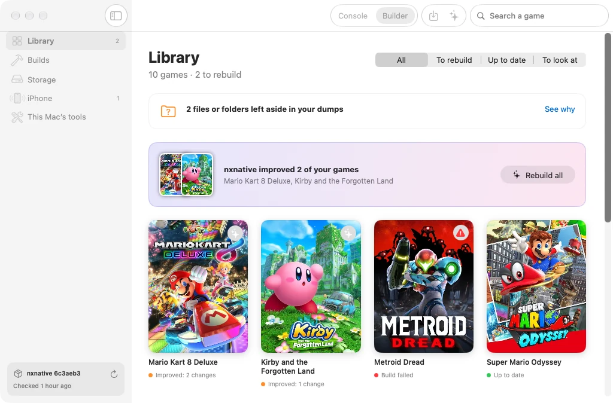
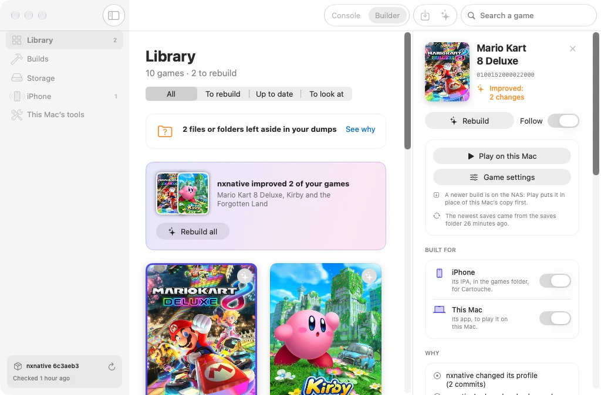
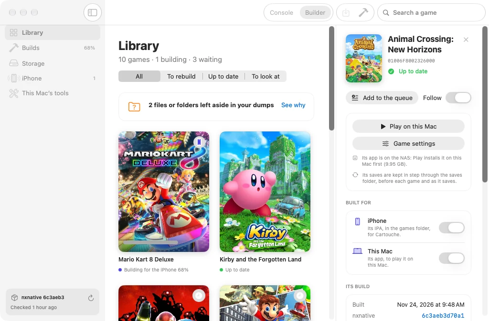

**Builder**, arriba en la ventana o <kbd>⌘</kbd><kbd>2</kbd>, muestra el Builder. Compila cada uno de tus juegos con nxnative en una IPA para el iPhone y el iPad, y en una app para este Mac, los pone en tu carpeta de juegos y los vuelve a compilar cuando nxnative los mejora.

## La biblioteca

**Biblioteca** muestra tus juegos con sus portadas: los de tu carpeta de dumps, y aquellos cuya IPA está sola en tu carpeta de juegos. Cada uno dice si está al día, si toca recompilarlo y por qué, si se compiló por la noche, o si falló y qué falló. Fíltralos por **Todos**, **Por recompilar**, **Al día** o **Por revisar**.

La ficha de un juego muestra lo que nxnative cambió para él desde su compilación, su IPA y su app para este Mac, **Compilar**, **Recompilar** o **Compilar de nuevo**, si se sigue, y para qué se compila.

## Compilar

Abre un juego y elige **Compilar**. La primera compilación de un juego grande lleva horas; las siguientes reutilizan su carpeta de compilación y llevan minutos. **Compilaciones** muestra la tanda en curso, juego a juego y paso a paso, su cola, y las tandas anteriores con sus informes.

- Un juego pedido mientras compila una tanda, con **Añadir a la cola**, espera su turno al final de la tanda.
- **Detener este juego** detiene solo el juego que se compila; **Detener todo** detiene la tanda y vacía su cola.
- Una notificación avisa cuando termina una tanda.

## Cuando nxnative mejora tus juegos

nxnative recibe decenas de cambios al día. El Builder lee lo que cambió desde la compilación de cada juego, y solo vuelve a compilar un juego cuando gana algo:

| Un juego se vuelve a compilar cuando | |
| --- | --- |
| nunca se compiló, o su IPA salió de la carpeta de juegos | |
| su carpeta tiene archivos nuevos | una nueva actualización, un DLC o un dump |
| un cambio de nxnative está hecho para él | su perfil, o una corrección que lo nombra |
| cambió el código compartido de nxnative | cada semana por defecto; o enseguida, o nunca, en los ajustes |
| cambió Xcode | |

¿**nxnative mejoró** algunos de tus juegos? **Recompilar todo** los compila. Cartouche en el iPhone ofrece entonces cada actualización en la ficha del juego, conservando las partidas guardadas.

Un juego cuya compilación falló espera a que cambien nxnative o sus archivos en lugar de volver a fallar cada noche; **Compilar de nuevo** lo compila enseguida.

## Cada noche

**Compilar lo pendiente cada noche**, en los ajustes, compila lo que nxnative mejoró a la hora que elijas, incluso con la app cerrada. El Mac se mantiene activo mientras compila, y una notificación dice cómo fue. Un recurso compartido de tu NAS que no está montado se vuelve a montar solo.

## Compilado para el iPhone y el Mac

Cada juego se compila para el iPhone y el iPad, y también para este Mac, salvo que desactives uno de los dos en **Compilar para**, para todos los juegos en **Ajustes › Compilaciones**, o para un juego en su ficha. Mira [Jugar en el Mac](/es/mac/console/#jugar-en-el-mac).

## Compilar para cada uno de tus iPhone

El iPhone 15, el iPhone 15 Plus y los modelos anteriores tienen un chip gráfico que no lee texturas comprimidas en BC, que nxnative necesita. **Ajustes › Compilaciones › Compilar para** dice para quién son los juegos: tus iPhone emparejados, por defecto, o un modelo que elijas. Cuando uno de ellos no lee texturas BC, el Builder compila cada juego con [nxnative-nobc](https://github.com/mianmuhammadse/nxnative-nobc), una bifurcación distinta de nxnative de mianmuhammadse que convierte esas texturas; si no, con nxnative. El ajuste dice con cuál y por qué.

## Poco espacio en el Mac

Cada juego conserva una carpeta de compilación que acelera su siguiente compilación. El Builder evita que el disco se llene: quita los archivos que extrae en cuanto termina una compilación, quita las carpetas de compilación usadas hace más tiempo cuando el disco se queda corto, y dice antes de una compilación cuánto espacio falta. **Almacenamiento** muestra lo que conserva el Builder, con **Liberar**.

## Cuando una compilación no sale

El error bajo un juego en **Compilaciones** dice qué hacer cuando puedes actuar: un disco lleno, archivos del juego dañados que volver a copiar desde tu consola, o un Xcode que actualizar. Cuando el último cambio de nxnative rompe la compilación de un juego, el Builder lo compila con un cambio anterior que funcionaba, por sí solo.

## Lo que nunca hace

Nunca descarga, comparte ni sube un juego, una clave ni una IPA a ningún sitio salvo tu propio almacenamiento: compila los juegos que posees a partir de tus propios archivos, en tu Mac, en tu propia carpeta de juegos.
