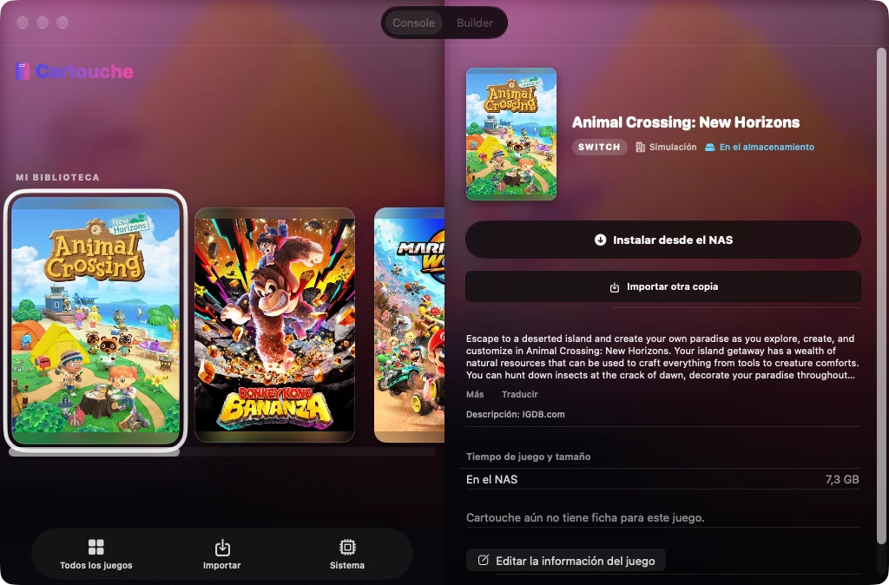
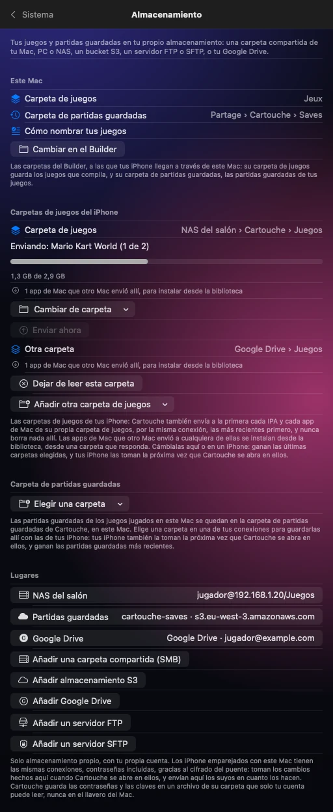

**Console**, arriba en la ventana o <kbd>⌘</kbd><kbd>1</kbd>, muestra la consola de Cartouche, como en el iPhone: tus juegos compilados para este Mac, con sus portadas, el juego seleccionado con **Jugar**, y su ficha al lado.

## Jugar en el Mac

**Jugar** abre el juego enseguida, a pantalla completa, con la ventana de Cartouche detrás, y con tus partidas guardadas más recientes. <kbd>⌃</kbd><kbd>⌘</kbd><kbd>F</kbd> lo pone en una ventana. Cuando el juego termina, Cartouche vuelve delante.

- **Ajustes del juego** abre los ajustes del juego en su ficha, como en el iPhone, con los propios del Mac: modo de pantalla, pantalla completa o ventana, y mandos.
- El juego habla el idioma de tu Mac cuando lo tiene, hasta que elijas uno.
- Un juego que guarda tu NAS y que aún no está en este Mac también aparece: **Instalar desde el NAS** lo instala, y luego **Jugar** lo abre.
- **Quitar de este Mac** manda su app a la Papelera; el juego se queda en tu carpeta de juegos.
- Cuando el último mando se desconecta durante una partida, el juego se pone en pausa 3 segundos después y Cartouche vuelve delante, que lo dice. Un mando conectado de nuevo reanuda el juego, como **Reanudar**, o el juego traído delante desde el Dock. **Sistema › Mientras funciona un juego** lo desactiva.

La ficha también dice cuánto has jugado el juego en este Mac y si funciona aquí.

## Tus partidas guardadas en el Mac

El Mac mantiene al día las partidas de los juegos jugados en él con tu carpeta de partidas guardadas, como hace el iPhone: la copia más reciente llega antes de que empiece un juego, y las partidas del Mac se van unos segundos después de que el juego guarde. Cuando ambos lados cambiaron, ganan las partidas escritas en último lugar y las otras se conservan como copia. Todos los perfiles del juego van con ellas, con el espacio que el juego hizo a cada uno, y los shaders que preparó vuelven, como en el iPhone. La ficha las muestra, con **Sincronizar ahora con …** y **Restaurar una copia**, y trae una partida de tu consola como en el iPhone. **Restaurar una copia** también muestra, en **En este Mac**, las copias que cada juego hace de sus partidas al arrancar, para volver al inicio de una partida ([Tus partidas guardadas](/es/iphone/saves/)).

La copia en este Mac de un juego que guarda tu NAS queda fuera de Time Machine: vuelve desde el NAS. Las partidas guardadas del juego siguen entrando.

## Sistema

**Sistema**, en el dock de la consola, abre la página Sistema del iPhone con las secciones propias de este Mac:

- **Tu primer juego:** la guía, en los tres pasos de este Mac: el asistente de configuración, un juego compilado para este Mac y ese juego jugado.
- **Almacenamiento:** tus conexiones, las mismas que las de tus iPhone emparejados, y las carpetas de juegos y de partidas guardadas del Mac ([más abajo](#el-mismo-almacenamiento-que-tu-iphone)).
- **Abrir el Builder**, con sus ajustes.
- **Mientras funciona un juego:** **Pausar si el mando se desconecta** ([arriba](#jugar-en-el-mac)).
- **Este Mac:** su modelo, su chip y su macOS, y si su chip gráfico tiene lo que necesita nxnative.
- **Actualizaciones:** las de Cartouche para Mac, con **Buscar una actualización** e **Instalar las actualizaciones automáticamente**.
- **Mediciones de juego** e **Informar de un problema**, como en el iPhone.

## El mismo almacenamiento que tu iPhone

Tus iPhone emparejados y el Mac mantienen las mismas conexiones a tu almacenamiento, contraseñas incluidas: una carpeta compartida, un bucket S3, un servidor FTP o SFTP o tu Google Drive añadidos en uno llegan al otro. La carpeta de juegos y la carpeta de partidas guardadas que eliges en cualquiera de ellos las conservan los dos.

Cuando la carpeta de juegos elegida en el iPhone está en una de tus conexiones, el Builder le envía cada juego que compila, uno a uno, para que tu iPhone los encuentre aunque el Mac esté en reposo.
