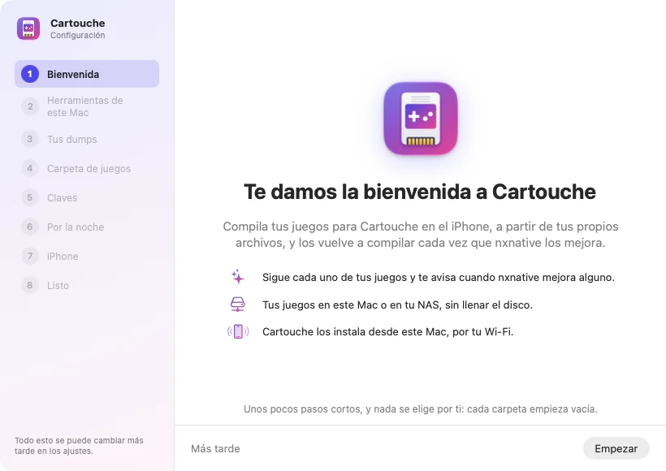
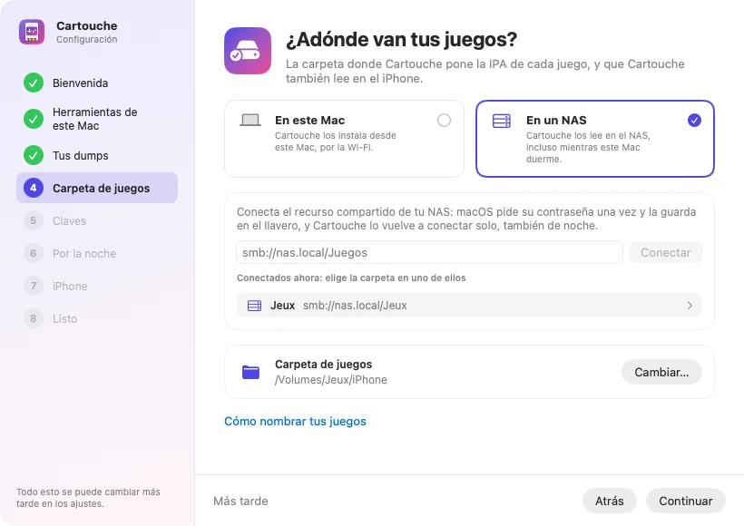
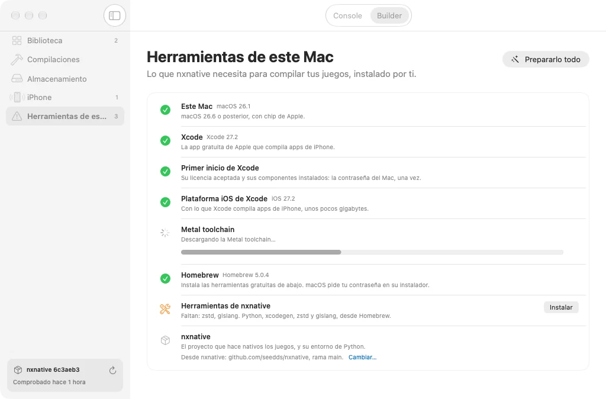

En el Mac, Cartouche es una sola app: su **consola**, como en el iPhone, y el **Builder**, que compila tus juegos con nxnative a partir de tus propias copias, para el iPhone, el iPad y el Mac. Necesita un Mac con Apple silicon y macOS 26.6 o posterior.

## Descarga y primera apertura

1. [Descarga Cartouche para Mac](https://cartouche.cloud/download/#builder): la imagen de disco se descarga enseguida.
2. Ábrela y arrastra **Cartouche** a **Aplicaciones**.
3. Abre Cartouche desde Aplicaciones. La primera vez, macOS dice que no puede comprobarlo, ya que no está firmado por Apple: en **Ajustes del Sistema › Privacidad y seguridad**, haz clic en **Abrir igualmente** junto a Cartouche, una vez. Sus actualizaciones se abren sin volver a preguntar.

## El asistente de configuración

En su primer inicio, un asistente de configuración prepara el Mac contigo, paso a paso. No se elige nada por ti: cada carpeta empieza vacía. Cada elección se guarda en cuanto la haces, y todas se pueden cambiar después en los ajustes, donde **Avanzado › Abrir el asistente de configuración** lo vuelve a abrir.

1. **Bienvenida:** lo que hace la app.
2. **Herramientas de este Mac:** **Prepararlo todo** instala aquello con lo que compila nxnative. Xcode viene del App Store, que la app abre por ti; Homebrew pide la contraseña de tu Mac; el resto se instala en segundo plano mientras sigues con los pasos siguientes.
3. **Tus dumps:** la carpeta de tus juegos, tal como los extrajiste de tu consola, en el Mac o en tu NAS. El Builder solo la lee.
4. **Carpeta de juegos:** adonde van las IPA de tus juegos, en este Mac o en tu NAS. Es la carpeta que Cartouche lee también en el iPhone.
5. **Claves:** las claves de tu consola, `prod.keys`, para los juegos que vienen como paquetes.
6. **Por la noche:** si compilar lo pendiente cada noche, y cuándo.
7. **iPhone:** si el Mac comparte sus juegos y partidas guardadas con Cartouche en el iPhone, y cómo emparejarlo.
8. **Listo:** lo que eligió cada paso, con un botón para volver a él.

:::tip[Tus juegos en un NAS]
Para una carpeta de tu NAS, escribe la dirección de su recurso compartido en el asistente y el Finder lo conecta; luego elige la carpeta que hay en él. macOS guarda la contraseña en el llavero, y Cartouche vuelve a conectar el recurso solo, también por la noche.
:::

## Herramientas de este Mac

**Herramientas de este Mac**, en el Builder, muestra cada herramienta que necesita nxnative, instalada o ausente, con una instalación para lo que falta, y **Actualizar Xcode** cuando nxnative necesita uno más reciente.

## Tus dumps

El Builder lee tus juegos como paquetes de tu consola (`.nsp`, `.xci`, `.nsz`, `.xcz`, con sus actualizaciones y DLC, que necesitan `prod.keys`, o `.nup`), como dumps, o como un `.zip` de un dump. Pueden estar sueltos en la carpeta, una carpeta por juego, o en carpetas dentro de carpetas. Un juego se reconoce por su ID de título; la biblioteca dice lo que dejó de lado, y por qué.

**Nombrar tus juegos**, en **Carpetas** de los ajustes, muestra con ejemplos lo que el Builder y Cartouche hacen con cada nombre.

## Actualizaciones

Cartouche para Mac busca sus nuevas versiones al abrirse y cada seis horas. Una nueva versión se descarga, se comprueba y se pone en su sitio cuando la app se cierra, o enseguida con **Reiniciar**. **Instalar las actualizaciones automáticamente**, en los ajustes, se puede desactivar: la app ofrece entonces cada actualización.

## Siguiente

[Compila tus juegos](/es/mac/builder/).
