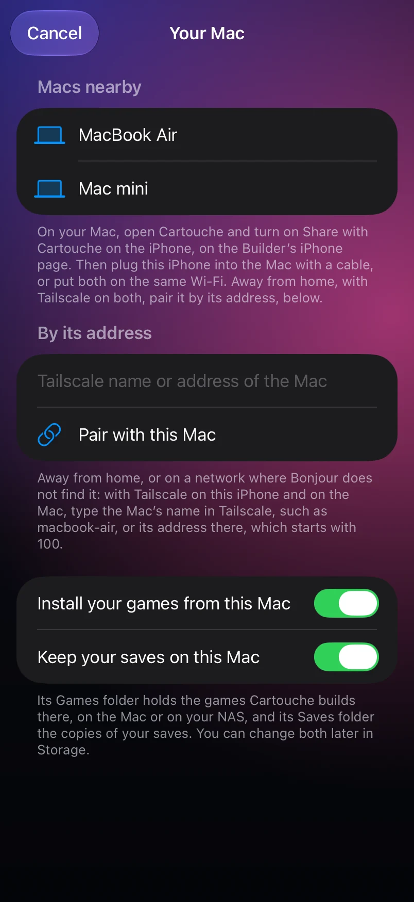
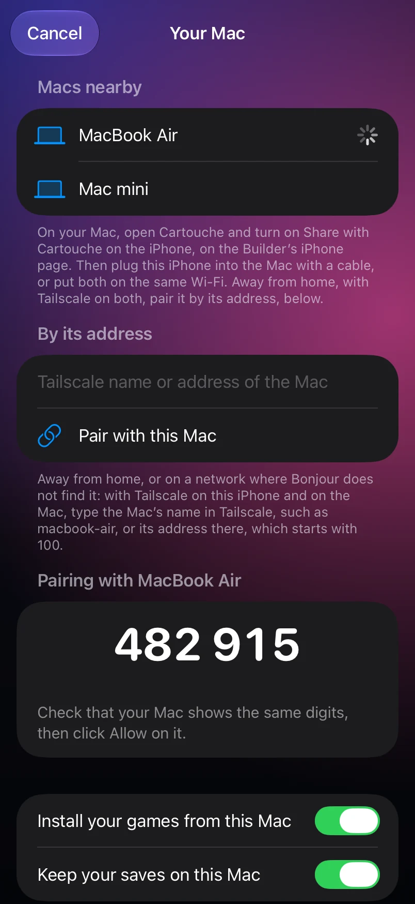
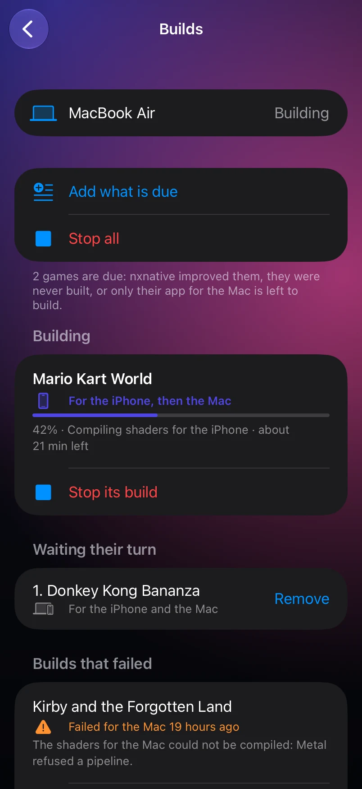
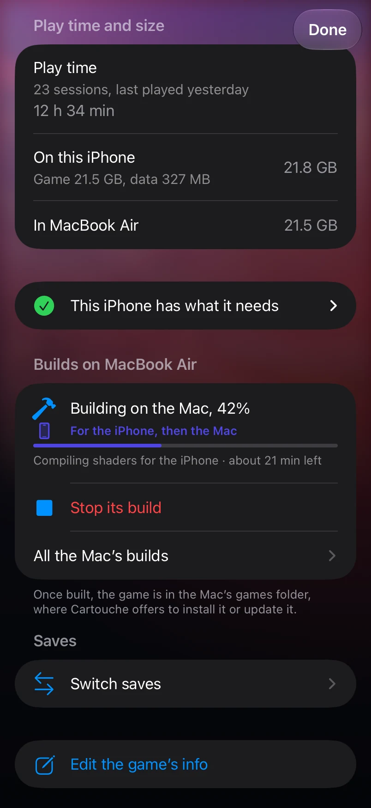

Emparejado una vez, tu Mac se convierte en un lugar de almacenamiento de Cartouche en el iPhone: Cartouche instala tus juegos desde él y guarda allí tus partidas, cifradas por el camino. Y el iPhone maneja las compilaciones del Mac.

## Emparejarlos

1. En el Mac, en la página **iPhone** del Builder, activa **Compartir con Cartouche en el iPhone**.
2. En el iPhone, en **Sistema › Almacenamiento**, elige **Añadir tu Mac**, y luego tu Mac en **Mac cercanos**. La primera vez, permite que Cartouche busque dispositivos en tu red local.
3. Ambas pantallas muestran seis cifras: cuando son las mismas, haz clic en **Permitir** en el Mac.

El Mac comparte dos carpetas, y nada más de él es accesible: **Juegos**, tu carpeta de juegos, esté donde esté, en el Mac o en tu NAS; y **Partidas guardadas**, la carpeta que eliges para las copias de tus partidas. La clave que comparten los dos nunca cruza la red, y cada mensaje va cifrado.

## Por Wi-Fi, por cable o fuera de casa

- **Por cable:** conecta el iPhone al Mac, y llega al Mac a través del cable, sin Wi-Fi. **Añadir tu Mac** lista ese Mac primero, **Por cable**. El iPhone debe confiar en el Mac, como pide el Finder una vez.
- **En tu Wi-Fi:** el iPhone encuentra el Mac solo, o en la dirección en la que lo alcanzó por última vez, también a través de tu VPN. El Mac se mantiene activo mientras hay un iPhone conectado.
- **Fuera de casa:** con Tailscale en el Mac y en el iPhone, con la misma cuenta, el iPhone llega al Mac a través de Tailscale. Un Mac nunca visto en tu Wi-Fi se empareja por su nombre o su dirección en Tailscale, en **Añadir tu Mac › Por su dirección**.

El Mac responde mientras Cartouche está abierto en él.

## Manejar las compilaciones del Mac desde el iPhone

- La ficha de cada juego muestra **Compilaciones en** tu Mac: compilándose, con cuánto lleva y el tiempo restante, esperando su turno, al día, mejorado por nxnative, o fallido y por qué. Su botón pide al Mac que lo compile, ahora o después de la tanda en curso, o detiene su compilación.
- **Sistema › Compilaciones en** tu Mac muestra todas sus compilaciones, como las tiene su propia ventana: **Compilar lo pendiente**, **Detener todo**, la cola con **Quitar**, las compilaciones que fallaron, **Seguir** para cada juego, y **Compilar lo pendiente cada noche** con su hora.

Las carpetas del Mac, sus herramientas y sus ajustes se quedan en el Mac.

## Las mismas conexiones

Una vez emparejados, el iPhone y el Mac mantienen las mismas conexiones a tu almacenamiento, contraseñas incluidas: una que añades, cambias o quitas en uno llega al otro. Mira [El mismo almacenamiento que tu iPhone](/es/mac/console/#el-mismo-almacenamiento-que-tu-iphone).

## Mantener los dos al día

Cartouche en el iPhone y Cartouche para Mac hablan entre sí: cuando uno es mucho más antiguo, el iPhone dice que actualices los dos. Cartouche para Mac se actualiza solo; un Cartouche para Mac antiguo que ya no encuentra sus actualizaciones recibe el enlace desde el iPhone, en **Sistema › Compilaciones en** tu Mac.
