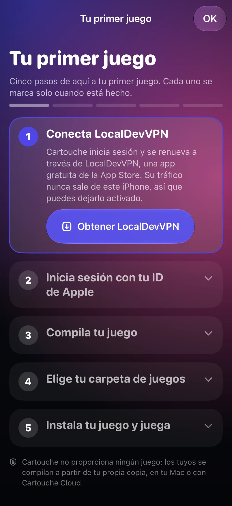
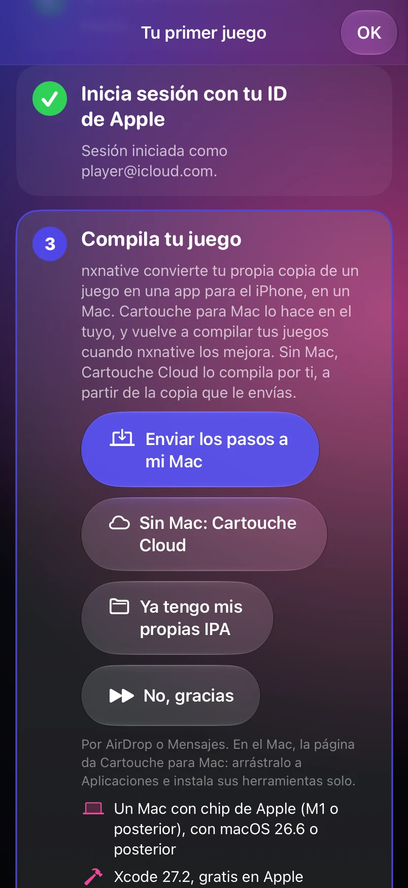
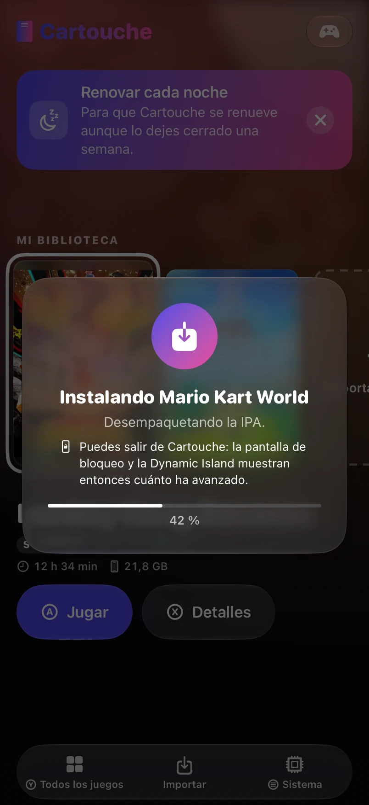

La primera vez que abres Cartouche, su guía, **Tu primer juego**, se abre en el paso pendiente. Cada paso se marca solo una vez hecho, en cualquier orden, y la guía te lleva hasta jugar.

## 1. Conecta LocalDevVPN e inicia sesión

Los pasos de la puesta a punto, de [Instalar Cartouche](/es/start/install/#4-la-puesta-a-punto-de-cartouche). La guía los muestra primero mientras no estén hechos.

## 2. Compila tu juego

Tu juego es tu propia copia, extraída de tu consola. nxnative la convierte en una app para el iPhone, en un Mac. Elige el camino que te va:

- **Con tu Mac:** **Enviar los pasos a mi Mac** envía al Mac, por AirDrop o Mensajes, la página con [Cartouche para Mac](/es/mac/install/). Instálalo allí; compila tu juego y lo pone en tu carpeta de juegos.
- **Sin Mac: Cartouche Cloud** abre [Cartouche Cloud](/es/cloud/): envía tu copia desde un ordenador, y el juego compilado para ti llega a Cartouche.
- **Ya tengo mis propias IPA** abre Archivos: se instala la IPA que elijas.
- **No, gracias:** tus juegos ya están compilados, en tu NAS por ejemplo. La guía sigue con tu carpeta de juegos.

## 3. Elige tu carpeta de juegos

**Elegir la carpeta de juegos** abre la página [Almacenamiento](/es/iphone/storage/): añade tu Mac, una carpeta compartida de tu NAS, un bucket S3, un servidor FTP o SFTP, tu Google Drive o una carpeta en Archivos, y elige la carpeta que contiene tus juegos. Cartouche lista tus juegos desde allí y ofrece sus actualizaciones.

Con Cartouche Cloud, no necesitas carpeta de juegos: la guía se salta este paso. ¿Ninguna carpeta de juegos? **Importar una IPA en su lugar** instala una IPA desde Archivos.

## 4. Instala tu juego y juega

Tu juego aparece en el último paso de la guía y en tu biblioteca. **Instalar** lo instala, desde tu carpeta de juegos o desde Cartouche Cloud, y luego se abre su ficha con **Jugar**.

Tus siguientes juegos van igual: compilados en el Mac o por Cartouche Cloud, y luego instalados.

## Volver a abrir la guía

- La **×** de la tarjeta de la guía la quita de la pantalla de inicio.
- **Sistema › Tu primer juego** la vuelve a abrir cuando quieras.
- Mientras no tengas ningún juego, **Cómo conseguir un juego**, junto a **Importar mi copia**, también la abre.

En el Mac, la consola de Cartouche tiene su propia guía, en tres pasos: el asistente de configuración, un juego compilado para este Mac y ese juego jugado. Mira [La consola en el Mac](/es/mac/console/).
