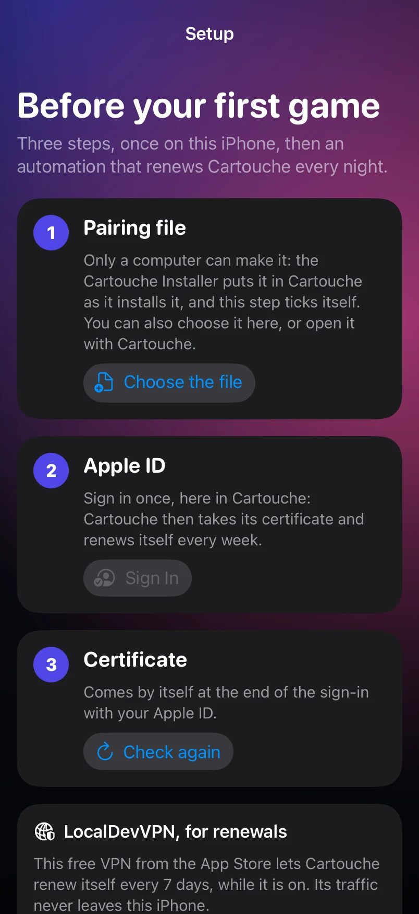

Se necesita un ordenador una vez, para poner Cartouche en tu iPhone o iPad. Después, Cartouche se firma, se renueva y se actualiza sin él. ¿Ya usas SideStore? [Instálalo desde allí](/es/start/sidestore/), sin ordenador.

En un iPad, cada paso es igual, con el iPad en lugar del iPhone.

## 1. LocalDevVPN en el iPhone

Instala **LocalDevVPN**, gratis, desde el App Store. Cartouche inicia sesión y se renueva a través de él. Su tráfico nunca sale del iPhone, y Cartouche lo conecta solo cuando lo necesita.

## 2. El Instalador de Cartouche en tu ordenador

1. Descarga el Instalador de Cartouche [para Mac](https://cartouche.cloud/download/#installer-mac) o [para Windows](https://cartouche.cloud/download/#installer-windows). En Windows, instala también **Dispositivos Apple** desde Microsoft Store, para que Windows pueda hablar con el iPhone.
2. Ábrelo. No está notarizado por Apple ni por Microsoft, así que la primera vez:
   - en un Mac, abre **Ajustes del Sistema › Privacidad y seguridad** y haz clic en **Abrir igualmente** junto a Cartouche Installer, una vez;
   - en Windows, si SmartScreen detiene la instalación, elige **Más información › Ejecutar de todas formas**.
3. Conecta el iPhone al ordenador con un cable y desbloquéalo. La primera vez, toca **Confiar** en el iPhone y escribe su código.
4. En el Instalador, inicia sesión con tu cuenta de Apple (basta con una gratuita) y escribe el código que Apple envía a tus dispositivos.
5. Haz clic en **Instalar Cartouche**. El Instalador descarga la versión más reciente de Cartouche, la comprueba, la firma con la memoria ampliada y la instala, con su certificado y el archivo de emparejamiento que necesita.

Más sobre el Instalador, sus ajustes y qué hacer cuando se detiene: [Instalador de Cartouche](/es/installer/).

:::tip[Tu propio certificado de firma]
¿Tienes un certificado de firma (.p12) y su perfil de aprovisionamiento? El Instalador puede firmar Cartouche con ellos, sin cuenta de Apple y sin renovación semanal. Mira [Tu propio certificado](/es/installer/own-certificate/).
:::

## 3. La primera vez en el iPhone

Antes de que Cartouche se abra por primera vez:

1. En **Ajustes › General › VPN y gestión de dispositivos**, confía en tu cuenta de Apple.
2. Si iOS lo pide, activa el **Modo de desarrollador** en **Ajustes › Privacidad y seguridad**, y reinicia el iPhone.

## 4. La puesta a punto de Cartouche

Abre Cartouche. Su puesta a punto lleva unos pocos pasos, una sola vez:

1. **LocalDevVPN, para las renovaciones:** **Conectar LocalDevVPN** lo conecta y te devuelve a Cartouche.
2. **ID de Apple:** inicia sesión con la cuenta de Apple que diste al Instalador y escribe el código que envía Apple. Cartouche toma su certificado.
3. **Archivo de emparejamiento:** ya lo puso el Instalador; este paso se marca solo.
4. **Renovar cada noche:** el último paso muestra la automatización de Atajos que hay que crear una vez, para que Cartouche se renueve cada noche aunque siga cerrado. Mira [Renovarse cada noche](/es/iphone/system/#renovarse-cada-noche).

Terminada la puesta a punto, Cartouche renueva solo su firma de siete días y ofrece sus propias actualizaciones. Tus juegos y sus partidas guardadas se quedan en cada actualización.

## Siguiente

[Tu primer juego](/es/start/first-game/): la guía de Cartouche te lleva desde aquí hasta jugar.
