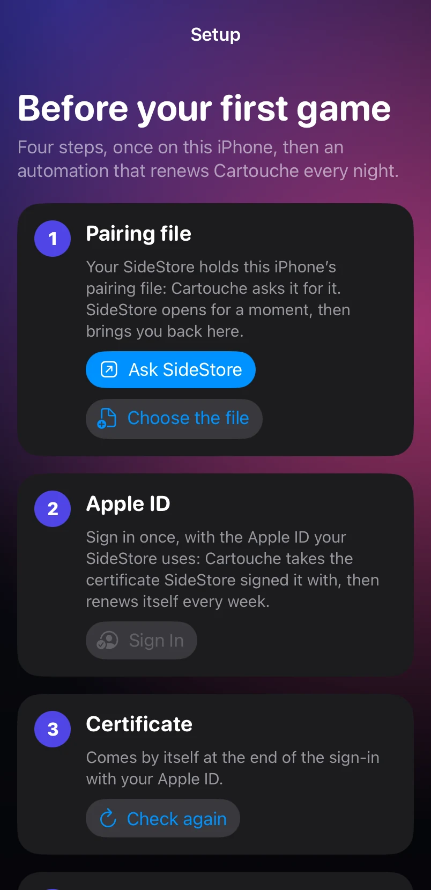

Si SideStore ya está en tu iPhone o iPad, puedes instalar Cartouche desde él, sin ordenador.

1. En SideStore, añade la fuente de Cartouche: `https://source.cartouche.cloud`. En el iPhone, el botón de abajo la añade por ti.

   <a href="sidestore://source?url=https://source.cartouche.cloud">Añadir a SideStore</a>

2. Instala **Cartouche** desde esa fuente. Cuando SideStore pregunte, elige **Keep App Extensions (Use Main Profile)**: Cartouche las necesita para ejecutar tus juegos detrás de su consola.
3. Abre Cartouche. Su puesta a punto pide a tu SideStore el archivo de emparejamiento y toma su certificado: no hay que volver a escribir ninguna cuenta de Apple.
4. Después, Cartouche se vuelve a instalar una vez para obtener la memoria ampliada, la memoria que necesitan tus juegos.

A partir de ahí, Cartouche se renueva y se actualiza como tras una instalación con el Instalador. Su puesta a punto termina con el mismo último paso, [Renovar cada noche](/es/iphone/system/#renovarse-cada-noche).

:::note
Una copia de Cartouche firmada por otra app en el iPhone no abre ningún juego, salvo la de la fuente de Cartouche para SideStore. Si tienes tu propio certificado de firma, mira [Tu propio certificado](/es/installer/own-certificate/).
:::

## Siguiente

[Tu primer juego](/es/start/first-game/).
