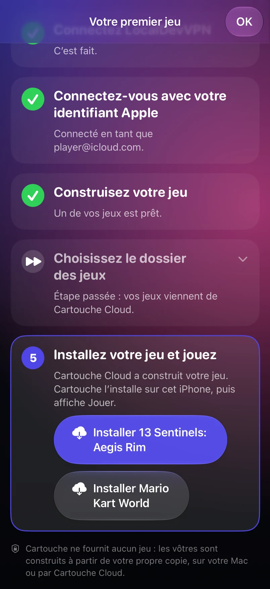

Pas de Mac ? Depuis un ordinateur, envoyez votre propre copie d'un jeu sur le [site de Cartouche Cloud](https://build.cartouche.cloud/). Il la construit avec nxnative sur un Mac dans le cloud, pour vous seul, puis efface votre copie. Cartouche, lié à votre compte, suit la construction et installe le jeu sur votre iPhone.

Cartouche Cloud ne fournit aucun jeu : il ne construit que la copie que vous lui envoyez.

## Construire un jeu

1. Sur un ordinateur, ouvrez le [site de Cartouche Cloud](https://build.cartouche.cloud/), créez votre compte, et achetez-y des crédits.
2. Envoyez votre propre copie du jeu : le paquet de votre console (`.nsp`, `.xci`, `.nsz` ou `.xcz`, avec ses mises à jour et DLC, et les clés de votre console, `prod.keys`), un `.nup`, ou un `.zip` d'un dump.
3. Liez Cartouche à votre compte, une fois ([Lier votre iPhone](/fr/cloud/iphone/#lier-votre-iphone)).
4. Cartouche suit la construction, étape par étape, et un e-mail vous dit quand elle est finie. **Installer** met alors le jeu sur votre iPhone, comme vos autres jeux.

## Mises à jour et DLC

Choisissez ensemble le jeu de base, ses mises à jour et ses DLC quand vous l'envoyez : la mise à jour la plus récente est appliquée, et les DLC sont construits avec. Une mise à jour ou un DLC part avec son jeu de base : pour en ajouter un à un jeu déjà construit, renvoyez le jeu avec, ce qui fait une nouvelle construction.

## Vos clés restent chez vous

Votre navigateur ouvre le jeu sur votre ordinateur et n'envoie que le jeu : vos clés ne quittent jamais l'ordinateur.

## Les crédits

Une construction réussie se paie en crédits, achetés à l'avance sur le site de Cartouche Cloud, qui en donne le prix. Une construction qui échoue ne coûte rien. Les crédits sont réservés pendant qu'un jeu se construit, et rendus si la construction échoue.

## Ce qu'il garde

- **Votre copie :** effacée dès que le jeu est construit, et au plus tard deux jours après l'envoi.
- **Le jeu construit :** gardé deux jours, pour votre compte seul, le temps de l'installer.
- **Vos clés :** jamais envoyées.

Le détail est sur la [page de confidentialité](https://build.cartouche.cloud/privacy) de Cartouche Cloud.

## Rien à installer

Pas de Mac, pas de Xcode, pas de Terminal : un navigateur sur un ordinateur, et Cartouche sur l'iPhone. Cartouche Cloud est pour l'iPhone et l'iPad ; avec un Mac, [Cartouche pour Mac](/fr/mac/install/) construit vos jeux chez vous.
