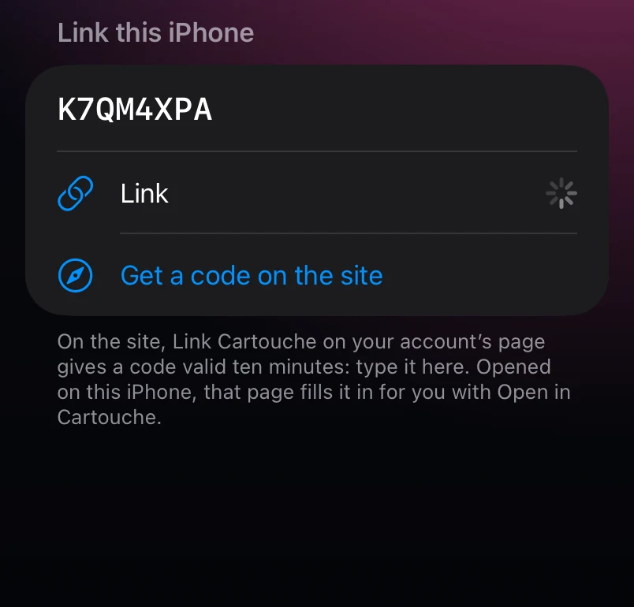
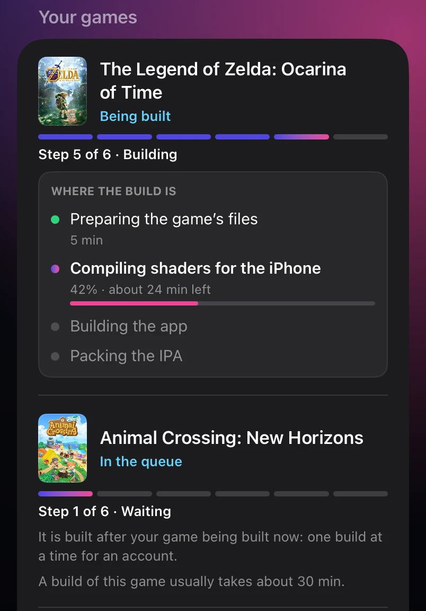
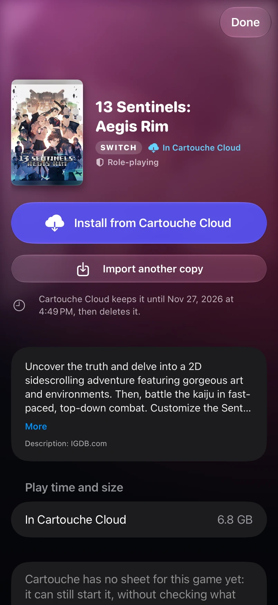

**Système › Cartouche Cloud** dit ce qu'est le service, et lie votre iPhone à votre compte. **Sans Mac : Cartouche Cloud**, dans le guide, ouvre la même page.

## Lier votre iPhone

1. Sur le site de Cartouche Cloud, sur la page de votre compte, choisissez **Lier Cartouche** : il donne un code valable dix minutes.
2. Dans Cartouche, tapez-le sous **Lier cet iPhone**. Ouverte sur l'iPhone, cette page le remplit pour vous avec **Ouvrir dans Cartouche**, ou son code QR le fait.

Lié, votre iPhone lit les jeux de votre compte et récupère ceux qui sont construits, rien de plus : envoyer un jeu, vos crédits et votre compte restent sur le site.

## Suivre une construction

Cartouche montre chaque jeu de votre compte avec sa jaquette, où il en est, chaque étape de sa construction et le temps restant, et vos crédits.

## L'installer

Un jeu construit apparaît dans votre bibliothèque et sur sa fiche, *Dans Cartouche Cloud* : **Installer** le met sur votre iPhone, comme un jeu de votre dossier de jeux. Il reste deux jours sur Cartouche Cloud : installez-le dans ce délai.

## Délier

**Délier cet iPhone** arrête le suivi de votre compte par Cartouche ici ; votre compte et ses jeux restent sur le site. Délié depuis le site, l'iPhone le dit : liez-le de nouveau avec un nouveau code.
