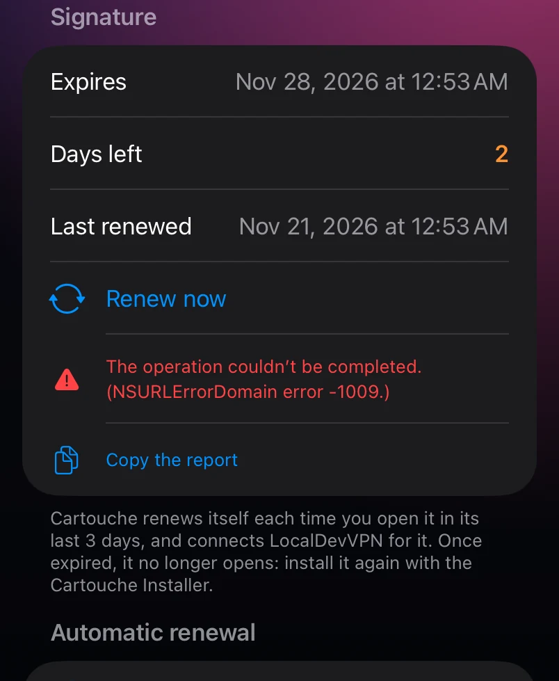
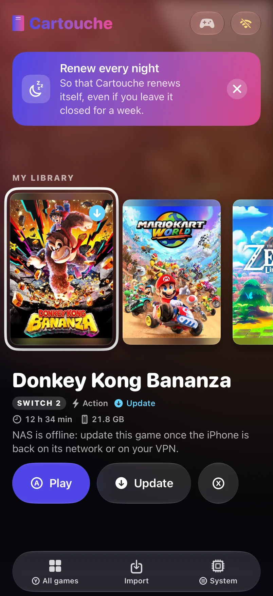

Sous chaque erreur, Cartouche dit pourquoi et quoi faire, et **Copier le rapport** donne à qui vous aide ce dont il a besoin. Voici les cas les plus courants.

## Signature et renouvellement

**Cartouche ne s'ouvre plus.** Sa signature a expiré : un compte Apple gratuit signe les apps pour sept jours, et Cartouche n'a pas été ouvert dans ses 3 derniers jours, ni renouvelé la nuit. Réinstallez-le avec l'[Installeur Cartouche](/fr/installer/), par-dessus cette copie, avec le même compte Apple : vos jeux et vos sauvegardes restent. Créez ensuite l'[automatisation de la nuit](/fr/iphone/system/#se-renouveler-chaque-nuit).

**L'accueil dit « Le certificat ne fonctionne plus. »** iOS ne l'accepte plus, peut-être après une installation depuis un autre ordinateur. Reconnectez-vous avec votre compte Apple : Cartouche en prend un nouveau.

**Apple dit que la session a expiré.** Cartouche ne peut plus se renouveler ni se mettre à jour tant que vous ne vous êtes pas reconnecté : choisissez **Se reconnecter** sur la page Système, avec le même compte Apple. Vos jeux et vos sauvegardes restent.

**Apple a révoqué le certificat.** Le plus souvent, une autre app ou un autre ordinateur en a pris un nouveau avec le même compte Apple. Cartouche ne peut plus se renouveler avec : réinstallez Cartouche par-dessus cette copie avec l'Installeur Cartouche, avec le même compte Apple.

**Une partie de l'app manque.** Cartouche le dit quand il se connecte, se renouvelle ou se met à jour. Réinstallez-le par-dessus cette copie avec l'Installeur Cartouche, qui la remet.

**Le fichier de jumelage manque.** Dans l'Installeur Cartouche, **Remettre le fichier de jumelage dans Cartouche**.

**Le renouvellement n'a pas abouti.** Vérifiez que LocalDevVPN est installé et peut se connecter, puis **Renouveler maintenant** sur la page Système, qui dit pourquoi il a échoué.

**L'automatisation de la nuit ne s'exécute pas.** **Renouveler chaque nuit**, sur la page Système, dit ce qu'il a vu. Dans Raccourcis, vérifiez que l'automatisation est toujours là, active, réglée sur **Exécuter immédiatement**, à une heure où l'iPhone charge et a internet, et que **Enable LocalDevVPN** vient avant **Refresh All Apps**, celle de Cartouche et non de LiveContainer.

## Les jeux

**Un jeu ne s'installe pas : pas assez de place.** Cartouche dit combien le jeu prend et combien il reste. Libérez de la place, puis réinstallez-le.

**L'IPA est abîmée.** Elle s'arrête trop tôt, ou un fichier a changé depuis sa création, comme quand une copie s'arrête avant la fin. Recopiez-la depuis là où elle a été construite.

**Le jeu a été construit sans les fichiers du jeu.** Mettez son `romfs.img`, tel que nxnative l'a écrit, à côté de son IPA dans votre dossier de jeux, puis installez le jeu depuis là.

**Le jeu se ferme au lancement, sur un iPhone 15 ou plus ancien.** nxnative demande une puce graphique qui lit les textures BC. Cartouche pour Mac construit vos jeux avec nxnative-nobc pour un tel iPhone une fois associé : voir [Construire pour chacun de vos iPhone](/fr/mac/builder/#construire-pour-chacun-de-vos-iphone).

**iOS a fermé le jeu.** Près de sa limite de mémoire derrière la console, le jeu démarre ensuite à la place de Cartouche, avec toute la mémoire de Cartouche. La fiche du jeu dit s'il convient à votre iPhone. Sinon, votre progression est gardée jusqu'à sa dernière sauvegarde.

**Le jeu n'est pas signé.** Signez-le de nouveau en le relançant ; si cela échoue encore, réinstallez-le depuis son IPA.

## Le stockage

**Un endroit est hors ligne.** Il ne répond pas depuis là où se trouve l'iPhone. Chez vous, vérifiez son adresse et que l'iPhone est sur votre Wi-Fi ou votre VPN. Ailleurs, allumez Tailscale. Vos jeux se jouent comme toujours, et vos sauvegardes attendent.

**Tailscale est éteint.** LocalDevVPN l'a éteint, car iOS ne garde qu'un VPN à la fois : ouvrez Tailscale pour le rallumer, ou ajoutez son action **Connect** à l'automatisation de la nuit.

**Google Drive demande de se reconnecter.** Tant que votre projet Google Cloud est en test, Google met fin à la connexion après 7 jours : **Se reconnecter à Google** sur la page Stockage.

**Cartouche ne trouve pas votre Mac.** Sur le Mac, ouvrez Cartouche, avec **Partager avec Cartouche sur l'iPhone** activé. Sur l'iPhone, autorisez Cartouche dans **Réglages › Confidentialité et sécurité › Réseau local**. Soyez sur le même Wi-Fi, ou branchez l'iPhone au Mac.

## Cartouche pour Mac

**macOS ne peut pas vérifier l'app.** La première fois seulement : **Réglages Système › Confidentialité et sécurité**, puis **Ouvrir quand même** à côté de Cartouche.

**Une construction échoue.** L'erreur sous le jeu, dans **Constructions**, dit quoi faire : libérer de la place sur un disque plein, recopier depuis votre console des fichiers du jeu abîmés, ou mettre à jour Xcode depuis **Outils du Mac**. Un jeu dont la construction a échoué est réessayé quand nxnative ou ses fichiers changent ; **Construire à nouveau** réessaie tout de suite.

## Toujours bloqué ?

Voir [Obtenir de l'aide](/fr/help/support/).
