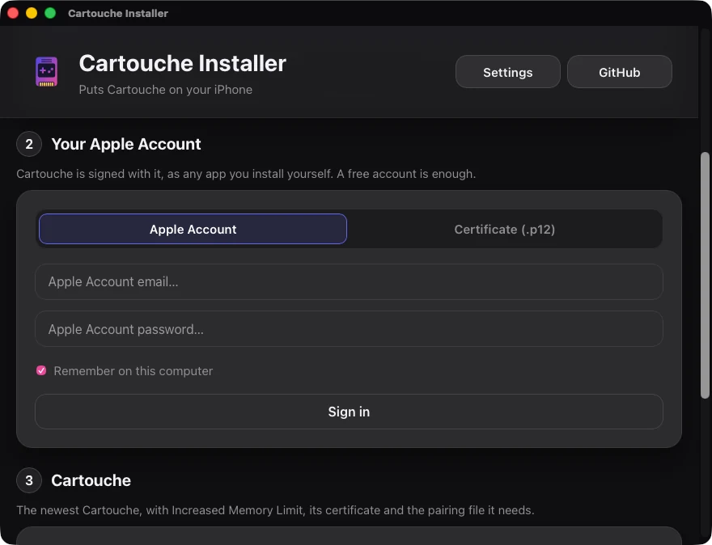

L'Installeur Cartouche met Cartouche sur un iPhone ou un iPad depuis un Mac ou un PC Windows, la seule fois où un ordinateur est nécessaire. Sa fenêtre a trois étapes.

| Ordinateur | Téléchargement | Première ouverture |
| --- | --- | --- |
| Mac, puce Apple ou Intel, macOS 11 ou plus récent | [Pour Mac](https://cartouche.cloud/download/#installer-mac) | macOS ne peut pas le vérifier : dans **Réglages Système › Confidentialité et sécurité**, cliquez sur **Ouvrir quand même** à côté de l'Installeur Cartouche, une fois. |
| Windows 10 ou 11 | [Pour Windows](https://cartouche.cloud/download/#installer-windows) | SmartScreen peut arrêter l'installation : **Informations complémentaires › Exécuter quand même**. Il s'installe pour votre compte, sans droits d'administrateur. Installez aussi **Appareils Apple** depuis le Microsoft Store. |

## Les trois étapes

1. **Votre iPhone :** branchez-le à l'ordinateur avec un câble et déverrouillez-le. La première fois, touchez **Se fier** sur l'iPhone et tapez son code.
2. **Votre compte Apple :** connectez-vous, un compte gratuit suffit, avec le code à deux facteurs qu'Apple envoie. **Retenir sur cet ordinateur** garde le mot de passe dans le trousseau de l'ordinateur.
3. **Cartouche :** **Installer Cartouche** télécharge le Cartouche le plus récent depuis ses versions publiées, le vérifie, le signe avec la Mémoire augmentée et l'installe, avec son certificat et le fichier de jumelage dont il a besoin.

Une fois fini, l'Installeur dit quoi faire sur l'iPhone la première fois : faire confiance à votre compte Apple dans **Réglages › Général › VPN et gestion de l'appareil**, et activer le **Mode développeur** si iOS le demande. Ouvrez ensuite Cartouche : voir [Installer Cartouche](/fr/start/install/#4-la-mise-en-route-de-cartouche).

## Réinstaller, ou mettre à jour

Réinstaller par-dessus Cartouche garde ses jeux et leurs sauvegardes, et l'amène à la version la plus récente. Faites-le quand :

- la signature de Cartouche a expiré, après une semaine sans l'ouvrir ;
- Apple a révoqué le certificat avec lequel Cartouche est signé, comme le dit alors la page Système ;
- une partie de l'app manque, comme le dit Cartouche quand il se connecte, se renouvelle ou se met à jour.

Utilisez le même compte Apple qu'avant.

## Le fichier de jumelage

Le fichier de jumelage permet à Cartouche d'installer et de renouveler des apps sur l'iPhone sans ordinateur. L'Installeur le met dans Cartouche en l'installant. Après un effacement de l'iPhone, ou la suppression de son jumelage, **Remettre le fichier de jumelage dans Cartouche** le remet, sans réinstaller Cartouche.

## Réglages

**Réglages** contient la langue de l'Installeur (anglais, français, espagnol ou allemand), les certificats et identifiants d'app de votre compte, les journaux, et le jumelage gardé pour l'iPhone choisi.

:::caution[Trop de certificats]
Un compte Apple gratuit a un nombre limité de certificats de développement. Quand il les a tous, l'Installeur propose de les révoquer et d'en créer un nouveau : les apps signées avec eux ne s'ouvrent plus jusqu'à ce qu'elles soient réinstallées.
:::

:::note[Trois apps]
Un compte Apple gratuit peut avoir 3 apps à lui installées à la fois, apps expirées comprises. Vos jeux tournent dans Cartouche et ne comptent pas.
:::

L'Installeur n'installe rien d'autre que Cartouche, et ne télécharge jamais rien d'autre que les versions publiées de Cartouche.
