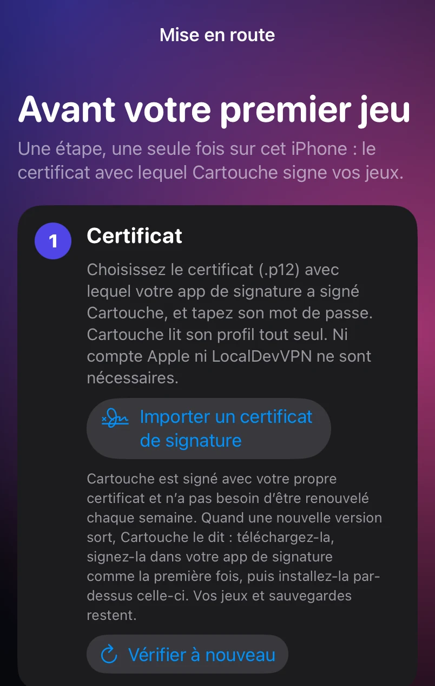

Signer avec votre compte Apple reste le choix par défaut. Si vous avez déjà un certificat de signature (.p12) et son profil de provisionnement, l'Installeur Cartouche peut signer Cartouche avec eux à la place : pas de compte Apple, pas de LocalDevVPN et pas de renouvellement chaque semaine.

Cartouche ne recommande ni vendeurs de certificats, ni apps ou services de signature.

## Installer avec votre certificat

1. Dans l'Installeur Cartouche, choisissez votre iPhone.
2. En haut de l'étape du compte Apple, choisissez **Certificat (.p12)**.
3. Choisissez votre certificat (.p12), tapez son mot de passe (laissez vide s'il n'en a pas), et choisissez son profil (`.mobileprovision`).
4. Installez Cartouche. La signature se fait sur l'ordinateur ; l'Installeur ne se connecte à aucun compte Apple.
5. Ouvrez Cartouche : il prend votre certificat tout seul. Si iOS vous demande de faire confiance au développeur ou d'activer le Mode développeur, faites-le dans Réglages.

## Ce que le profil doit permettre

- **La Mémoire augmentée.** Sans elle, Cartouche et vos jeux ont bien trop peu de mémoire pour la plupart des jeux. L'Installeur vous prévient quand le profil ne l'a pas : la signature ne peut pas l'ajouter.
- **Les groupes de trousseau des jeux.** Un profil générique avec le droit de trousseau `*` de votre équipe les couvre.
- **L'identifiant d'app de Cartouche**, ou un identifiant générique qui le couvre.

## Ce qui change

- Les jeux démarrent à la place de Cartouche : garder la console derrière un jeu demande les extensions d'app qu'un seul profil ne peut pas signer.
- Cartouche dit quand une nouvelle version sort. Installez-la depuis l'Installeur avec votre certificat, comme la première fois : vos jeux, leurs sauvegardes et votre certificat restent.
- Un certificat qui expire ou est révoqué se remplace de la même façon : réinstallez Cartouche avec le nouveau.

Pour revenir à votre compte Apple, réinstallez Cartouche avec l'option **Compte Apple** de l'Installeur.
