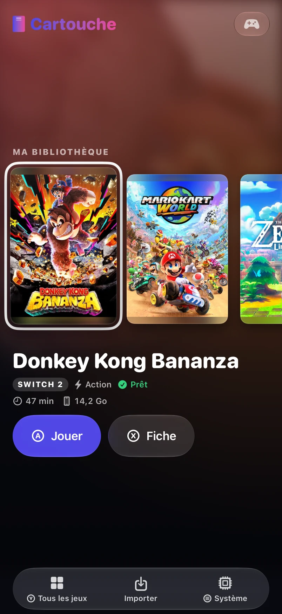
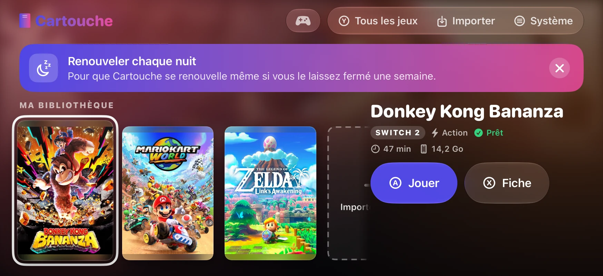
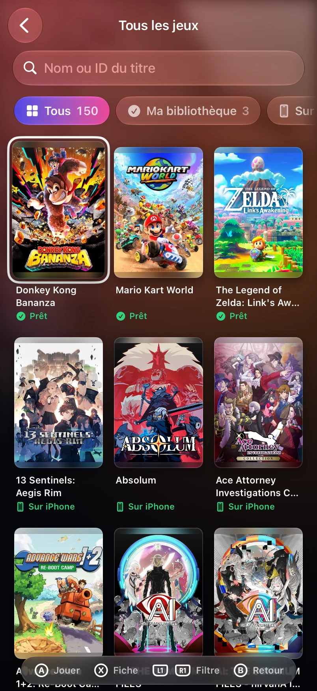

Cartouche s'ouvre sur sa console : vos jeux, en grand, sur une seule étagère, avec leurs jaquettes officielles. Le jeu en focus montre tout ce qu'il faut pour y jouer, et le reste de Cartouche est à un geste.

## L'accueil

- **Ma bibliothèque :** vos jeux, installés ou dans votre dossier de jeux, puis **Importer** et **Tous les jeux**.
- **Le jeu en focus :** son nom, sa plateforme, son genre et son statut sur cet iPhone, votre temps de jeu et la place qu'il prend. **Jouer** le lance, **Fiche** ouvre sa [fiche](/fr/iphone/game-sheet/). Quand votre dossier de jeux contient une construction plus récente, **Mettre à jour** l'installe, sauvegardes gardées.
- **Le dock :** **Tous les jeux**, **Importer** et **Système**. Il est en bas quand l'iPhone est debout, et dans la barre du haut quand il est couché.
- **La barre du haut :** une manette quand elle est connectée et, dans les trois derniers jours de la signature de Cartouche, les jours qui restent.

Une ligne sous le statut du jeu dit ce qui reste à faire, comme une mise en route à finir, et disparaît quand le jeu est prêt.

## Tous les jeux

**Tous les jeux** liste chaque jeu qui a un profil dans nxnative, les vôtres d'abord, chacun avec son statut sous sa jaquette. Cherchez par nom ou par identifiant de titre, et filtrez par **Tous**, **Ma bibliothèque**, **Sur iPhone**, **Sur Mac**, **En portage** ou par plateforme.

Un jeu que vous n'avez pas ne propose que **Importer ma copie** : Cartouche ne propose jamais de téléchargement. Un jeu de votre dossier de jeux pas encore installé propose **Installer depuis** cet endroit.

| Statut | Ce qu'il veut dire |
| --- | --- |
| **Prêt** | Votre jeu, installé, sans rien en travers. |
| **En stockage** | Son IPA est dans votre dossier de jeux : installez-le pour y jouer. |
| **Mettre à jour** | Une IPA plus récente est dans votre dossier de jeux : la mise à jour garde vos sauvegardes. |
| **Tourne sur cet iPhone** | Les résultats d'autres joueurs sur votre modèle le disent jouable. |
| **Pas encore essayé sur cet iPhone** | Aucun résultat sur votre modèle pour l'instant. |
| **Déconseillé sur cet iPhone** | Il demande plus de mémoire que Cartouche n'en a ici, ou des joueurs ont vu qu'il ne tourne pas. |
| **Non pris en charge sur cet iPhone** | Il lui manque sa version d'iOS ou sa puce graphique. |

## Au toucher et à la manette

Le toucher et une manette pilotent chaque écran, et chaque bouton montre le bouton de la manette qui lui correspond.

| | Toucher | Manette |
| --- | --- | --- |
| Déplacer le focus | Toucher une jaquette | Croix ou stick |
| Jouer, ou l'action principale | **Jouer** | <kbd>A</kbd> |
| La fiche d'un jeu | Toucher le jeu en focus, ou **Fiche** | <kbd>X</kbd> |
| Tous les jeux | **Tous les jeux** | <kbd>Y</kbd> |
| Changer de filtre | Toucher un filtre | <kbd>L</kbd> <kbd>R</kbd> |
| Système | **Système** | <kbd>Menu</kbd> |
| Retour, ou fermer une page | **OK** | <kbd>B</kbd> |

Un appui long sur l'un de vos jeux propose **Jouer**, **Fiche**, **Désinstaller**, et **Mettre à jour depuis** votre dossier de jeux quand il contient une construction plus récente.

## Importer ma copie

**Importer** ouvre Fichiers : choisissez l'IPA d'un jeu construit à partir de votre propre copie, sur votre iPhone, iCloud Drive, une clé USB-C ou un partage réseau. Cartouche la lit là où elle est, l'installe avec une barre de progression, puis ouvre sa fiche. Une IPA que nxnative a construite sans les fichiers du jeu s'installe avec le `romfs.img` posé à côté.

Une IPA qui n'est pas un jeu nxnative va dans **Système › Autres apps installées** : la console ne montre que des jeux.

:::note
Cartouche liste ce qu'il sait faire tourner, jamais où trouver un jeu. Les seuls jeux qu'il télécharge sont ceux que [Cartouche Cloud](/fr/cloud/) a construits pour vous, à partir de la copie que vous lui avez envoyée.
:::
