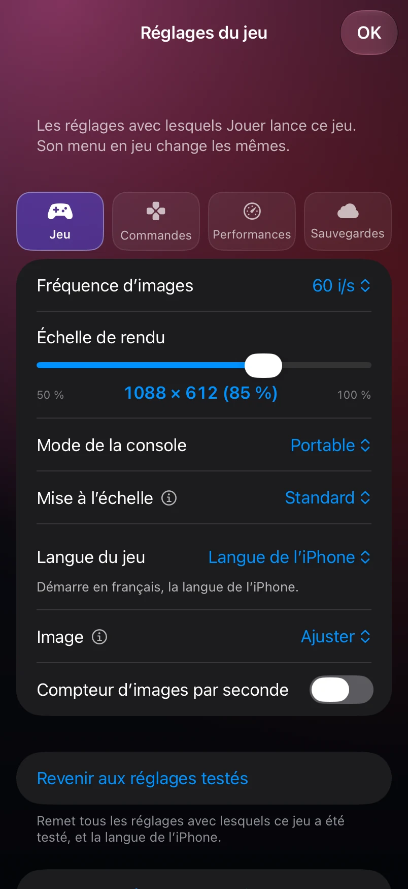
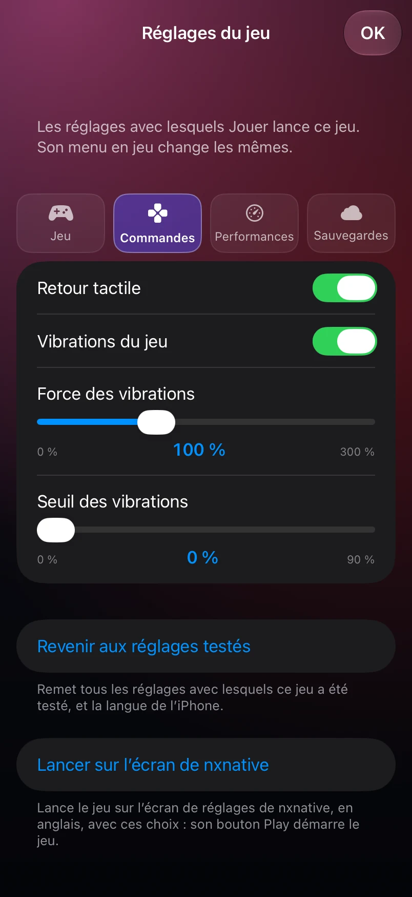

**Réglages du jeu**, sur la fiche d'un jeu, réunit les réglages avec lesquels **Jouer** lance le jeu : ceux que l'écran de nxnative montre avant un jeu, sur une page de Cartouche, dans votre langue. Le menu du jeu, en jeu, change les mêmes.

## Les sections

Les réglages sont rangés en sections, **Jeu**, **Performances**, **Commandes** et **Sauvegardes**, une à la fois : touchez une section, ou appuyez sur <kbd>L</kbd> et <kbd>R</kbd> sur une manette. Ce qu'un jeu propose dépend du jeu ; les plus courants sont :

- **Fréquence d'images** et **Échelle de rendu**, avec la taille en pixels que donne l'échelle.
- **Mode de la console :** **Portable** ou **TV**.
- **Image :** **Ajuster** ou **Remplir** l'écran.
- **Orientation :** **Automatique**, comme vous tenez l'iPhone, ou bloquée en **Paysage** ou en **Portrait**.
- **Mise à l'échelle**, **Résolution dynamique**, **Compteur d'images par seconde** et **Indicateurs de performance**.
- **Vibrations du jeu** et **Retour tactile**.
- **Langue du jeu** ([plus bas](#la-langue-du-jeu)).

Le **ⓘ** à côté d'un réglage dit ce qu'il fait. Un réglage que les fichiers du jeu fixent apparaît grisé.

**Revenir aux réglages testés** remet tous les réglages avec lesquels le jeu a été testé, et la langue de l'iPhone.

## La langue du jeu

Un jeu parle la langue de votre iPhone quand il l'a. Avant chaque lancement, Cartouche prend la première des langues de votre iPhone, dans l'ordre de **Réglages › Général › Langue et région**, que le jeu propose. **Langue de l'iPhone**, le premier choix du réglage, dit laquelle c'est.

Une langue que vous choisissez reste celle du jeu jusqu'à ce que vous choisissiez de nouveau **Langue de l'iPhone**, ou **Revenir aux réglages testés**.

## Les sauvegardes dans le nuage

Les sauvegardes dans le nuage de nxnative, par un dossier d'iCloud Drive, sont dans la section **Sauvegardes**. Cartouche garde déjà vos sauvegardes à jour tout seul, avec le dossier des sauvegardes de votre [stockage](/fr/iphone/saves/) : l'un des deux suffit.

## L'écran de nxnative

**Démarrer sur l'écran de nxnative** lance le jeu une fois sur l'écran de réglages de nxnative, en anglais, avec ces choix : son bouton **Play** lance ensuite le jeu.
