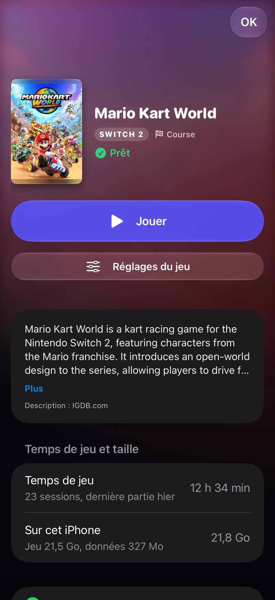
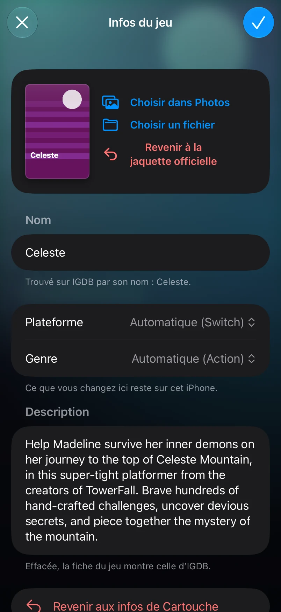
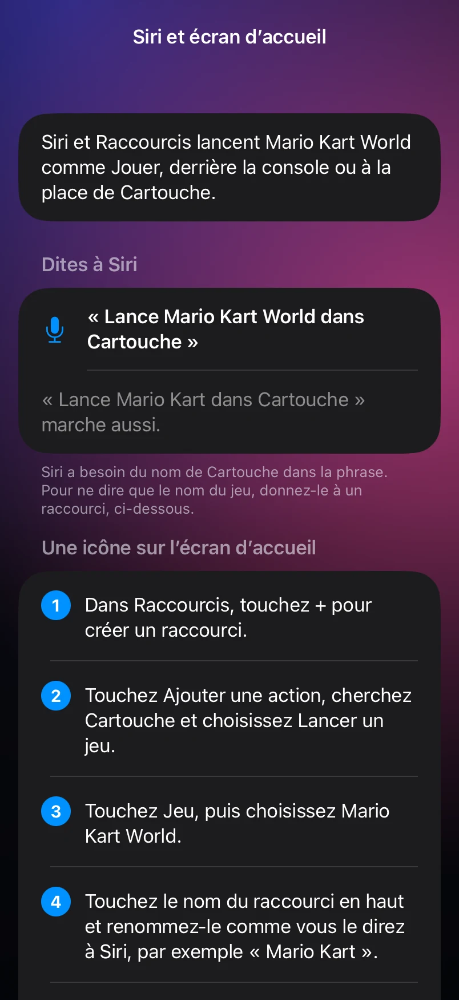
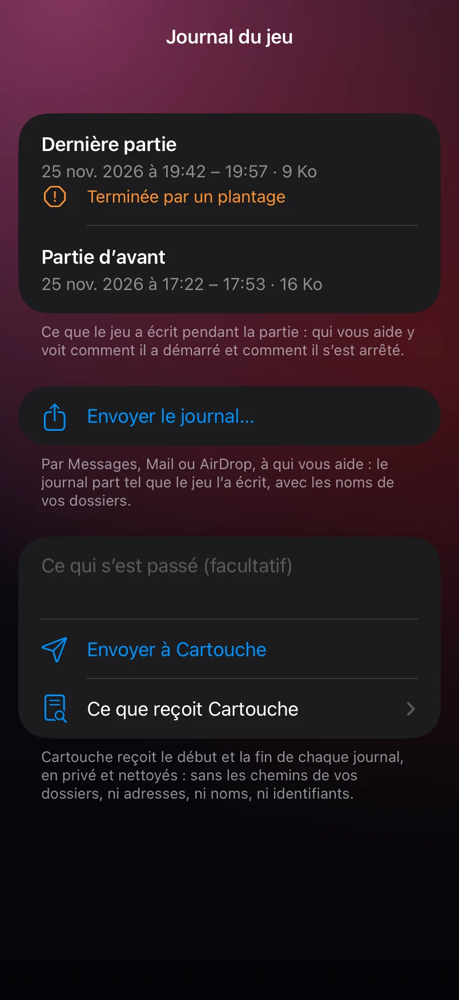

Chaque jeu a sa fiche : **Fiche** sur l'accueil, ou <kbd>X</kbd> sur une manette. Elle dit si le jeu tourne sur votre iPhone ou votre iPad, et rassemble tout ce que vous pouvez faire avec lui.

## En haut

- **Jouer** et **Réglages du jeu** pour votre propre jeu ; **Reprendre**, **Réglages du jeu** et **Quitter** quand il est [en pause derrière la console](/fr/iphone/playing/).
- **Installer depuis** votre dossier de jeux, pour un jeu qui s'y trouve sans être installé, ou **Importer ma copie** pour un jeu que vous n'avez pas.
- **Mettre à jour depuis** votre dossier de jeux quand il contient une construction plus récente, avec la construction installée et la nouvelle.

## Ce qu'elle vous dit

- **La description**, la vôtre ou celle d'IGDB. L'iPhone la traduit dans la langue de Cartouche, avec **Voir l'original** à côté.
- **Temps de jeu et taille :** combien de temps vous avez joué, combien de fois et quand pour la dernière fois ; la place que prennent le jeu et ses données sur cet iPhone, et la taille de son IPA dans votre dossier de jeux.
- **Ce que le jeu demande** face à ce que cet iPhone a : la mémoire, la version d'iOS et la puce graphique. Quand tout y est, cela tient en une ligne, *Cet iPhone a tout ce qu'il faut*.
- **Les résultats des testeurs**, ceux de votre modèle d'abord : comment le jeu y tourne, d'après ce que d'autres joueurs ont mesuré. Leurs notes sont traduites aussi.
- **Détails techniques :** les réglages conseillés, ce que nxnative dit du jeu, et la construction installée.

Sur un iPhone dont la puce graphique ne lit pas les textures BC (iPhone 15 et plus anciens), la fiche dit que le jeu s'arrête avant sa première image, sauf si sa construction les convertit, comme les jeux construits avec nxnative-nobc : elle dit alors *Textures converties pour ce GPU par la construction de ce jeu*.

## Ce que vous pouvez faire

- **[Réglages du jeu](/fr/iphone/game-settings/) :** fréquence d'images, échelle de rendu, portable ou TV, langue du jeu, et plus encore.
- **[Sauvegardes](/fr/iphone/saves/) :** où elles sont gardées, remettre une copie plus ancienne, ou faire venir une sauvegarde de votre console.
- **[Mods](#mods) :** des fichiers qui changent les textures, les textes, la musique ou les niveaux du jeu, activés dans l'ordre que vous choisissez.
- **Modifier les infos du jeu :** donnez à votre jeu un nom, une plateforme, un genre, une description et une jaquette à vous, depuis Photos ou Fichiers. Ils restent sur cet iPhone. **Revenir aux infos de Cartouche** les annule. Un jeu hors de la liste de nxnative, construit avec une fourche par exemple, trouve sa jaquette et son genre sur IGDB par son nom.
- **Siri et écran d'accueil :** ce qu'il faut dire à Siri, *« Lance Stardew Valley dans Cartouche »*, et comment donner au jeu sa propre icône sur l'écran d'accueil avec l'action Raccourcis **Lancer un jeu**.
- **Partager le journal :** le journal du jeu, pour qui vous aide, par Messages, Mail ou AirDrop, ou **Envoyer à Cartouche**, qui retire d'abord vos chemins, adresses et noms. Vous voyez ce qui part avant que ça parte.
- **Constructions sur** votre Mac : avec un Mac associé, où en est la construction du jeu là-bas, et un bouton pour la lancer ou l'arrêter. Voir [Votre iPhone et votre Mac](/fr/mac/iphone/).
- **Copier vers** votre dossier de jeux, et **Désinstaller**, qui demande si ses sauvegardes restent.

## Mods

Un mod change les textures, les textes, la musique ou les niveaux d'un jeu : le jeu lit ses fichiers à la place des siens. **Mods**, sur la fiche, dit combien sont activés. **Ajouter un mod** en prend un dans Fichiers, en dossier ou en ZIP, comme les mods circulent : Cartouche garde son dossier `romfs`, où qu'il soit dedans. Un choix qui contient plusieurs mods les donne tous, désactivés.

- Activez ou désactivez chaque mod. Quand deux changent le même fichier, celui du haut l'emporte : **Monter** et **Descendre** règlent l'ordre. Jusqu'à 16 peuvent être activés à la fois.
- Les changements valent au prochain lancement du jeu. Quittez d'abord le jeu s'il est en pause derrière la console.
- Un mod ajouté avec une autre version du jeu le dit : un mod fait pour une version peut ne pas marcher avec une autre.
- Un mod qui change aussi le code du jeu, avec un dossier `exefs`, ne peut pas marcher sur un iPhone ou un iPad : iOS n'exécute que le code signé avec le jeu. Cartouche le dit et le laisse de côté.
- Les mods restent sur cet iPhone : ils ne vont pas dans votre dossier de sauvegardes. **Supprimer** retire un mod et ses fichiers.

Cartouche ne télécharge aucun mod : vous apportez les vôtres.

## Les jeux hors de la liste de nxnative

Un jeu pour lequel Cartouche n'a pas de fiche s'affiche quand même, avec *Pas encore de fiche*, et démarre : Cartouche ne peut simplement pas vérifier ce qu'il demande. Sa jaquette vient d'IGDB, par son identifiant de titre ou son nom.
